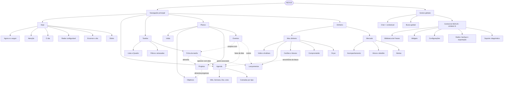

# NEXUS — Proposta de Arquitetura da Informação e Experiência

*Proposta independente do Claude · baseada no Dossiê v1.0 (24/11/2026) · sem implementação: é um raciocínio de organização, feito para ser comparado com outras propostas.*

## Como ler este documento

Para não misturar o que existe com o que eu sugiro, uso etiquetas:

- **\[atual\]** — o dossiê descreve como existente.
- **\[parcial\]** — o dossiê diz que está incompleto.
- **\[novo · apresentação\]** — só muda *como* se mostra algo que já existe.
- **\[novo · funcionalidade\]** — exige uma capacidade que o dossiê não descreve.
- **\[novo · dados/regra\]** — exige mexer em regras ou no modelo de dados.
- **\[hipótese\]** — só dá para confirmar vendo o app rodando. Eu tenho o dossiê, não o app.

Fora do dossiê, consultei apenas o guia oficial do Android sobre apps adaptáveis (barra de navegação que vira rail, classes de tamanho de janela, layouts lista‑detalhe e painel de apoio) e o anúncio da Navigation 3 estável. Os links estão no fim. Fóruns e Reddit de “vibe coding” não entram aqui: a decisão é de arquitetura, não de ferramenta; o que importa deles (passos pequenos e verificáveis) aparece no plano de transição.

## 1. Síntese da visão do NEXUS

O NEXUS não é um app de tarefas, nem uma agenda, nem um app de finanças. É um lugar onde a pessoa **recupera o contexto da própria vida** sem carregar tudo na cabeça. O que faz dele um produto — e não cinco apps colados — é que o mesmo fato da vida aparece por ângulos diferentes: um show é uma data (Agenda), uma ocasião com preparação (Evento), um gasto (Dinheiro) e talvez parte de um objetivo.

O problema que ele resolve não é *guardar* informação, é *juntá-la*: “o que tenho esta semana, quanto isso vai pesar, o que depende do quê”. Por isso a arquitetura precisa responder, com poucos toques, a quatro perguntas:

1. **E agora?** — o que importa hoje, o que exige atenção.
2. **Quando?** — o que está onde no tempo.
3. **O que fazer, e para quê?** — ação, entrega, intenção e ocasiões.
4. **Quanto?** — o que gastei, devo, comprometi, e o mundo financeiro ao redor.

Há dois ritmos de uso: o diário (olhar e seguir) e o profundo (investigar). A proposta serve ao primeiro por padrão e ao segundo por *descida de camadas*, nunca por esconder. Personalidade (sobriedade monocromática, frases discretas) e honestidade (estado vazio claro, origem do número) fazem parte da arquitetura, não são enfeite.

## 2. Classificação das áreas e mapa conceitual dos domínios

Em vez de agrupar por tela, agrupo pela *natureza* de cada coisa:

| Classe | O que é | Áreas do NEXUS |
| --- | --- | --- |
| Orientação | Ajuda a decidir o dia; não possui registros | Início, Assistente de Rotina, Widgets, notificações |
| Domínios | Onde os registros nascem e moram | Tarefas · Compromissos · Finanças (lançamentos, cartões e faturas, parcelamentos, recorrências, empréstimos, orçamentos, metas financeiras) |
| Contêineres de planejamento | Agrupam vários registros e dão sentido a eles | Objetivos · Projetos · Eventos |
| Lentes | Mostram sem possuir | Agenda (tempo) · Busca Global · Início |
| Mundo externo | Informação que não é da pessoa | Mercado |
| Personalidade | Dá voz ao produto | Biblioteca de Frases |
| Manutenção | Cuida dos dados e do app | Configurações · Backup e restauração · Exportação · Diagnóstico |
| Gestos transversais | Valem em qualquer lugar | Criar · Buscar · Vínculos e origem · Lembretes |

Cinco ideias sustentam o resto:

- **A Agenda é uma lente, não um domínio.** Só o compromisso nasce nela; tarefas, eventos, faturas e prazos de projeto são projeções de registros que moram em outro lugar. Isso explica por que ela integra tanto e por que não deve ter regras próprias sobre registros alheios.
- **Existe uma escada de intenção:** Objetivo (resultado que quero) → Projeto (entrega com começo e fim) → Tarefa (ação) → Passo (subtarefa). Hoje o degrau mais baixo é o mais visível e o mais alto fica escondido.
- **Evento é um terceiro tipo de contêiner**, ancorado no tempo. Objetivo, Projeto e Evento compartilham o mesmo esqueleto — *itens + datas + custos + progresso* — com ênfases diferentes. Reconhecer isso permite uma ficha com a mesma estrutura nos três.
- **Dinheiro tem três camadas:** o que *aconteceu ou está previsto* (lançamentos), o que está *comprometido adiante* (cartão, parcelas, recorrências, empréstimos) e o que se *planeja* (orçamentos, metas). Hoje a segunda camada é a mais difícil de enxergar.
- **O Assistente de Rotina é um ritual sobre o dia, não um módulo de dados.** Briefing e Revisão leem tarefas, agenda, eventos e finanças — exatamente o que o Início já lê.

Quem mora onde, e onde mais aparece:

| Registro | Mora em | Aparece também em |
| --- | --- | --- |
| Tarefa | Tarefas | Agenda (se tem data) · Projeto/Evento/Objetivo (se vinculada) · Início · Busca |
| Compromisso | Agenda | Início · Evento (se vinculado) · Busca |
| Evento | Planos › Eventos | Agenda (faixa de dias) · Dinheiro (custos) · Início |
| Projeto | Planos › Projetos | Agenda (prazo) · Objetivo · Dinheiro (custo) |
| Objetivo | Planos › Objetivos | Início (opcional) |
| Lançamento | Dinheiro › Lançamentos | Tarefa/Evento/Projeto (custo) · Agenda (conta direta não liquidada) |
| Compra no cartão | Dentro da fatura (Dinheiro › Cartões) | Nunca isolada na Agenda |
| Fatura | Dinheiro › Cartões | Agenda (vencimento) · Início (Atenção) |
| Ativo | Dinheiro › Mercado | Início (opcional) · alertas |
| Frase | Biblioteca de Frases | Início (cabeçalho) · fechamento do dia |

## 3. Diagnóstico da arquitetura atual

O dossiê pede equilíbrio: nem “tudo errado”, nem “a organização atual é a melhor”. O que **funciona e deve ser preservado**: o Início como abertura padrão; a Agenda como lente com a regra anti-duplicação (a fatura aparece, a compra individual não); atraso calculado separado do status; o Kanban como outra visão das mesmas tarefas; a recorrência como série; os blocos configuráveis; a transparência do Mercado sobre cache; o backup local.

O que vejo como problema ou oportunidade:

| # | Achado | Tipo | Base |
| --- | --- | --- | --- |
| 1 | A barra mistura naturezas: Início (orientação), Agenda (lente), Tarefas e Finanças (domínios), Eventos (contêiner). Não há critério único para “merece ser aba”. | Hierarquia / navegação | Dossiê |
| 2 | A escada de intenção está invertida: Tarefas tem aba, Projetos é uma aba *dentro* de Tarefas e Objetivos mora nas opções adicionais. | Hierarquia | Dossiê |
| 3 | Dentro de Tarefas convivem no mesmo nível visões (Lista, Kanban), filtros (Atrasadas, Concluídas) e outra entidade (Projetos). | Agrupamento | Dossiê |
| 4 | O menu de opções adicionais junta conteúdo (Mercado), gesto global (Busca), ritual (Assistente), domínio (Objetivos), personalidade (Frases), sistema (Widgets) e manutenção (Configurações, Backup, Diagnóstico). Quem procura “metas” não pensa em abrir esse menu. | Agrupamento / navegação | Dossiê |
| 5 | Início e Assistente de Rotina respondem à mesma pergunta (“como está meu dia?”) com dados muito parecidos. | Duplicação de responsabilidade | Dossiê; o grau de repetição é hipótese |
| 6 | O Início carrega análise (anel do mês, fluxo de seis meses, categorias) que repete telas de Tarefas e Finanças e disputa com o princípio “Home não é depósito”. | Densidade | Dossiê |
| 7 | “Meta” e “objetivo” aparecem três vezes: Objetivos, Metas financeiras e o bloco “Objetivos e metas”. | Nomenclatura | Dossiê |
| 8 | Compromissos dentro da ficha do evento são parciais; sem isso o ciclo preparação → participação não fecha. | Fluxo / integração | Dossiê (parcial) |
| 9 | A integração é interna, mas o dossiê não registra um padrão visual de “de onde vem / por que está aqui”. | Integração visual | Hipótese |
| 10 | Finanças concentra cerca de dez conceitos; “o que continuará pesando nos próximos meses” está espalhado entre cartões, parcelas, recorrências e empréstimos. | Densidade / agrupamento | Dossiê; a dispersão é hipótese |
| 11 | Criar exige escolher o tipo antes de escrever; são 14 editores, e compra parcelada e regra recorrente são editores à parte em vez de opções do lançamento. | Fluxo de criação | Dossiê; confirmar no app |
| 12 | Mercado não tem lugar conceitual: nem domínio pessoal, nem ferramenta. | Agrupamento | Dossiê |
| 13 | A navegação é por estado e o dossiê admite perda de estado na rotação. Sem pilha de “voltar” explícita e estado persistente por área, nenhuma arquitetura de vários painéis se sustenta. | Navegação (base técnica) | Dossiê |
| 14 | Backup é pilar da autonomia dos dados, mas divide o mesmo nível de Diagnóstico; Frases e Widgets têm valor e pouca descoberta. | Contexto | Dossiê |

## 4. Proposta de navegação principal

### 4.1 A decisão central

Em vez de perguntar “quais módulos viram abas”, perguntei **quais perguntas a pessoa faz com mais frequência** e quais registros respondem a cada uma. Resultado: cinco destinos com um critério único — cada um responde a *uma* pergunta.

| Destino | Pergunta | Natureza |
| --- | --- | --- |
| **Hoje** | E agora? | Orientação + ritual do dia |
| **Agenda** | Quando? | Lente de tempo |
| **Tarefas** | O que fazer? | Domínio de ação |
| **Planos** | Para quê, e que ocasiões? | Contêineres: Objetivos, Projetos, Eventos |
| **Dinheiro** | Quanto? | Domínio financeiro + Mercado |

A ordem vai do imediato ao estrutural. O guia do Android recomenda de três a cinco destinos na barra inferior, que vira um *rail* lateral em telas maiores; cinco destinos com essa lógica cabem nos dois formatos. “Hoje” continua sendo a abertura padrão. (A posição central do Início pode ser mantida no celular se testes mostrarem ganho de alcance, mas o critério principal é ter a mesma ordem no rail do tablet.)

### 4.2 O que muda de lugar — e por quê

- **Eventos** sai da barra e vira sub-área de **Planos**, ao lado de Projetos e Objetivos, por ser contêiner (itens, datas, custos, progresso). Segue sendo cidadão de primeira classe: ficha própria, lista própria, presença em Hoje, Agenda e Busca.
- **Projetos** sai de dentro de Tarefas: tarefa é *fazer*, projeto é *conduzir*; as cadências são diferentes (diária × semanal).
- **Objetivos** sobe das opções adicionais para **Planos**, onde a escada Objetivo → Projeto → Tarefa fica visível.
- **Mercado** entra em **Dinheiro** como um segundo “mundo”, separado por um alternador *Meu dinheiro | Mercado*, para nunca parecer carteira de investimentos.
- **Assistente de Rotina** se dissolve em **Hoje**: o Briefing é o próprio Hoje de manhã; a Revisão Noturna vira o fluxo “Encerrar o dia”; o histórico vira “Diário”.
- **Busca** e **Criar** viram gestos globais. **Frases, Widgets, Configurações, Backup e Diagnóstico** vão para a **Central do NEXUS**, aberta pelo símbolo N.

### 4.3 Gestos globais

- **Barra superior (todo destino):** símbolo N (abre a Central), título, lupa (Busca) e uma ação do contexto (por exemplo, o seletor de mês em Dinheiro).
- **Criar (+):** botão flutuante *contextual*. Cada destino cria o “registro natural” dele (Agenda → compromisso no dia selecionado; Tarefas → tarefa; Dinheiro → lançamento; Planos → o que a sub-área mostra). Toque longo abre o menu completo: Tarefa, Compromisso, Lançamento, Evento, Projeto e Objetivo.
- **Tablet:** o rail leva o símbolo N e o Criar estendido no topo, a busca como campo e a Central embaixo.

### 4.4 O contrato da navegação

1. **Cada destino lembra onde você estava.** Trocar de aba não perde o filtro, o dia selecionado nem a ficha aberta.
2. **Voltar sempre sobe um degrau:** ficha → lista → início do destino → Hoje → sair.
3. **No máximo três profundidades:** destino → seção (abas ou segmentos) → ficha. Fichas podem encadear (tarefa → projeto) sem virar novos níveis de menu.
4. **Um registro, uma ficha.** Hoje, Agenda, Busca e notificações abrem a *mesma* ficha, na casa do registro.
5. **Visões leem, domínios escrevem.** Hoje, Agenda e Busca permitem microações (concluir, adiar, marcar como paga); a edição completa abre a ficha.
6. **Origem fora de casa, vínculos dentro de casa** (4.5).
7. Formulários seguem sobrepostos, com confirmação de descarte \[atual\].

### 4.5 A linguagem das conexões

É a peça que faz o NEXUS parecer *um* produto:

- **Chip de origem:** sempre que um item aparece fora do seu domínio (Agenda, Hoje, Busca), mostra ícone do tipo + nome da origem (“Projeto Viagem”, “Fatura Nubank”, “Evento Show · dia 2 de 3”). Tocar explica em uma frase: *“Aparece aqui porque a tarefa tem prazo em 12/12.”* \[novo · apresentação\]
- **Faixa de Conexões:** dentro da ficha de qualquer registro, os vínculos com verbos claros — *parte de* · *custa* · *prepara* · *contribui para* · *vence em*. \[novo · apresentação\]
- **Vocabulário que separa os conceitos:** Objetivo = resultado que quero · Projeto = entrega com começo e fim · Tarefa = ação · Evento = ocasião com data · Compromisso = hora marcada · Lançamento = movimento de dinheiro · Fatura = obrigação do cartão.
- **Forma antes de cor:** os tipos se distinguem por ícone e forma; a cor fica reservada a atraso, conflito, informação e resultado positivo, preservando a identidade monocromática.

### 4.6 Alternativas consideradas

- **B — Três pilares** (Hoje · Vida · Dinheiro, com “Vida” = Agenda | Tarefas | Planos em um alternador). Menos abas no celular e muito natural em tablet, mas acrescenta um nível de alternância a tudo que é diário. Não recomendo para o celular; no tablet em paisagem a proposta principal já se comporta de forma parecida.
- **C — Tempo como espinha dorsal** (a Agenda como tela-mãe e o resto como filtros). Elegante para quem vive de calendário, mas tarefas sem data, objetivos e dinheiro não são tempo; forçá-los numa linha do tempo recria a “tela única” que o dossiê desaconselha.

## 5. Mapa completo de telas e subáreas

```
NEXUS
├─ Gestos globais — Criar (+) · Busca (lupa) · Central (símbolo N)
│
├─ 1. HOJE
│    ├─ Cabeçalho (saudação, data, frase do dia)
│    ├─ Agora e a seguir
│    ├─ Atenção
│    ├─ O dia (linha do tempo + “para hoje”)
│    ├─ Radar (blocos configuráveis)
│    ├─ Encerrar o dia (fluxo da revisão noturna)
│    └─ Diário (histórico de revisões e briefings)
│
├─ 2. AGENDA
│    ├─ Visões: Mês · Semana · Dia · Lista
│    ├─ Camadas: tarefas · compromissos · eventos · financeiro · projetos (+ mostrar pagos)
│    └─ Painel do dia → ficha do item (na casa do registro)
│
├─ 3. TAREFAS
│    ├─ Visões: Lista · Quadro (Kanban)
│    ├─ Filtros: atrasadas · hoje · próximas · sem prazo · concluídas · status · prioridade · categoria · projeto · evento · objetivo
│    └─ Ficha da tarefa: quando · passos · série · contexto · gasto
│
├─ 4. PLANOS
│    ├─ Visão (objetivos ativos · projetos em andamento · próximos eventos)
│    ├─ Objetivos → ficha: marcos · progresso · escada · histórico
│    ├─ Projetos  → ficha: tarefas · prazo · progresso · custos
│    └─ Eventos   → ficha: datas e local · preparação · ingresso · custos
│
├─ 5. DINHEIRO
│    ├─ Meu dinheiro
│    │    ├─ Visão (+ Análises: categorias · fluxo de 6 meses · previsão de 30 dias)
│    │    ├─ Lançamentos
│    │    ├─ Cartões e faturas
│    │    ├─ Comprometido (parcelas · recorrências · empréstimos · faturas futuras)
│    │    └─ Orçar (orçamentos · metas financeiras)
│    └─ Mercado: Acompanhamento · Todos os ativos · Alertas → detalhe do ativo
│
├─ BUSCA (resultados agrupados por tipo → ficha)
│
└─ CENTRAL DO NEXUS (símbolo N)
     ├─ Biblioteca de Frases
     ├─ Widgets
     ├─ Configurações: Perfil e aparência · Início · Notificações e silêncio · Dinheiro
     ├─ Dados: backup e restauração · exportação CSV
     └─ Suporte: diagnóstico · sobre
```

O mesmo mapa em Mermaid (o GitHub renderiza esse bloco direto em arquivos .md). Linhas contínuas são navegação; linhas pontilhadas são *relações* entre registros, não caminhos de menu.



**Como ler o mapa.** Cinco destinos respondem a cinco perguntas; Busca, Criar e Central ficam sempre à mão e não competem por lugar na barra. Dentro de cada destino há no máximo um nível de seções (abas ou segmentos) antes da ficha do registro. Nada foi removido: todo módulo e subárea do dossiê tem endereço, e os que mudaram de lugar (Eventos, Projetos, Objetivos, Mercado, Assistente, Frases, Widgets, Backup, Diagnóstico) foram movidos para junto de conceitos da mesma natureza.

## 6. Organização de cada tela

Cada área segue a mesma ficha: finalidade, informação prioritária, blocos e hierarquia entre resumo e detalhe, visões e filtros, ações, relações e comportamento nos três formatos (celular, tablet retrato, tablet paisagem). Ainda não desenho componentes — resolvo a lógica de apresentação.

### 6.1 Hoje

- **Finalidade:** responder “como está meu dia e o que exige atenção?” numa leitura de cerca de dez segundos. Nunca é o lugar onde se administra: lê tudo, não possui nada.
- **Informação prioritária:** (1) o que está acontecendo ou vem a seguir; (2) o que está em risco; (3) o que há para fazer hoje; (4) o pulso do resto da vida.
- **Personalização:** só o Radar (ordem, visibilidade, compacto ou detalhado por bloco), com “Editar Radar” a um toque do cabeçalho. O esqueleto dos blocos 1 a 4 não se reordena — evita uma Home vazia ou caótica —, mas Atenção e O dia podem ser recolhidos. Blocos configuráveis são \[atual\]; o esqueleto fixo é \[novo · apresentação\].
- **Hierarquia resumo → detalhe:** cada bloco é uma frase; tocar abre a ficha ou a tela de origem. Gráficos deixam de ser padrão do Hoje: continuam no Radar como opção e vivem completos em Dinheiro e Tarefas.
- **Ações:** concluir tarefa, adiar, marcar conta como paga, abrir ficha. O Criar (+) abre a captura rápida com Tarefa pré-selecionada.
- **Relações:** lê de todos os destinos; cada item carrega o chip de origem.

**Blocos, de cima para baixo (esqueleto fixo + Radar configurável):**

1. **Cabeçalho:** saudação, nome, data e a frase do dia numa linha discreta \[atual\].
2. **Agora e a seguir:** um ou dois itens — compromisso em curso ou o próximo, evento em andamento, tarefa com horário.
3. **Atenção** (até três itens + “ver mais”): conflitos de horário, tarefas atrasadas, contas e faturas que vencem em breve, orçamento perto do limite, evento com preparação pendente, alerta de Mercado disparado. Cada item mostra a origem e *uma* ação (Resolver · Adiar · Abrir). Sem nada a dizer, uma linha serena — “Nada pede atenção agora” —, honesta, sem preencher. \[novo · apresentação\]
4. **O dia:** linha do tempo do dia (compromissos, eventos, prazos com hora) e, abaixo, “Para hoje” (tarefas sem hora, com caixa de marcar) e vencimentos do dia. Link “Abrir na Agenda”.
5. **Radar:** blocos configuráveis, cada um uma linha-resumo que expande — Dinheiro (saldo declarado, resultado do mês, próximo vencimento) · Próximos eventos · Objetivos em andamento · Comprometido nos próximos meses · Mercado (acompanhamento) · Gráficos (fluxo de seis meses, categorias).
6. **Fechamento:** à noite aparece o cartão “Encerrar o dia” (6.2).

**Tamanhos.** *Celular:* coluna única; Radar abaixo, blocos compactos por padrão. *Tablet retrato:* duas colunas (Agora e O dia | Atenção e Radar); a ficha abre num painel lateral, não em tela cheia. *Tablet paisagem:* três colunas (O dia | Atenção e Para hoje | Radar), com os gráficos do Radar sempre à vista sem empurrar a leitura inicial.

### 6.2 Encerrar o dia e Diário

- **Finalidade:** fechar o ciclo diário sem cobrança. Mantém a lógica da Revisão Noturna e do histórico \[atual\]; muda apenas onde vive.
- **Fluxo em três passos:** (1) *O que foi feito* — as concluídas do dia; (2) *O que ficou* — para cada pendência: concluir agora · adiar para amanhã (horários sugeridos) · reagendar · cancelar · deixar sem data; (3) *Amanhã* — prévia de compromissos, prazos e vencimentos. Ao final, uma frase de encerramento opcional e o registro no Diário.
- **Diário:** histórico de revisões e briefings, acessado pelo menu do Hoje.
- **Regra de tom:** nada de pontuação, sequência de dias ou culpa — o dossiê pede que o assistente não seja um coach.
- **Celular:** um passo por vez, em tela cheia. **Tablet:** os três passos lado a lado; ver “o que ficou” e “amanhã” ao mesmo tempo ajuda a decidir onde cada pendência cabe.

### 6.3 Agenda

- **Finalidade:** ver e planejar o *tempo*, sem possuir os registros.
- **Informação prioritária:** o que ocupa tempo (blocos), o que vence (prazos), o que se sobrepõe (conflitos).
- **Estrutura:** topo com período e visões; logo abaixo as **Camadas** (Tarefas · Compromissos · Eventos · Financeiro · Projetos, de seleção múltipla, lembrando a escolha; “Tudo” é o padrão); corpo com a visão; painel do dia selecionado.
- **Visões:** Mês (padrão) · Semana (segunda a domingo) · Dia (hora a hora) · Lista (próximos dias em sequência, para ler). Busca textual e “mostrar pagos” permanecem \[atual\].
- **Três coisas no tempo, três formas:** **Blocos** (compromissos e tarefas com horário ocupam intervalo na grade); **Faixas** (eventos de vários dias, barras que atravessam os dias); **Prazos** (tarefas só com data, contas, faturas, prazo de projeto: marcas “vence” numa linha “Dia todo / Prazos” no topo do dia). Assim uma fatura não se confunde com um compromisso às 14h. \[novo · apresentação\]
- **Origem:** ícone do tipo + chip de origem em cada item; cor só para atraso e conflito.
- **Conflitos:** marca na grade e uma linha-resumo na semana (“1 conflito na quinta”), que também alimenta a Atenção do Hoje.
- **Fatura:** item único (“Fatura Nubank · R$ …”); tocar mostra a composição e leva a Dinheiro › Cartões. Compras isoladas nunca aparecem \[atual\].
- **Ações:** Criar (+) cria compromisso no dia selecionado; tocar num item abre a ficha na casa dele; microações no próprio item.
- **Celular:** Mês = grade compacta em cima e lista do dia embaixo; Semana = tira de sete dias + lista do dia (em paisagem de celular, sete colunas). **Tablet retrato:** calendário + dia selecionado; semana em sete colunas legíveis. **Tablet paisagem:** três painéis — calendário · dia selecionado · ficha do item (hoje: calendário + itens do dia \[atual\]).

### 6.4 Tarefas

- **Finalidade:** encontrar e conduzir ações — inclusive as sem data.
- **Informação prioritária:** o que está atrasado e o que é para hoje.
- **Estrutura:** faixa-resumo no topo (“2 atrasadas · 4 hoje · 9 em andamento”, tocável como filtros; o anel do mês fica aqui como detalhe recolhível, vindo do Início); alternador **Lista | Quadro**; filtros em chips (Atrasadas · Hoje · Próximas · Sem prazo · Concluídas) e “Mais filtros” (status, prioridade, categoria, projeto, evento, objetivo).
- **Lista:** grupos temporais \[atual\]; Atrasadas no topo, com acento semântico — uma *seção*, não uma aba; Concluídas recolhidas como histórico.
- **Quadro:** seis colunas, uma por status, sobre as mesmas tarefas \[atual\].
- **Ficha da tarefa:** título e estado · **Quando** (prazo, horário, lembrete) · **Passos** (subtarefas) · **Série** (se recorrente, com “só esta / toda a série”) · **Contexto** (projeto, evento, objetivo) · **Dinheiro** (gasto associado, “Registrar gasto”) · notas.
- **Ações:** + Tarefa (captura rápida); concluir direto da lista; “Registrar gasto” e “Mover para projeto” na ficha.
- **Relações:** Agenda (se tem data), Planos (vínculos), Dinheiro (gasto).
- **Celular:** lista; o quadro vira abas por status com contagem. **Tablet retrato:** lista + ficha lado a lado; quadro com três colunas visíveis. **Tablet paisagem:** quadro com as seis colunas (ou quatro com rolagem) e ficha em painel lateral; ou lista + ficha.

### 6.5 Planos

Os três contêineres usam a **mesma ficha de plano**: cabeçalho (nome, status, datas) · resumo (progresso, prazo, custo) · itens · dinheiro · conexões · histórico. O que muda é a ênfase.

- **Visão:** três faixas — Objetivos ativos, Projetos em andamento, Próximos eventos — com dois ou três cartões cada e “Ver todos”. Mostra a escada de uma só vez.
- **Objetivos:** lista com progresso e a *origem do número* (“calculado a partir de 2 projetos e 5 tarefas” ou “informado por você”) — progresso manual e automático são \[atual\]; o rótulo é \[novo · apresentação\]. Ficha: marcos com datas, progresso, **Escada** (projetos e tarefas ligados, em árvore expansível), histórico de evolução.
- **Projetos:** lista com progresso, prazo e custo; filtros por status, prazo e objetivo. Ficha: resumo (progresso, prazo que também aparece na Agenda, custo das despesas não canceladas), tarefas agrupadas por status, objetivo vinculado.
- **Eventos:** lista por tempo — Em andamento · Próximos · Passados. Ficha: identidade (datas, local), **Preparação** (tarefas e compromissos \[parcial\]), **Ingresso** (gratuito, pago ou cancelado; à vista ou parcelado), **Custos** (por tipo; previsto × pago), linha do tempo antes / durante / depois.
- **Ações:** Criar (+) cria o que a sub-área mostra; dentro de uma ficha, “+ Tarefa”, “+ Compromisso” e “+ Custo” já nascem vinculados.
- **Diferenciar os três:** Objetivo é *resultado* (progresso e marcos); Projeto é *entrega* (tarefas, prazo, custo); Evento é *ocasião* (datas, preparação, ingresso). Na criação, uma pergunta de apoio: “É um resultado que você quer, uma entrega com fim ou uma ocasião com data?”
- **Celular:** Visão em faixas; listas; ficha em tela cheia, resumo sempre no topo e seções recolhíveis. **Tablet retrato:** lista + ficha. **Tablet paisagem:** lista · ficha · painel de apoio (Escada no objetivo, Custos no evento).

### 6.6 Dinheiro — Meu dinheiro

Cabeçalho comum: seletor de mês e ano \[atual\] e o alternador **Meu dinheiro | Mercado**.

- **Visão:** (a) pulso — saldo declarado com a legenda “informado por você, não recalculado” \[atual\], receitas, despesas e resultado, com alternador realizado | previsto; (b) **Vence logo** — previsão de 30 dias e maiores vencimentos; (c) orçamentos em alerta; (d) resumo de cartões (limite disponível, fatura aberta); (e) mini-gráficos — rosca por categoria e fluxo de seis meses. Tocar num gráfico abre **Análises**: tela cheia com os controles de hoje (pago × pago + previsto; selecionar uma categoria filtra os lançamentos).
- **Lançamentos:** extrato com filtros (período, tipo, categoria, status previsto/realizado/atrasado, conta ou cartão, vínculo com tarefa/evento/projeto), busca inline e soma do filtro no topo. Cada linha traz o chip de vínculo.
- **Cartões e faturas:** lista de cartões (limite, disponível, fechamento, vencimento); dentro, seletor **Atual · Fechada · Futuras** com as compras. “Pagar fatura” liquida as compras sem criar segunda despesa \[atual\]. Uma linha explica: *compras compõem a fatura; a Agenda mostra só o vencimento*.
- **Comprometido** \[novo · apresentação; possivelmente dados/regra\]: horizonte de doze meses empilhado por origem — faturas, parcelas, recorrências, empréstimos —, mês atual destacado. Tocar num mês lista o que o compõe e de onde vem (cada linha abre a ficha da origem). Abaixo, a gestão: parcelamentos, regras recorrentes, empréstimos e pagamentos, agrupados por tipo. Responde “o que vence e o que continuará pesando”.
- **Orçar:** orçamentos por categoria (barra de consumo, aviso ao se aproximar ou ultrapassar) e metas financeiras. Nomenclatura: “Metas financeiras” fica aqui, com a explicação “valores a juntar”, para não competir com “Objetivos” (resultados de vida).
- **Exportar CSV:** no menu ⋮ de Dinheiro e em Central › Dados \[atual\].
- **Celular:** abas rolantes; Visão em cartões verticais. **Tablet retrato:** Visão em duas colunas (pulso e vencimentos | gráficos); Lançamentos lista + ficha. **Tablet paisagem:** Visão em grade com os dois gráficos lado a lado (comparação); Lançamentos = filtros e soma · lista · ficha; Cartões = cartões · fatura · compras; Comprometido = horizonte · composição do mês.

### 6.7 Dinheiro — Mercado

- **Finalidade:** acompanhar cotações e variações; informativo, nunca o patrimônio da pessoa nem uma corretora \[atual\].
- **Honestidade:** cabeçalho próprio (“Mercado · dados informativos”); cada cotação com carimbo de frescor (“atualizado há 12 min · cache”); estado offline explícito, usando o último cache válido \[atual\].
- **Estrutura:** **Acompanhamento** (favoritos) primeiro; **Todos os ativos** agrupados (moedas, criptomoedas, índices, ações); **Alertas** de preço. Detalhe do ativo: cotação, variação, unidade, gráfico (1 dia, 1 semana, 1 mês, 3 meses, 6 meses, 1 ano, conforme a disponibilidade), favoritar, criar alerta.
- **Relações:** alerta disparado vira notificação, abre o ativo e aparece na Atenção do Hoje; o acompanhamento é bloco opcional do Radar (desligado por padrão).
- **Celular:** lista → detalhe. **Tablet retrato:** lista + detalhe. **Tablet paisagem:** lista + detalhe, com espaço para comparar dois ativos \[novo · funcionalidade\].

### 6.8 Busca

- **Finalidade:** achar sem lembrar o módulo.
- **Entrada:** lupa na barra superior de qualquer destino; campo permanente no rail do tablet. Filtros *dentro* de listas (como o texto da Agenda) continuam filtrando só aquela lista; a lupa é sempre global.
- **Estado inicial:** buscas recentes e chips de tipo (Tarefas · Compromissos · Eventos · Lançamentos · Projetos · Objetivos · Ativos).
- **Resultados:** agrupados por tipo, com cabeçalho e contagem; cada linha mostra ícone do tipo, título, contexto (projeto, evento), data ou valor e status. Tocar abre a ficha na casa do registro; Voltar retorna à busca com a consulta preservada.
- **Cobertura:** o dossiê fala em “entidades suportadas” sem listá-las \[hipótese: confirmar quais tipos a busca cobre hoje\]; a proposta supõe todos os registros do mapa acima.
- **Celular:** tela cheia. **Tablet:** resultados à esquerda, prévia ou ficha à direita.

### 6.9 Criar e editores

- **Criar (+) contextual:** Hoje e Tarefas → tarefa · Agenda → compromisso (no dia selecionado) · Planos → objetivo, projeto ou evento, conforme a sub-área · Dinheiro › Meu dinheiro → lançamento · Mercado → alerta de preço. Toque longo: menu completo.
- **Captura rápida:** uma folha baixa com o **título primeiro**; uma linha de tipo (já escolhido pelo contexto, trocável sem perder o texto); chips opcionais — *Quando*, *Valor*, *Projeto/Evento*; “Salvar” ou “Mais detalhes”, que abre o editor completo mantendo o que foi digitado.
- **Tarefa × compromisso, em uma linha:** *Tarefa: algo que você faz, com prazo. Compromisso: hora marcada, com início e fim.*
- **Editor completo em quatro blocos:** Essencial · Quando e onde · Vínculos e dinheiro · Avançado (recorrência, lembrete, categoria…). Nenhum campo é removido; campos vazios ficam recolhidos. \[novo · apresentação\]
- **Lançamentos por perguntas, não por tipos:** “No cartão?” · “Parcelar?” · “Repete?”. As respostas levam ao que hoje são editores separados (compra parcelada, regra recorrente). \[novo · apresentação; confirmar nas regras de dados se parcelamento e recorrência podem nascer do mesmo fluxo\]
- **Criação em contexto:** dentro de projeto, evento, tarefa ou cartão, o vínculo vem preenchido (“+ Tarefa” no evento já nasce ligada a ele; “Registrar gasto” na tarefa já traz a tarefa).
- **Tablet:** o editor abre como folha lateral ou diálogo central, sem cobrir a lista de onde veio.
- **Segurança:** confirmações de descarte e de operações destrutivas permanecem \[atual\].

### 6.10 Central do NEXUS (símbolo N)

Cinco entradas, cada uma com uma natureza só:

- **Biblioteca de Frases:** gerenciar frases e autores, importar TXT/JSON, ativar e desativar \[atual\]. Participação discreta e intencional: cabeçalho do Hoje \[atual\]; frase de encerramento em “Encerrar o dia” \[novo · apresentação\]; nunca em telas de dinheiro, alertas ou estados vazios. Um controle por momento (“mostrar no Hoje · mostrar no encerramento”) e, mais adiante, marcar frases por momento (manhã, noite) \[novo · funcionalidade e dados\].
- **Widgets:** os quatro widgets com a pergunta que cada um responde e como adicioná-los. Cada widget é uma *janela para um destino*, nunca uma tela miniaturizada (6.11).
- **Configurações**, por assunto: *Perfil e aparência* (nome, tema) · *Início* (Radar e densidade) · *Notificações e silêncio* · *Dinheiro* (categorias e preferências financeiras).
- **Dados:** exportar e restaurar backup (JSON) e exportar finanças (CSV) \[atual\]. Restaurar ganha atrito proporcional ao risco: mostra o que será substituído, recomenda exportar antes e pede confirmação explícita. Um selo “último backup: …” no topo \[novo · funcionalidade\] e, depois, um lembrete discreto na Atenção do Hoje quando fizer muito tempo. O backup completo com imagens de eventos continua pendente \[parcial\].
- **Suporte:** o Diagnóstico em duas camadas — um estado simples (“Tudo certo” ou “Há algo a reportar”) e “Detalhes técnicos” expansível, com contagens e registros —, botão “Copiar relatório” \[novo · apresentação\] e a versão do app.

### 6.11 Widgets e notificações como extensões

- **Widgets:** *Meu Dia* ↔ Agora e a seguir + O dia · *Minhas Tarefas* ↔ tarefas de hoje e atrasadas · *Financeiro* ↔ pulso do Dinheiro · *Resumo NEXUS* ↔ Atenção e contagens. Tocar abre a ficha ou o destino no contexto exato. Ideias futuras: “Fixar widget” a partir do destino correspondente e um widget de Mercado \[novo · funcionalidade\].
- **Notificações:** sempre abrem a *ficha do registro* (ou o ativo, ou “Encerrar o dia”), nunca só a aba. Regra de coerência: o que notifica é o que aparece em Atenção — e vice-versa — para que o aplicativo diga a mesma coisa nos dois lugares. Horários de silêncio e restauração dos agendamentos permanecem \[atual\].

## 7. Fluxos de uso ponta a ponta

Cada fluxo abaixo testa se a arquitetura realmente conecta as áreas.

1. **Abrir pela manhã e entender o dia.** Abre em Hoje. Lê a frase do dia, “Agora e a seguir” (primeiro compromisso às 9h), “Atenção” (uma fatura vence amanhã; um conflito na quinta) e “O dia” (blocos e três tarefas para hoje). Marca uma tarefa como feita ali mesmo; toca na fatura, vê a composição e marca como paga — ou deixa para depois. Custo: zero a dois toques, sem trocar de destino.
2. **Criar uma tarefa simples.** Em Tarefas (ou Hoje): + → título → (opcional) chip “Hoje” → Salvar. Se tiver data, aparece na Agenda; se não, fica em Tarefas, em “Sem prazo”.
3. **Tarefa de projeto com gasto.** Planos › Projetos › o projeto → “+ Tarefa” (já nasce vinculada) → título e prazo → Salvar. Na ficha da tarefa, bloco Dinheiro → “Registrar gasto” → valor e categoria. Resultado: o projeto passa a mostrar o custo, o lançamento mostra o chip “Tarefa · Projeto”, e o prazo da tarefa aparece na Agenda. Um registro feito uma vez, visto em quatro lugares.
4. **Consultar uma semana e perceber um conflito.** Agenda › Semana. A linha-resumo mostra “1 conflito na quinta”; tocar leva ao dia com os dois blocos sobrepostos destacados; tocar num deles abre a ficha, onde dá para reagendar. (Quem nem abriu a Agenda já teria visto o conflito em Atenção, no Hoje.)
5. **Planejar um evento.** Planos › Eventos › + → nome, datas, local → ficha. Ingresso: pago, em três vezes no cartão → gera as obrigações nas faturas. Custos: + transporte, + alimentação. Preparação: + tarefa “Comprar capa de chuva” (já vinculada) e + compromisso (hoje parcial). A Agenda mostra a faixa dos dias do evento e os prazos das tarefas de preparação.
6. **Entender o impacto financeiro de uma viagem.** Planos › Eventos › a viagem › Custos: total previsto, pago e a pagar, por tipo, e “quando pesa” mês a mês (parcelas do ingresso nas faturas de dezembro a fevereiro; hospedagem em janeiro). Tocar num mês abre Dinheiro › Comprometido naquele mês, com a composição. Alternativa já possível: Dinheiro › Lançamentos filtrando por evento. \[A visão “quando pesa” é novo · apresentação e depende de o vínculo evento → lançamento permitir somar por mês e por fatura.\]
7. **Consultar um cartão.** Dinheiro › Cartões › o cartão → limite disponível; fatura atual (vence dia 10 e aparece na Agenda); seletor Futuras → faturas dos próximos meses com as parcelas. Para o horizonte inteiro: Dinheiro › Comprometido, com a parte do cartão destacada; tocar em março mostra “parcela 4/10 …” e de onde vem. Responde às duas perguntas: o que vence e o que continuará pesando.
8. **Acompanhar um objetivo.** Planos › Objetivos › o objetivo → progresso com a origem do número (“calculado a partir de 2 projetos, 5 tarefas e 3 marcos”); Escada em árvore; marcos com datas; histórico. Tocar num projeto da escada abre a ficha dele; Voltar retorna ao objetivo. Pode alternar para progresso manual.
9. **Encontrar sem lembrar o módulo.** Lupa → “dentista” → resultados agrupados: Compromisso (12/12, 14h) · Tarefa “Ligar para o dentista” · Lançamento “Dentista R$ 200”. Toca no compromisso → ficha → Voltar → a busca continua lá, com a consulta.
10. **Consultar o Mercado e acompanhar um ativo.** Dinheiro › Mercado › Acompanhamento (favoritos, “atualizado há 12 min”). Toca no dólar → detalhe com gráfico de um mês; marca para acompanhar; cria alerta acima de um valor. Quando dispara: notificação → abre o ativo; o Hoje registra em Atenção. Sem conexão: último cache, com aviso claro.
11. **Revisão do dia e reorganização de pendências.** À noite, o Hoje mostra “Encerrar o dia”. Passo 1: o que foi feito. Passo 2: três pendências — adiar duas para amanhã às 9h (em lote), reagendar uma para sexta. Passo 3: prévia de amanhã. Concluir → frase de encerramento (opcional) → registro no Diário.

**O que os fluxos mostram.** Os fluxos 3, 5, 6 e 7 cruzam três domínios com um único cadastro; os fluxos 1, 4 e 11 mostram Hoje e Atenção como tecido conectivo; os fluxos 9 e 10 mostram que Busca e Mercado têm caminho próprio sem disputar a barra.

## 8. Adaptação para celulares e tablets

- **Princípio:** uma arquitetura só — mesmos cinco destinos, mesmas fichas, mesmo vocabulário. O que muda é *quantos painéis cabem*. A decisão segue a **classe de tamanho da janela** (compacta, média, expandida), não “ser tablet”; assim funciona também em janela dividida, dobráveis e rotação. Nas classes compacta e média cabe um painel; na expandida, dois ou mais — é a orientação oficial do Android.
- **Navegação:** barra inferior na janela compacta; rail nas demais. No rail: símbolo N e Criar estendido no topo, os cinco destinos, o campo de busca e a Central embaixo — mesma ordem e mesmos ícones em todos os formatos.
- **Lista–detalhe:** Tarefas, Planos, Lançamentos, Cartões, Mercado e Busca.
- **Principal + apoio:** Agenda (calendário + dia + ficha), Hoje (feed + ficha), Planos (ficha + Escada ou Custos).
- **Grade de blocos:** Hoje e Dinheiro › Visão, para ver vários resumos de uma vez e **comparar** (gráficos lado a lado).
- **Contexto e comparação:** a ficha abre ao lado, não por cima; categorias e fluxo de caixa ficam juntos; objetivo, escada e custos aparecem lado a lado; o Kanban mostra todas as colunas.
- **Formulários:** folha lateral ou diálogo central em telas largas — nunca uma tela de celular esticada.
- **Estado:** dia selecionado, filtros, ficha aberta e posição de rolagem sobrevivem a rotação, dobra e janela dividida. É pré-requisito: o dossiê registra a perda de estado na rotação como pendência, e por isso a fundação é a primeira fase do plano.

| Destino | Celular | Tablet retrato | Tablet paisagem |
| --- | --- | --- | --- |
| Hoje | Coluna única; Radar recolhido | Duas colunas; ficha em painel lateral | Três colunas; gráficos do Radar sempre visíveis |
| Agenda | Grade + lista do dia; semana em tira | Calendário + dia; semana de sete colunas | Calendário · dia · ficha |
| Tarefas | Lista; quadro em abas por status | Lista + ficha; quadro de três colunas | Quadro de seis colunas, ou lista + ficha |
| Planos | Visão em faixas; lista → ficha | Lista + ficha | Lista · ficha · apoio (Escada ou Custos) |
| Dinheiro | Abas rolantes; cartões verticais | Visão em duas colunas; lista + ficha | Grade com gráficos lado a lado; cartão · fatura · compras; horizonte · composição |
| Mercado | Lista → detalhe | Lista + detalhe | Lista + detalhe + comparação (futuro) |
| Busca | Tela cheia | Resultados + prévia | Campo permanente + resultados + ficha |

## 9. Trade-offs e riscos

**O que melhora:** a barra passa a ter um critério único; a escada de intenção fica visível; as opções adicionais deixam de ser gaveta; a duplicação entre Hoje e Assistente desaparece; a densidade do Hoje cai sem tirar função; as conexões ficam legíveis; o tablet vira ganho real de contexto.

**O que pode piorar ou custar:**

1. **Eventos perde a aba própria.** Para quem vive de eventos, é um toque a mais. Mitigação: Planos abre na última sub-área usada, atalho no ícone do app, presença em Hoje, Agenda e Busca. Se o uso real mostrar Eventos como domínio diário, reavaliar.
2. **“Planos” é um nome abstrato** e pode demorar a ser descoberto. Testar com uso real (alternativas: Projetos, Rumos).
3. **Mercado dentro de Dinheiro** pode sugerir carteira de investimentos. Mitigação: alternador explícito, cabeçalho “informativo” e estética própria; quem consulta muito usa favoritos no Radar ou o widget futuro.
4. **Dissolver o Assistente no Hoje** pode inchar o Hoje. Mitigação: esqueleto fixo, Radar configurável, “Encerrar o dia” como fluxo à parte. Se pesar, Diário e Rotina voltam como entrada própria na Central.
5. **Dinheiro continua denso:** Visão + quatro seções + Mercado. As camadas ajudam, mas Comprometido depende de parcelas, recorrências e empréstimos serem agregáveis por mês \[hipótese\].
6. **Separar Projetos de Tarefas** esconde “as tarefas deste projeto” dentro de Tarefas. Mitigação: filtro por projeto e chip em cada tarefa.
7. **Ficha única e “visões leem, domínios escrevem”** exigem uma pilha de voltar confiável; sem isso, encadear fichas confunde.
8. **Esqueleto fixo do Hoje** tira liberdade de quem já ordenou todos os blocos. Mitigação: Radar totalmente configurável; Atenção e O dia recolhíveis.
9. **Camadas da Agenda** são mais abstratas que “Tudo / um tipo”. Manter “Tudo” como padrão e nomes simples.
10. **Conceitos que ficam mais difíceis de achar:** Backup (Central › Dados — mitigado pelo selo de último backup), Diagnóstico (Central › Suporte, de propósito), Metas financeiras (Dinheiro › Orçar).
11. **Custo oculto:** a base de navegação (pilha por destino, estado persistente, painéis) é a maior mudança e a menos visível.
12. **Risco de reformar tudo de uma vez.** Por isso o plano gradual, a seguir.

**O que exige funcionalidade nova:** Comprometido (se os dados não permitirem), selo e lembrete de backup, frases por momento, fixar widget, widget de Mercado, comparação no Mercado.

## 10. Plano gradual de evolução

A ordem segue risco crescente: primeiro o invisível e o organizacional (reversíveis), depois a navegação, depois a apresentação e, por último, o que mexe em dados. Cada fase é pequena o bastante para um pedido único à ferramenta de construção, termina com um teste no aparelho e funciona sem a seguinte. Como cada mudança de banco exige backup e restauração cuidadosos, as mudanças de dados devem ser agrupadas no menor número possível de versões. Num contexto de plano gratuito e limites de uso, a ordem também evita retrabalho: cada fase aproveita a anterior e nenhuma pede reescrever o app.

| Fase | O que muda | Tipo |
| --- | --- | --- |
| 0. Verificar | Abrir o app e confirmar as \[hipótese\]; anotar o que mais se usa; decidir as questões da seção 11 | Sem código |
| 1. Fundação | Voltar sobe um degrau; cada destino guarda seu estado; o estado sobrevive à rotação. Direção técnica possível: Navigation 3 (estável desde novembro de 2025, com a pilha de telas sob controle do próprio app) e a barra/rail adaptativa do Material 3 — sugestão, não imposição | Navegação (base técnica) |
| 2. Organização | Central do NEXUS (Frases, Widgets, Configurações por assunto, Dados, Suporte); Mercado vira alternador em Dinheiro; Projetos sai das abas de Tarefas; Atrasadas e Concluídas viram seção e filtro; ajustes de nomenclatura (4.5) | Puramente organizacional |
| 3. Navegação principal | Planos (Visão · Objetivos · Projetos · Eventos) no lugar de Eventos na barra; Busca na barra superior; Criar contextual com toque longo | Navegação |
| 4. Hoje | Esqueleto (Cabeçalho, Agora e a seguir, Atenção, O dia) + Radar; Encerrar o dia e Diário substituem a entrada do Assistente; gráficos viram opção do Radar | Apresentação (dados que já existem) |
| 5. Conexões | Chips de origem; faixa de Conexões; ficha única; Agenda com blocos, faixas, prazos e camadas | Apresentação |
| 6. Criação | Captura rápida com título primeiro; editores em quatro blocos; criação em contexto | Apresentação |
| 7. Tablets | Rail; lista–detalhe e principal + apoio por destino; formulários em folha lateral | Navegação + apresentação |
| 8. Dinheiro em profundidade | Visão e Análises, Cartões com seletor Atual/Futuras, Orçar; **Comprometido**; perguntas “No cartão? Parcelar? Repete?” | Apresentação; **dados/regra** onde a agregação ou o fluxo único não existir |
| 9. Evoluções | Selo e lembrete de backup; frases por momento; fixar widget; widget de Mercado; comparação no Mercado; completar compromissos em eventos \[parcial\]; recorrência de compromissos e eventos; backup ZIP com imagens | Funcionalidades novas |

Resumo por natureza: **organizacionais** — fase 2; **de navegação** — fases 1, 3 e 7; **de apresentação** — fases 4, 5, 6 e parte da 8; **que exigem funcionalidade nova** — fase 9 e partes da 8; **que exigem alteração de regras ou dados** — somente onde a fase 8 esbarrar nos limites do modelo atual, e por isso ficam por último.

## 11. Questões em aberto que precisam de decisão humana

1. **Uso real.** Quais destinos você abre mais por semana, e quanto Eventos pesa? Se Eventos for diário, a posição dele (e a de Planos) muda.
2. **Nome do quarto destino.** “Planos”, “Projetos” ou outro? Afeta a descoberta de Objetivos e Eventos.
3. **Mercado dentro de Dinheiro.** Aceitável, ou prefere na Central? Com que frequência você consulta?
4. **Esqueleto fixo do Hoje.** Aceita personalizar só o Radar? Os gráficos devem ficar fora do Hoje por padrão?
5. **Assistente de Rotina.** Dissolver em Hoje (Briefing = Hoje; Revisão = “Encerrar o dia”) ou manter uma entrada própria?
6. **Busca.** Quais tipos ela cobre hoje? Define se “achar sem lembrar o módulo” já é verdade.
7. **Comprometido.** Os dados de parcelas, recorrências, empréstimos e faturas permitem projetar os próximos meses? Se não, a seção vira trabalho de dados e regra.
8. **Custo de evento por mês.** O vínculo evento → lançamento permite somar por mês e por fatura?
9. **Objetivo × meta financeira.** Devem se conectar (um objetivo conter uma meta de dinheiro como marco) ou ficar separados e apenas bem nomeados?
10. **Compromissos dentro do evento.** Completar o fluxo \[parcial\] antes ou depois da reorganização?
11. **Parcelamento e recorrência no fluxo do lançamento.** As regras permitem nascer do mesmo editor, ou há diferenças que exigem telas separadas?
12. **Frases por momento.** Vale marcar frases (manhã, noite) ou o sorteio atual basta?
13. **Critério de Atenção.** Aceita “o que notifica é o que aparece em Atenção”? Quais itens entram?
14. **Lacunas do dossiê.** Ele não descreve gestos existentes (deslizar para concluir?), o comportamento do botão de criação atual, o conteúdo exato do Diagnóstico e da Busca, nem o desempenho em telas grandes. Tratei tudo isso como \[hipótese\]; cada ponto pode ajustar detalhes de 6.3, 6.4, 6.8 e 6.10, mas não muda a arquitetura central.

## Referências consultadas

- Android Developers — Build adaptive navigation: https://developer.android.com/develop/adaptive-apps/guides/build-adaptive-navigation
- Android Developers — Adaptive layouts in Compose: https://developer.android.com/develop/ui/compose/layouts/adaptive
- Android Developers — Layout and navigation patterns: https://developer.android.com/design/ui/mobile/guides/layout-and-content/layout-and-nav-patterns
- Android Developers Blog — Jetpack Navigation 3 is stable: https://developer.android.com/blog/posts/jetpack-navigation-3-is-stable
