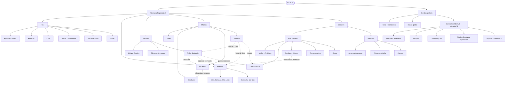

# Claude — Arquitetura da informação e navegação

> **Origem:** extração temática fiel da proposta completa do Claude, preservada sem reescrita substantiva.  
> **Estado:** PROPOSTA / EM ANÁLISE. Este material não representa decisão aprovada nem autorização de implementação.  
> **Fonte integral preservada:** `NEXUS — Proposta de Arquitetura da Informação e Experiência (2).md`. Consulte a fonte original para contexto contínuo e referências.

---

## 4. Proposta de navegação principal

### 4.1 A decisão central

Em vez de perguntar “quais módulos viram abas”, perguntei **quais perguntas a pessoa faz com mais frequência** e quais registros respondem a cada uma. Resultado: cinco destinos com um critério único — cada um responde a *uma* pergunta.

| Destino | Pergunta | Natureza |
| --- | --- | --- |
| **Hoje** | E agora? | Orientação + ritual do dia |
| **Agenda** | Quando? | Lente de tempo |
| **Tarefas** | O que fazer? | Domínio de ação |
| **Planos** | Para quê, e que ocasiões? | Contêineres: Objetivos, Projetos, Eventos |
| **Dinheiro** | Quanto? | Domínio financeiro + Mercado |

A ordem vai do imediato ao estrutural. O guia do Android recomenda de três a cinco destinos na barra inferior, que vira um *rail* lateral em telas maiores; cinco destinos com essa lógica cabem nos dois formatos. “Hoje” continua sendo a abertura padrão. (A posição central do Início pode ser mantida no celular se testes mostrarem ganho de alcance, mas o critério principal é ter a mesma ordem no rail do tablet.)

### 4.2 O que muda de lugar — e por quê

- **Eventos** sai da barra e vira sub-área de **Planos**, ao lado de Projetos e Objetivos, por ser contêiner (itens, datas, custos, progresso). Segue sendo cidadão de primeira classe: ficha própria, lista própria, presença em Hoje, Agenda e Busca.
- **Projetos** sai de dentro de Tarefas: tarefa é *fazer*, projeto é *conduzir*; as cadências são diferentes (diária × semanal).
- **Objetivos** sobe das opções adicionais para **Planos**, onde a escada Objetivo → Projeto → Tarefa fica visível.
- **Mercado** entra em **Dinheiro** como um segundo “mundo”, separado por um alternador *Meu dinheiro | Mercado*, para nunca parecer carteira de investimentos.
- **Assistente de Rotina** se dissolve em **Hoje**: o Briefing é o próprio Hoje de manhã; a Revisão Noturna vira o fluxo “Encerrar o dia”; o histórico vira “Diário”.
- **Busca** e **Criar** viram gestos globais. **Frases, Widgets, Configurações, Backup e Diagnóstico** vão para a **Central do NEXUS**, aberta pelo símbolo N.

### 4.3 Gestos globais

- **Barra superior (todo destino):** símbolo N (abre a Central), título, lupa (Busca) e uma ação do contexto (por exemplo, o seletor de mês em Dinheiro).
- **Criar (+):** botão flutuante *contextual*. Cada destino cria o “registro natural” dele (Agenda → compromisso no dia selecionado; Tarefas → tarefa; Dinheiro → lançamento; Planos → o que a sub-área mostra). Toque longo abre o menu completo: Tarefa, Compromisso, Lançamento, Evento, Projeto e Objetivo.
- **Tablet:** o rail leva o símbolo N e o Criar estendido no topo, a busca como campo e a Central embaixo.

### 4.4 O contrato da navegação

1. **Cada destino lembra onde você estava.** Trocar de aba não perde o filtro, o dia selecionado nem a ficha aberta.
2. **Voltar sempre sobe um degrau:** ficha → lista → início do destino → Hoje → sair.
3. **No máximo três profundidades:** destino → seção (abas ou segmentos) → ficha. Fichas podem encadear (tarefa → projeto) sem virar novos níveis de menu.
4. **Um registro, uma ficha.** Hoje, Agenda, Busca e notificações abrem a *mesma* ficha, na casa do registro.
5. **Visões leem, domínios escrevem.** Hoje, Agenda e Busca permitem microações (concluir, adiar, marcar como paga); a edição completa abre a ficha.
6. **Origem fora de casa, vínculos dentro de casa** (4.5).
7. Formulários seguem sobrepostos, com confirmação de descarte \[atual\].

### 4.5 A linguagem das conexões

É a peça que faz o NEXUS parecer *um* produto:

- **Chip de origem:** sempre que um item aparece fora do seu domínio (Agenda, Hoje, Busca), mostra ícone do tipo + nome da origem (“Projeto Viagem”, “Fatura Nubank”, “Evento Show · dia 2 de 3”). Tocar explica em uma frase: *“Aparece aqui porque a tarefa tem prazo em 12/12.”* \[novo · apresentação\]
- **Faixa de Conexões:** dentro da ficha de qualquer registro, os vínculos com verbos claros — *parte de* · *custa* · *prepara* · *contribui para* · *vence em*. \[novo · apresentação\]
- **Vocabulário que separa os conceitos:** Objetivo = resultado que quero · Projeto = entrega com começo e fim · Tarefa = ação · Evento = ocasião com data · Compromisso = hora marcada · Lançamento = movimento de dinheiro · Fatura = obrigação do cartão.
- **Forma antes de cor:** os tipos se distinguem por ícone e forma; a cor fica reservada a atraso, conflito, informação e resultado positivo, preservando a identidade monocromática.

### 4.6 Alternativas consideradas

- **B — Três pilares** (Hoje · Vida · Dinheiro, com “Vida” = Agenda | Tarefas | Planos em um alternador). Menos abas no celular e muito natural em tablet, mas acrescenta um nível de alternância a tudo que é diário. Não recomendo para o celular; no tablet em paisagem a proposta principal já se comporta de forma parecida.
- **C — Tempo como espinha dorsal** (a Agenda como tela-mãe e o resto como filtros). Elegante para quem vive de calendário, mas tarefas sem data, objetivos e dinheiro não são tempo; forçá-los numa linha do tempo recria a “tela única” que o dossiê desaconselha.

## 5. Mapa completo de telas e subáreas

```
NEXUS
├─ Gestos globais — Criar (+) · Busca (lupa) · Central (símbolo N)
│
├─ 1. HOJE
│    ├─ Cabeçalho (saudação, data, frase do dia)
│    ├─ Agora e a seguir
│    ├─ Atenção
│    ├─ O dia (linha do tempo + “para hoje”)
│    ├─ Radar (blocos configuráveis)
│    ├─ Encerrar o dia (fluxo da revisão noturna)
│    └─ Diário (histórico de revisões e briefings)
│
├─ 2. AGENDA
│    ├─ Visões: Mês · Semana · Dia · Lista
│    ├─ Camadas: tarefas · compromissos · eventos · financeiro · projetos (+ mostrar pagos)
│    └─ Painel do dia → ficha do item (na casa do registro)
│
├─ 3. TAREFAS
│    ├─ Visões: Lista · Quadro (Kanban)
│    ├─ Filtros: atrasadas · hoje · próximas · sem prazo · concluídas · status · prioridade · categoria · projeto · evento · objetivo
│    └─ Ficha da tarefa: quando · passos · série · contexto · gasto
│
├─ 4. PLANOS
│    ├─ Visão (objetivos ativos · projetos em andamento · próximos eventos)
│    ├─ Objetivos → ficha: marcos · progresso · escada · histórico
│    ├─ Projetos  → ficha: tarefas · prazo · progresso · custos
│    └─ Eventos   → ficha: datas e local · preparação · ingresso · custos
│
├─ 5. DINHEIRO
│    ├─ Meu dinheiro
│    │    ├─ Visão (+ Análises: categorias · fluxo de 6 meses · previsão de 30 dias)
│    │    ├─ Lançamentos
│    │    ├─ Cartões e faturas
│    │    ├─ Comprometido (parcelas · recorrências · empréstimos · faturas futuras)
│    │    └─ Orçar (orçamentos · metas financeiras)
│    └─ Mercado: Acompanhamento · Todos os ativos · Alertas → detalhe do ativo
│
├─ BUSCA (resultados agrupados por tipo → ficha)
│
└─ CENTRAL DO NEXUS (símbolo N)
     ├─ Biblioteca de Frases
     ├─ Widgets
     ├─ Configurações: Perfil e aparência · Início · Notificações e silêncio · Dinheiro
     ├─ Dados: backup e restauração · exportação CSV
     └─ Suporte: diagnóstico · sobre
```

O mesmo mapa em Mermaid (o GitHub renderiza esse bloco direto em arquivos .md). Linhas contínuas são navegação; linhas pontilhadas são *relações* entre registros, não caminhos de menu.



**Como ler o mapa.** Cinco destinos respondem a cinco perguntas; Busca, Criar e Central ficam sempre à mão e não competem por lugar na barra. Dentro de cada destino há no máximo um nível de seções (abas ou segmentos) antes da ficha do registro. Nada foi removido: todo módulo e subárea do dossiê tem endereço, e os que mudaram de lugar (Eventos, Projetos, Objetivos, Mercado, Assistente, Frases, Widgets, Backup, Diagnóstico) foram movidos para junto de conceitos da mesma natureza.


---


### E.1 Classificando o que existe hoje

| Classe | Elementos \[código\]\[doc\] |
| --- | --- |
| **Domínios** | Tarefas (com subtarefas e recorrência) · Compromissos · Eventos · Projetos · Objetivos · Finanças (lançamentos, cartões e faturas, compras parceladas, recorrências, empréstimos, orçamentos, metas) · Mercado (externo) · Biblioteca de Frases |
| **Destinos atuais (abas)** | Tarefas · Agenda · Início · Finanças · Eventos |
| **Lentes** | Agenda (compõe ocorrências de tarefas, compromissos, eventos, lançamentos, faturas e projetos) · Início · Busca · Widgets · Notificações e lembretes |
| **Ferramentas transversais** | Criar (seletor de novo registro) · Busca · Personalizar Início · Configurações · Backup · Diagnóstico |
| **Agrupadores** | Evento · Projeto · Objetivo (e a Categoria, como classificação transversal) |
| **Rituais** | Assistente de Rotina (Briefing diário e Revisão noturna, com histórico) |

### E.2 Quatro modelos genuinamente diferentes

|  | **A. Atual refinada** | **B. Por perguntas** (Parte I, revisada) | **C. Início como central + Áreas** | **D. Por áreas da vida** |
| --- | --- | --- | --- | --- |
| **Como funciona** | Mantém Tarefas · Agenda · Início · Finanças · Eventos. O menu Mais é reorganizado em grupos nomeados; Mercado mantém o ícone da barra superior; Objetivos ganham entrada visível | Hoje · Agenda · Tarefas · Planos · Dinheiro; Eventos, Projetos e Objetivos viram seções de Planos | Barra curta (Início · Agenda · Tarefas · Áreas). Áreas é uma grade de cartões informativos (Finanças, Eventos, Projetos, Objetivos, Mercado, Rotina…) | A navegação principal é por categoria (Estudos, Assistência, Família e Lazer…): cada área reúne tarefas, compromissos, eventos e dinheiro dela |
| **Problema que resolve** | Arruma o que está em volta sem mudar hábitos | Dá critério único aos destinos; aproxima as entidades-contêiner | Faz da Início a verdadeira central de acesso | Casa com “administrar dimensões da vida” |
| **Benefícios** | Menor risco; preserva a memória muscular; permite concentrar o esforço em Início, fichas e semântica | Modelo mental limpo; Projetos e Objetivos saem do esconderijo | Atalhos informativos para tudo; menos abas | Visão do todo por contexto de vida |
| **Limitações** | Projetos continuam dentro de Tarefas; Objetivos continuam longe da barra | Quebra hábito; nomes novos (“Planos”); rebaixa Eventos sem dados de uso; conflita com o uso atual de “Planejamento” | Esconde Finanças e Eventos atrás de um toque; “Áreas” corre o risco de virar um Mais maior | Categorias são por escopo e Projeto nem tem categoria; depende de cadastro completo; o vazio pesa |
| **Complexidade** | Baixa | Média a alta (rotas, nomes, migração de hábito) | Média | Alta (dados e regras) |
| **Pressupostos** | As abas atuais refletem o uso real | Frequência de Eventos baixa; “Planos” compreendido | O usuário passa sempre pela Início | Categorias bem preenchidas e consistentes entre módulos |
| **Quando é adequada** | Quando o gargalo é apresentação, não localização | Quando testes mostrarem que Objetivos e Projetos se perdem | Se a Início for de fato a porta de entrada diária | Como **lente/filtro** (“mostrar só Estudos”), não como navegação |

### E.3 Comparação

| Critério | A | B | C | D |
| --- | --- | --- | --- | --- |
| Resolve os problemas B.2 e B.3 (Início, toque, relações) | Não, mas **não os agrava** | Não diretamente | Em parte (mexe na Início) | Não |
| Descoberta de áreas | Média | Média (nomes novos) | Média | Baixa a média |
| Respeito ao hábito atual | Alto | Baixo | Médio | Baixo |
| Risco técnico | Baixo | Alto (navegação e estado) | Médio | Alto (dados) |
| Clareza das relações | Depende das fichas | Melhor por proximidade | Depende das fichas | Boa por contexto |
| Cabimento em tablet | Bom | Bom | Bom | Incerto |
| Dependência de dados de uso | Baixa | **Alta** | Média | Alta |

### E.4 Recomendação provisória

**Partir do Modelo A**, com confiança **média** (não tenho dados de uso), e tratar B como hipótese a testar depois — não como ponto de partida. A razão é que **relações navegáveis substituem a proximidade**: a Parte I agrupava Objetivos, Projetos e Eventos num destino para que a ligação entre eles ficasse visível pela vizinhança. Com fichas que mostram o vínculo e deixam navegar até ele (seções H e I), a ligação fica visível sem mover nenhum módulo. A mudança de abas passa a ser consequência possível, não pré-requisito.

O que eu faria em A, concretamente \[proposta\]: (1) o menu Mais continua existindo, mas organizado em grupos nomeados (**Planejar**: Objetivos; **Acompanhar**: Mercado e Rotina; **Personalizar**: Início e Frases; **Dados e suporte**: Backup, Configurações, Diagnóstico, Widgets); (2) Objetivos ganham entrada visível na Início; (3) Projetos continuam em Tarefas, mas como uma **visão separada das tarefas** em vez de uma aba do mesmo nível que filtros.

**O que me faria mudar de ideia:** você abrir Objetivos ou Projetos toda semana e achar o caminho ruim; Eventos serem pouco usados; um teste de agrupamento com seus próprios registros reunir Objetivo, Projeto e Evento numa mesma pilha. Se isso acontecer, o hub de planejamento volta à mesa, com outro nome e depois das fichas.

### E.5 Respostas às perguntas do item 5

1. **Os destinos representam a melhor organização mental?** Não sei; é hipótese. Falta dado de frequência.
2. **“Planos” é compreensível?** Não demonstrado, e “Planejamento” já designa a tela de Objetivos hoje \[código\].
3. **Objetivos, Projetos e Eventos devem compartilhar uma área?** Compartilham a natureza de agrupadores, mas têm ciclos de vida diferentes (Evento acaba numa data; Projeto numa entrega; Objetivo num resultado). Acessos próprios com fichas ligadas funcionam sem exigir área comum.
4. **Hoje/Início como central de atenção, Home contextual ou outra coisa?** Uma composição híbrida em duas camadas (seção F).
5. **Mercado:** é ambiente externo e **já tem acesso direto** pela barra superior \[código\]. Manter como ferramenta própria, fora de Finanças.
6. **Frases e outras áreas próprias:** continuam em Mais, no grupo Personalizar, e aparecem na Início (frase do dia) e no encerramento do dia.
7. **Evitar funcionalidades difíceis de achar:** toda função atual precisa ter endereço estável e ser alcançável pela Busca; ver E.6.

### E.6 Onde cada função fica no modelo recomendado

| Função | Hoje | No Modelo A | Risco de achar | Mitigação |
| --- | --- | --- | --- | --- |
| Objetivos (Planejamento) | Mais › Planejamento | Entrada na Início + Mais › Planejar | Baixo | Bloco de objetivos na Início leva direto à ficha |
| Projetos | Tarefas (aba interna) | Tarefas, como visão própria | Baixo | Projeto aparece como etiqueta nas tarefas |
| Mercado | Ícone da barra superior; Mais | Mantém os dois | Baixo | — |
| Biblioteca de Frases | Mais | Mais › Personalizar | Baixo | Frase do dia tem atalho |
| Assistente de Rotina | Mais | Cartão contextual na Início (manhã, noite) + Mais › Acompanhar | Médio | O cartão só aparece no horário configurado |
| Widgets | Mais | Mais › Dados e suporte | Baixo | Opção “Adicionar à tela inicial” nas áreas correspondentes (futuro) |
| Configurações, Backup, Diagnóstico | Mais | Mais › Dados e suporte | Baixo | Selo de último backup no topo (futuro) |
| Personalizar Início | Fim da Início; atalho no cabeçalho \[doc\] | Cabeçalho da Início + Mais › Personalizar | Baixo | Tornar o atalho do cabeçalho visível |
| Busca | Ícone da barra superior | Mantém | Baixo | — |
| Cartões, faturas, orçamentos, metas financeiras, empréstimos | Finanças | Finanças | Baixo | — |

