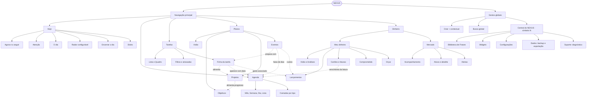

# NEXUS — Proposta de Arquitetura da Informação e Experiência

*Proposta independente do Claude · baseada no Dossiê v1.0 (24/11/2026) · sem implementação: é um raciocínio de organização, feito para ser comparado com outras propostas.*

## Como ler este documento

Para não misturar o que existe com o que eu sugiro, uso etiquetas:

- **\[atual\]** — o dossiê descreve como existente.
- **\[parcial\]** — o dossiê diz que está incompleto.
- **\[novo · apresentação\]** — só muda *como* se mostra algo que já existe.
- **\[novo · funcionalidade\]** — exige uma capacidade que o dossiê não descreve.
- **\[novo · dados/regra\]** — exige mexer em regras ou no modelo de dados.
- **\[hipótese\]** — só dá para confirmar vendo o app rodando. Eu tenho o dossiê, não o app.

Fora do dossiê, consultei apenas o guia oficial do Android sobre apps adaptáveis (barra de navegação que vira rail, classes de tamanho de janela, layouts lista‑detalhe e painel de apoio) e o anúncio da Navigation 3 estável. Os links estão no fim. Fóruns e Reddit de “vibe coding” não entram aqui: a decisão é de arquitetura, não de ferramenta; o que importa deles (passos pequenos e verificáveis) aparece no plano de transição.

## 1. Síntese da visão do NEXUS

O NEXUS não é um app de tarefas, nem uma agenda, nem um app de finanças. É um lugar onde a pessoa **recupera o contexto da própria vida** sem carregar tudo na cabeça. O que faz dele um produto — e não cinco apps colados — é que o mesmo fato da vida aparece por ângulos diferentes: um show é uma data (Agenda), uma ocasião com preparação (Evento), um gasto (Dinheiro) e talvez parte de um objetivo.

O problema que ele resolve não é *guardar* informação, é *juntá-la*: “o que tenho esta semana, quanto isso vai pesar, o que depende do quê”. Por isso a arquitetura precisa responder, com poucos toques, a quatro perguntas:

1. **E agora?** — o que importa hoje, o que exige atenção.
2. **Quando?** — o que está onde no tempo.
3. **O que fazer, e para quê?** — ação, entrega, intenção e ocasiões.
4. **Quanto?** — o que gastei, devo, comprometi, e o mundo financeiro ao redor.

Há dois ritmos de uso: o diário (olhar e seguir) e o profundo (investigar). A proposta serve ao primeiro por padrão e ao segundo por *descida de camadas*, nunca por esconder. Personalidade (sobriedade monocromática, frases discretas) e honestidade (estado vazio claro, origem do número) fazem parte da arquitetura, não são enfeite.

## 2. Classificação das áreas e mapa conceitual dos domínios

Em vez de agrupar por tela, agrupo pela *natureza* de cada coisa:

| Classe | O que é | Áreas do NEXUS |
| --- | --- | --- |
| Orientação | Ajuda a decidir o dia; não possui registros | Início, Assistente de Rotina, Widgets, notificações |
| Domínios | Onde os registros nascem e moram | Tarefas · Compromissos · Finanças (lançamentos, cartões e faturas, parcelamentos, recorrências, empréstimos, orçamentos, metas financeiras) |
| Contêineres de planejamento | Agrupam vários registros e dão sentido a eles | Objetivos · Projetos · Eventos |
| Lentes | Mostram sem possuir | Agenda (tempo) · Busca Global · Início |
| Mundo externo | Informação que não é da pessoa | Mercado |
| Personalidade | Dá voz ao produto | Biblioteca de Frases |
| Manutenção | Cuida dos dados e do app | Configurações · Backup e restauração · Exportação · Diagnóstico |
| Gestos transversais | Valem em qualquer lugar | Criar · Buscar · Vínculos e origem · Lembretes |

Cinco ideias sustentam o resto:

- **A Agenda é uma lente, não um domínio.** Só o compromisso nasce nela; tarefas, eventos, faturas e prazos de projeto são projeções de registros que moram em outro lugar. Isso explica por que ela integra tanto e por que não deve ter regras próprias sobre registros alheios.
- **Existe uma escada de intenção:** Objetivo (resultado que quero) → Projeto (entrega com começo e fim) → Tarefa (ação) → Passo (subtarefa). Hoje o degrau mais baixo é o mais visível e o mais alto fica escondido.
- **Evento é um terceiro tipo de contêiner**, ancorado no tempo. Objetivo, Projeto e Evento compartilham o mesmo esqueleto — *itens + datas + custos + progresso* — com ênfases diferentes. Reconhecer isso permite uma ficha com a mesma estrutura nos três.
- **Dinheiro tem três camadas:** o que *aconteceu ou está previsto* (lançamentos), o que está *comprometido adiante* (cartão, parcelas, recorrências, empréstimos) e o que se *planeja* (orçamentos, metas). Hoje a segunda camada é a mais difícil de enxergar.
- **O Assistente de Rotina é um ritual sobre o dia, não um módulo de dados.** Briefing e Revisão leem tarefas, agenda, eventos e finanças — exatamente o que o Início já lê.

Quem mora onde, e onde mais aparece:

| Registro | Mora em | Aparece também em |
| --- | --- | --- |
| Tarefa | Tarefas | Agenda (se tem data) · Projeto/Evento/Objetivo (se vinculada) · Início · Busca |
| Compromisso | Agenda | Início · Evento (se vinculado) · Busca |
| Evento | Planos › Eventos | Agenda (faixa de dias) · Dinheiro (custos) · Início |
| Projeto | Planos › Projetos | Agenda (prazo) · Objetivo · Dinheiro (custo) |
| Objetivo | Planos › Objetivos | Início (opcional) |
| Lançamento | Dinheiro › Lançamentos | Tarefa/Evento/Projeto (custo) · Agenda (conta direta não liquidada) |
| Compra no cartão | Dentro da fatura (Dinheiro › Cartões) | Nunca isolada na Agenda |
| Fatura | Dinheiro › Cartões | Agenda (vencimento) · Início (Atenção) |
| Ativo | Dinheiro › Mercado | Início (opcional) · alertas |
| Frase | Biblioteca de Frases | Início (cabeçalho) · fechamento do dia |

## 3. Diagnóstico da arquitetura atual

O dossiê pede equilíbrio: nem “tudo errado”, nem “a organização atual é a melhor”. O que **funciona e deve ser preservado**: o Início como abertura padrão; a Agenda como lente com a regra anti-duplicação (a fatura aparece, a compra individual não); atraso calculado separado do status; o Kanban como outra visão das mesmas tarefas; a recorrência como série; os blocos configuráveis; a transparência do Mercado sobre cache; o backup local.

O que vejo como problema ou oportunidade:

| # | Achado | Tipo | Base |
| --- | --- | --- | --- |
| 1 | A barra mistura naturezas: Início (orientação), Agenda (lente), Tarefas e Finanças (domínios), Eventos (contêiner). Não há critério único para “merece ser aba”. | Hierarquia / navegação | Dossiê |
| 2 | A escada de intenção está invertida: Tarefas tem aba, Projetos é uma aba *dentro* de Tarefas e Objetivos mora nas opções adicionais. | Hierarquia | Dossiê |
| 3 | Dentro de Tarefas convivem no mesmo nível visões (Lista, Kanban), filtros (Atrasadas, Concluídas) e outra entidade (Projetos). | Agrupamento | Dossiê |
| 4 | O menu de opções adicionais junta conteúdo (Mercado), gesto global (Busca), ritual (Assistente), domínio (Objetivos), personalidade (Frases), sistema (Widgets) e manutenção (Configurações, Backup, Diagnóstico). Quem procura “metas” não pensa em abrir esse menu. | Agrupamento / navegação | Dossiê |
| 5 | Início e Assistente de Rotina respondem à mesma pergunta (“como está meu dia?”) com dados muito parecidos. | Duplicação de responsabilidade | Dossiê; o grau de repetição é hipótese |
| 6 | O Início carrega análise (anel do mês, fluxo de seis meses, categorias) que repete telas de Tarefas e Finanças e disputa com o princípio “Home não é depósito”. | Densidade | Dossiê |
| 7 | “Meta” e “objetivo” aparecem três vezes: Objetivos, Metas financeiras e o bloco “Objetivos e metas”. | Nomenclatura | Dossiê |
| 8 | Compromissos dentro da ficha do evento são parciais; sem isso o ciclo preparação → participação não fecha. | Fluxo / integração | Dossiê (parcial) |
| 9 | A integração é interna, mas o dossiê não registra um padrão visual de “de onde vem / por que está aqui”. | Integração visual | Hipótese |
| 10 | Finanças concentra cerca de dez conceitos; “o que continuará pesando nos próximos meses” está espalhado entre cartões, parcelas, recorrências e empréstimos. | Densidade / agrupamento | Dossiê; a dispersão é hipótese |
| 11 | Criar exige escolher o tipo antes de escrever; são 14 editores, e compra parcelada e regra recorrente são editores à parte em vez de opções do lançamento. | Fluxo de criação | Dossiê; confirmar no app |
| 12 | Mercado não tem lugar conceitual: nem domínio pessoal, nem ferramenta. | Agrupamento | Dossiê |
| 13 | A navegação é por estado e o dossiê admite perda de estado na rotação. Sem pilha de “voltar” explícita e estado persistente por área, nenhuma arquitetura de vários painéis se sustenta. | Navegação (base técnica) | Dossiê |
| 14 | Backup é pilar da autonomia dos dados, mas divide o mesmo nível de Diagnóstico; Frases e Widgets têm valor e pouca descoberta. | Contexto | Dossiê |

## 4. Proposta de navegação principal

### 4.1 A decisão central

Em vez de perguntar “quais módulos viram abas”, perguntei **quais perguntas a pessoa faz com mais frequência** e quais registros respondem a cada uma. Resultado: cinco destinos com um critério único — cada um responde a *uma* pergunta.

| Destino | Pergunta | Natureza |
| --- | --- | --- |
| **Hoje** | E agora? | Orientação + ritual do dia |
| **Agenda** | Quando? | Lente de tempo |
| **Tarefas** | O que fazer? | Domínio de ação |
| **Planos** | Para quê, e que ocasiões? | Contêineres: Objetivos, Projetos, Eventos |
| **Dinheiro** | Quanto? | Domínio financeiro + Mercado |

A ordem vai do imediato ao estrutural. O guia do Android recomenda de três a cinco destinos na barra inferior, que vira um *rail* lateral em telas maiores; cinco destinos com essa lógica cabem nos dois formatos. “Hoje” continua sendo a abertura padrão. (A posição central do Início pode ser mantida no celular se testes mostrarem ganho de alcance, mas o critério principal é ter a mesma ordem no rail do tablet.)

### 4.2 O que muda de lugar — e por quê

- **Eventos** sai da barra e vira sub-área de **Planos**, ao lado de Projetos e Objetivos, por ser contêiner (itens, datas, custos, progresso). Segue sendo cidadão de primeira classe: ficha própria, lista própria, presença em Hoje, Agenda e Busca.
- **Projetos** sai de dentro de Tarefas: tarefa é *fazer*, projeto é *conduzir*; as cadências são diferentes (diária × semanal).
- **Objetivos** sobe das opções adicionais para **Planos**, onde a escada Objetivo → Projeto → Tarefa fica visível.
- **Mercado** entra em **Dinheiro** como um segundo “mundo”, separado por um alternador *Meu dinheiro | Mercado*, para nunca parecer carteira de investimentos.
- **Assistente de Rotina** se dissolve em **Hoje**: o Briefing é o próprio Hoje de manhã; a Revisão Noturna vira o fluxo “Encerrar o dia”; o histórico vira “Diário”.
- **Busca** e **Criar** viram gestos globais. **Frases, Widgets, Configurações, Backup e Diagnóstico** vão para a **Central do NEXUS**, aberta pelo símbolo N.

### 4.3 Gestos globais

- **Barra superior (todo destino):** símbolo N (abre a Central), título, lupa (Busca) e uma ação do contexto (por exemplo, o seletor de mês em Dinheiro).
- **Criar (+):** botão flutuante *contextual*. Cada destino cria o “registro natural” dele (Agenda → compromisso no dia selecionado; Tarefas → tarefa; Dinheiro → lançamento; Planos → o que a sub-área mostra). Toque longo abre o menu completo: Tarefa, Compromisso, Lançamento, Evento, Projeto e Objetivo.
- **Tablet:** o rail leva o símbolo N e o Criar estendido no topo, a busca como campo e a Central embaixo.

### 4.4 O contrato da navegação

1. **Cada destino lembra onde você estava.** Trocar de aba não perde o filtro, o dia selecionado nem a ficha aberta.
2. **Voltar sempre sobe um degrau:** ficha → lista → início do destino → Hoje → sair.
3. **No máximo três profundidades:** destino → seção (abas ou segmentos) → ficha. Fichas podem encadear (tarefa → projeto) sem virar novos níveis de menu.
4. **Um registro, uma ficha.** Hoje, Agenda, Busca e notificações abrem a *mesma* ficha, na casa do registro.
5. **Visões leem, domínios escrevem.** Hoje, Agenda e Busca permitem microações (concluir, adiar, marcar como paga); a edição completa abre a ficha.
6. **Origem fora de casa, vínculos dentro de casa** (4.5).
7. Formulários seguem sobrepostos, com confirmação de descarte \[atual\].

### 4.5 A linguagem das conexões

É a peça que faz o NEXUS parecer *um* produto:

- **Chip de origem:** sempre que um item aparece fora do seu domínio (Agenda, Hoje, Busca), mostra ícone do tipo + nome da origem (“Projeto Viagem”, “Fatura Nubank”, “Evento Show · dia 2 de 3”). Tocar explica em uma frase: *“Aparece aqui porque a tarefa tem prazo em 12/12.”* \[novo · apresentação\]
- **Faixa de Conexões:** dentro da ficha de qualquer registro, os vínculos com verbos claros — *parte de* · *custa* · *prepara* · *contribui para* · *vence em*. \[novo · apresentação\]
- **Vocabulário que separa os conceitos:** Objetivo = resultado que quero · Projeto = entrega com começo e fim · Tarefa = ação · Evento = ocasião com data · Compromisso = hora marcada · Lançamento = movimento de dinheiro · Fatura = obrigação do cartão.
- **Forma antes de cor:** os tipos se distinguem por ícone e forma; a cor fica reservada a atraso, conflito, informação e resultado positivo, preservando a identidade monocromática.

### 4.6 Alternativas consideradas

- **B — Três pilares** (Hoje · Vida · Dinheiro, com “Vida” = Agenda | Tarefas | Planos em um alternador). Menos abas no celular e muito natural em tablet, mas acrescenta um nível de alternância a tudo que é diário. Não recomendo para o celular; no tablet em paisagem a proposta principal já se comporta de forma parecida.
- **C — Tempo como espinha dorsal** (a Agenda como tela-mãe e o resto como filtros). Elegante para quem vive de calendário, mas tarefas sem data, objetivos e dinheiro não são tempo; forçá-los numa linha do tempo recria a “tela única” que o dossiê desaconselha.

## 5. Mapa completo de telas e subáreas

```
NEXUS
├─ Gestos globais — Criar (+) · Busca (lupa) · Central (símbolo N)
│
├─ 1. HOJE
│    ├─ Cabeçalho (saudação, data, frase do dia)
│    ├─ Agora e a seguir
│    ├─ Atenção
│    ├─ O dia (linha do tempo + “para hoje”)
│    ├─ Radar (blocos configuráveis)
│    ├─ Encerrar o dia (fluxo da revisão noturna)
│    └─ Diário (histórico de revisões e briefings)
│
├─ 2. AGENDA
│    ├─ Visões: Mês · Semana · Dia · Lista
│    ├─ Camadas: tarefas · compromissos · eventos · financeiro · projetos (+ mostrar pagos)
│    └─ Painel do dia → ficha do item (na casa do registro)
│
├─ 3. TAREFAS
│    ├─ Visões: Lista · Quadro (Kanban)
│    ├─ Filtros: atrasadas · hoje · próximas · sem prazo · concluídas · status · prioridade · categoria · projeto · evento · objetivo
│    └─ Ficha da tarefa: quando · passos · série · contexto · gasto
│
├─ 4. PLANOS
│    ├─ Visão (objetivos ativos · projetos em andamento · próximos eventos)
│    ├─ Objetivos → ficha: marcos · progresso · escada · histórico
│    ├─ Projetos  → ficha: tarefas · prazo · progresso · custos
│    └─ Eventos   → ficha: datas e local · preparação · ingresso · custos
│
├─ 5. DINHEIRO
│    ├─ Meu dinheiro
│    │    ├─ Visão (+ Análises: categorias · fluxo de 6 meses · previsão de 30 dias)
│    │    ├─ Lançamentos
│    │    ├─ Cartões e faturas
│    │    ├─ Comprometido (parcelas · recorrências · empréstimos · faturas futuras)
│    │    └─ Orçar (orçamentos · metas financeiras)
│    └─ Mercado: Acompanhamento · Todos os ativos · Alertas → detalhe do ativo
│
├─ BUSCA (resultados agrupados por tipo → ficha)
│
└─ CENTRAL DO NEXUS (símbolo N)
     ├─ Biblioteca de Frases
     ├─ Widgets
     ├─ Configurações: Perfil e aparência · Início · Notificações e silêncio · Dinheiro
     ├─ Dados: backup e restauração · exportação CSV
     └─ Suporte: diagnóstico · sobre
```

O mesmo mapa em Mermaid (o GitHub renderiza esse bloco direto em arquivos .md). Linhas contínuas são navegação; linhas pontilhadas são *relações* entre registros, não caminhos de menu.



**Como ler o mapa.** Cinco destinos respondem a cinco perguntas; Busca, Criar e Central ficam sempre à mão e não competem por lugar na barra. Dentro de cada destino há no máximo um nível de seções (abas ou segmentos) antes da ficha do registro. Nada foi removido: todo módulo e subárea do dossiê tem endereço, e os que mudaram de lugar (Eventos, Projetos, Objetivos, Mercado, Assistente, Frases, Widgets, Backup, Diagnóstico) foram movidos para junto de conceitos da mesma natureza.

## 6. Organização de cada tela

Cada área segue a mesma ficha: finalidade, informação prioritária, blocos e hierarquia entre resumo e detalhe, visões e filtros, ações, relações e comportamento nos três formatos (celular, tablet retrato, tablet paisagem). Ainda não desenho componentes — resolvo a lógica de apresentação.

### 6.1 Hoje

- **Finalidade:** responder “como está meu dia e o que exige atenção?” numa leitura de cerca de dez segundos. Nunca é o lugar onde se administra: lê tudo, não possui nada.
- **Informação prioritária:** (1) o que está acontecendo ou vem a seguir; (2) o que está em risco; (3) o que há para fazer hoje; (4) o pulso do resto da vida.
- **Personalização:** só o Radar (ordem, visibilidade, compacto ou detalhado por bloco), com “Editar Radar” a um toque do cabeçalho. O esqueleto dos blocos 1 a 4 não se reordena — evita uma Home vazia ou caótica —, mas Atenção e O dia podem ser recolhidos. Blocos configuráveis são \[atual\]; o esqueleto fixo é \[novo · apresentação\].
- **Hierarquia resumo → detalhe:** cada bloco é uma frase; tocar abre a ficha ou a tela de origem. Gráficos deixam de ser padrão do Hoje: continuam no Radar como opção e vivem completos em Dinheiro e Tarefas.
- **Ações:** concluir tarefa, adiar, marcar conta como paga, abrir ficha. O Criar (+) abre a captura rápida com Tarefa pré-selecionada.
- **Relações:** lê de todos os destinos; cada item carrega o chip de origem.

**Blocos, de cima para baixo (esqueleto fixo + Radar configurável):**

1. **Cabeçalho:** saudação, nome, data e a frase do dia numa linha discreta \[atual\].
2. **Agora e a seguir:** um ou dois itens — compromisso em curso ou o próximo, evento em andamento, tarefa com horário.
3. **Atenção** (até três itens + “ver mais”): conflitos de horário, tarefas atrasadas, contas e faturas que vencem em breve, orçamento perto do limite, evento com preparação pendente, alerta de Mercado disparado. Cada item mostra a origem e *uma* ação (Resolver · Adiar · Abrir). Sem nada a dizer, uma linha serena — “Nada pede atenção agora” —, honesta, sem preencher. \[novo · apresentação\]
4. **O dia:** linha do tempo do dia (compromissos, eventos, prazos com hora) e, abaixo, “Para hoje” (tarefas sem hora, com caixa de marcar) e vencimentos do dia. Link “Abrir na Agenda”.
5. **Radar:** blocos configuráveis, cada um uma linha-resumo que expande — Dinheiro (saldo declarado, resultado do mês, próximo vencimento) · Próximos eventos · Objetivos em andamento · Comprometido nos próximos meses · Mercado (acompanhamento) · Gráficos (fluxo de seis meses, categorias).
6. **Fechamento:** à noite aparece o cartão “Encerrar o dia” (6.2).

**Tamanhos.** *Celular:* coluna única; Radar abaixo, blocos compactos por padrão. *Tablet retrato:* duas colunas (Agora e O dia | Atenção e Radar); a ficha abre num painel lateral, não em tela cheia. *Tablet paisagem:* três colunas (O dia | Atenção e Para hoje | Radar), com os gráficos do Radar sempre à vista sem empurrar a leitura inicial.

### 6.2 Encerrar o dia e Diário

- **Finalidade:** fechar o ciclo diário sem cobrança. Mantém a lógica da Revisão Noturna e do histórico \[atual\]; muda apenas onde vive.
- **Fluxo em três passos:** (1) *O que foi feito* — as concluídas do dia; (2) *O que ficou* — para cada pendência: concluir agora · adiar para amanhã (horários sugeridos) · reagendar · cancelar · deixar sem data; (3) *Amanhã* — prévia de compromissos, prazos e vencimentos. Ao final, uma frase de encerramento opcional e o registro no Diário.
- **Diário:** histórico de revisões e briefings, acessado pelo menu do Hoje.
- **Regra de tom:** nada de pontuação, sequência de dias ou culpa — o dossiê pede que o assistente não seja um coach.
- **Celular:** um passo por vez, em tela cheia. **Tablet:** os três passos lado a lado; ver “o que ficou” e “amanhã” ao mesmo tempo ajuda a decidir onde cada pendência cabe.

### 6.3 Agenda

- **Finalidade:** ver e planejar o *tempo*, sem possuir os registros.
- **Informação prioritária:** o que ocupa tempo (blocos), o que vence (prazos), o que se sobrepõe (conflitos).
- **Estrutura:** topo com período e visões; logo abaixo as **Camadas** (Tarefas · Compromissos · Eventos · Financeiro · Projetos, de seleção múltipla, lembrando a escolha; “Tudo” é o padrão); corpo com a visão; painel do dia selecionado.
- **Visões:** Mês (padrão) · Semana (segunda a domingo) · Dia (hora a hora) · Lista (próximos dias em sequência, para ler). Busca textual e “mostrar pagos” permanecem \[atual\].
- **Três coisas no tempo, três formas:** **Blocos** (compromissos e tarefas com horário ocupam intervalo na grade); **Faixas** (eventos de vários dias, barras que atravessam os dias); **Prazos** (tarefas só com data, contas, faturas, prazo de projeto: marcas “vence” numa linha “Dia todo / Prazos” no topo do dia). Assim uma fatura não se confunde com um compromisso às 14h. \[novo · apresentação\]
- **Origem:** ícone do tipo + chip de origem em cada item; cor só para atraso e conflito.
- **Conflitos:** marca na grade e uma linha-resumo na semana (“1 conflito na quinta”), que também alimenta a Atenção do Hoje.
- **Fatura:** item único (“Fatura Nubank · R$ …”); tocar mostra a composição e leva a Dinheiro › Cartões. Compras isoladas nunca aparecem \[atual\].
- **Ações:** Criar (+) cria compromisso no dia selecionado; tocar num item abre a ficha na casa dele; microações no próprio item.
- **Celular:** Mês = grade compacta em cima e lista do dia embaixo; Semana = tira de sete dias + lista do dia (em paisagem de celular, sete colunas). **Tablet retrato:** calendário + dia selecionado; semana em sete colunas legíveis. **Tablet paisagem:** três painéis — calendário · dia selecionado · ficha do item (hoje: calendário + itens do dia \[atual\]).

### 6.4 Tarefas

- **Finalidade:** encontrar e conduzir ações — inclusive as sem data.
- **Informação prioritária:** o que está atrasado e o que é para hoje.
- **Estrutura:** faixa-resumo no topo (“2 atrasadas · 4 hoje · 9 em andamento”, tocável como filtros; o anel do mês fica aqui como detalhe recolhível, vindo do Início); alternador **Lista | Quadro**; filtros em chips (Atrasadas · Hoje · Próximas · Sem prazo · Concluídas) e “Mais filtros” (status, prioridade, categoria, projeto, evento, objetivo).
- **Lista:** grupos temporais \[atual\]; Atrasadas no topo, com acento semântico — uma *seção*, não uma aba; Concluídas recolhidas como histórico.
- **Quadro:** seis colunas, uma por status, sobre as mesmas tarefas \[atual\].
- **Ficha da tarefa:** título e estado · **Quando** (prazo, horário, lembrete) · **Passos** (subtarefas) · **Série** (se recorrente, com “só esta / toda a série”) · **Contexto** (projeto, evento, objetivo) · **Dinheiro** (gasto associado, “Registrar gasto”) · notas.
- **Ações:** + Tarefa (captura rápida); concluir direto da lista; “Registrar gasto” e “Mover para projeto” na ficha.
- **Relações:** Agenda (se tem data), Planos (vínculos), Dinheiro (gasto).
- **Celular:** lista; o quadro vira abas por status com contagem. **Tablet retrato:** lista + ficha lado a lado; quadro com três colunas visíveis. **Tablet paisagem:** quadro com as seis colunas (ou quatro com rolagem) e ficha em painel lateral; ou lista + ficha.

### 6.5 Planos

Os três contêineres usam a **mesma ficha de plano**: cabeçalho (nome, status, datas) · resumo (progresso, prazo, custo) · itens · dinheiro · conexões · histórico. O que muda é a ênfase.

- **Visão:** três faixas — Objetivos ativos, Projetos em andamento, Próximos eventos — com dois ou três cartões cada e “Ver todos”. Mostra a escada de uma só vez.
- **Objetivos:** lista com progresso e a *origem do número* (“calculado a partir de 2 projetos e 5 tarefas” ou “informado por você”) — progresso manual e automático são \[atual\]; o rótulo é \[novo · apresentação\]. Ficha: marcos com datas, progresso, **Escada** (projetos e tarefas ligados, em árvore expansível), histórico de evolução.
- **Projetos:** lista com progresso, prazo e custo; filtros por status, prazo e objetivo. Ficha: resumo (progresso, prazo que também aparece na Agenda, custo das despesas não canceladas), tarefas agrupadas por status, objetivo vinculado.
- **Eventos:** lista por tempo — Em andamento · Próximos · Passados. Ficha: identidade (datas, local), **Preparação** (tarefas e compromissos \[parcial\]), **Ingresso** (gratuito, pago ou cancelado; à vista ou parcelado), **Custos** (por tipo; previsto × pago), linha do tempo antes / durante / depois.
- **Ações:** Criar (+) cria o que a sub-área mostra; dentro de uma ficha, “+ Tarefa”, “+ Compromisso” e “+ Custo” já nascem vinculados.
- **Diferenciar os três:** Objetivo é *resultado* (progresso e marcos); Projeto é *entrega* (tarefas, prazo, custo); Evento é *ocasião* (datas, preparação, ingresso). Na criação, uma pergunta de apoio: “É um resultado que você quer, uma entrega com fim ou uma ocasião com data?”
- **Celular:** Visão em faixas; listas; ficha em tela cheia, resumo sempre no topo e seções recolhíveis. **Tablet retrato:** lista + ficha. **Tablet paisagem:** lista · ficha · painel de apoio (Escada no objetivo, Custos no evento).

### 6.6 Dinheiro — Meu dinheiro

Cabeçalho comum: seletor de mês e ano \[atual\] e o alternador **Meu dinheiro | Mercado**.

- **Visão:** (a) pulso — saldo declarado com a legenda “informado por você, não recalculado” \[atual\], receitas, despesas e resultado, com alternador realizado | previsto; (b) **Vence logo** — previsão de 30 dias e maiores vencimentos; (c) orçamentos em alerta; (d) resumo de cartões (limite disponível, fatura aberta); (e) mini-gráficos — rosca por categoria e fluxo de seis meses. Tocar num gráfico abre **Análises**: tela cheia com os controles de hoje (pago × pago + previsto; selecionar uma categoria filtra os lançamentos).
- **Lançamentos:** extrato com filtros (período, tipo, categoria, status previsto/realizado/atrasado, conta ou cartão, vínculo com tarefa/evento/projeto), busca inline e soma do filtro no topo. Cada linha traz o chip de vínculo.
- **Cartões e faturas:** lista de cartões (limite, disponível, fechamento, vencimento); dentro, seletor **Atual · Fechada · Futuras** com as compras. “Pagar fatura” liquida as compras sem criar segunda despesa \[atual\]. Uma linha explica: *compras compõem a fatura; a Agenda mostra só o vencimento*.
- **Comprometido** \[novo · apresentação; possivelmente dados/regra\]: horizonte de doze meses empilhado por origem — faturas, parcelas, recorrências, empréstimos —, mês atual destacado. Tocar num mês lista o que o compõe e de onde vem (cada linha abre a ficha da origem). Abaixo, a gestão: parcelamentos, regras recorrentes, empréstimos e pagamentos, agrupados por tipo. Responde “o que vence e o que continuará pesando”.
- **Orçar:** orçamentos por categoria (barra de consumo, aviso ao se aproximar ou ultrapassar) e metas financeiras. Nomenclatura: “Metas financeiras” fica aqui, com a explicação “valores a juntar”, para não competir com “Objetivos” (resultados de vida).
- **Exportar CSV:** no menu ⋮ de Dinheiro e em Central › Dados \[atual\].
- **Celular:** abas rolantes; Visão em cartões verticais. **Tablet retrato:** Visão em duas colunas (pulso e vencimentos | gráficos); Lançamentos lista + ficha. **Tablet paisagem:** Visão em grade com os dois gráficos lado a lado (comparação); Lançamentos = filtros e soma · lista · ficha; Cartões = cartões · fatura · compras; Comprometido = horizonte · composição do mês.

### 6.7 Dinheiro — Mercado

- **Finalidade:** acompanhar cotações e variações; informativo, nunca o patrimônio da pessoa nem uma corretora \[atual\].
- **Honestidade:** cabeçalho próprio (“Mercado · dados informativos”); cada cotação com carimbo de frescor (“atualizado há 12 min · cache”); estado offline explícito, usando o último cache válido \[atual\].
- **Estrutura:** **Acompanhamento** (favoritos) primeiro; **Todos os ativos** agrupados (moedas, criptomoedas, índices, ações); **Alertas** de preço. Detalhe do ativo: cotação, variação, unidade, gráfico (1 dia, 1 semana, 1 mês, 3 meses, 6 meses, 1 ano, conforme a disponibilidade), favoritar, criar alerta.
- **Relações:** alerta disparado vira notificação, abre o ativo e aparece na Atenção do Hoje; o acompanhamento é bloco opcional do Radar (desligado por padrão).
- **Celular:** lista → detalhe. **Tablet retrato:** lista + detalhe. **Tablet paisagem:** lista + detalhe, com espaço para comparar dois ativos \[novo · funcionalidade\].

### 6.8 Busca

- **Finalidade:** achar sem lembrar o módulo.
- **Entrada:** lupa na barra superior de qualquer destino; campo permanente no rail do tablet. Filtros *dentro* de listas (como o texto da Agenda) continuam filtrando só aquela lista; a lupa é sempre global.
- **Estado inicial:** buscas recentes e chips de tipo (Tarefas · Compromissos · Eventos · Lançamentos · Projetos · Objetivos · Ativos).
- **Resultados:** agrupados por tipo, com cabeçalho e contagem; cada linha mostra ícone do tipo, título, contexto (projeto, evento), data ou valor e status. Tocar abre a ficha na casa do registro; Voltar retorna à busca com a consulta preservada.
- **Cobertura:** o dossiê fala em “entidades suportadas” sem listá-las \[hipótese: confirmar quais tipos a busca cobre hoje\]; a proposta supõe todos os registros do mapa acima.
- **Celular:** tela cheia. **Tablet:** resultados à esquerda, prévia ou ficha à direita.

### 6.9 Criar e editores

- **Criar (+) contextual:** Hoje e Tarefas → tarefa · Agenda → compromisso (no dia selecionado) · Planos → objetivo, projeto ou evento, conforme a sub-área · Dinheiro › Meu dinheiro → lançamento · Mercado → alerta de preço. Toque longo: menu completo.
- **Captura rápida:** uma folha baixa com o **título primeiro**; uma linha de tipo (já escolhido pelo contexto, trocável sem perder o texto); chips opcionais — *Quando*, *Valor*, *Projeto/Evento*; “Salvar” ou “Mais detalhes”, que abre o editor completo mantendo o que foi digitado.
- **Tarefa × compromisso, em uma linha:** *Tarefa: algo que você faz, com prazo. Compromisso: hora marcada, com início e fim.*
- **Editor completo em quatro blocos:** Essencial · Quando e onde · Vínculos e dinheiro · Avançado (recorrência, lembrete, categoria…). Nenhum campo é removido; campos vazios ficam recolhidos. \[novo · apresentação\]
- **Lançamentos por perguntas, não por tipos:** “No cartão?” · “Parcelar?” · “Repete?”. As respostas levam ao que hoje são editores separados (compra parcelada, regra recorrente). \[novo · apresentação; confirmar nas regras de dados se parcelamento e recorrência podem nascer do mesmo fluxo\]
- **Criação em contexto:** dentro de projeto, evento, tarefa ou cartão, o vínculo vem preenchido (“+ Tarefa” no evento já nasce ligada a ele; “Registrar gasto” na tarefa já traz a tarefa).
- **Tablet:** o editor abre como folha lateral ou diálogo central, sem cobrir a lista de onde veio.
- **Segurança:** confirmações de descarte e de operações destrutivas permanecem \[atual\].

### 6.10 Central do NEXUS (símbolo N)

Cinco entradas, cada uma com uma natureza só:

- **Biblioteca de Frases:** gerenciar frases e autores, importar TXT/JSON, ativar e desativar \[atual\]. Participação discreta e intencional: cabeçalho do Hoje \[atual\]; frase de encerramento em “Encerrar o dia” \[novo · apresentação\]; nunca em telas de dinheiro, alertas ou estados vazios. Um controle por momento (“mostrar no Hoje · mostrar no encerramento”) e, mais adiante, marcar frases por momento (manhã, noite) \[novo · funcionalidade e dados\].
- **Widgets:** os quatro widgets com a pergunta que cada um responde e como adicioná-los. Cada widget é uma *janela para um destino*, nunca uma tela miniaturizada (6.11).
- **Configurações**, por assunto: *Perfil e aparência* (nome, tema) · *Início* (Radar e densidade) · *Notificações e silêncio* · *Dinheiro* (categorias e preferências financeiras).
- **Dados:** exportar e restaurar backup (JSON) e exportar finanças (CSV) \[atual\]. Restaurar ganha atrito proporcional ao risco: mostra o que será substituído, recomenda exportar antes e pede confirmação explícita. Um selo “último backup: …” no topo \[novo · funcionalidade\] e, depois, um lembrete discreto na Atenção do Hoje quando fizer muito tempo. O backup completo com imagens de eventos continua pendente \[parcial\].
- **Suporte:** o Diagnóstico em duas camadas — um estado simples (“Tudo certo” ou “Há algo a reportar”) e “Detalhes técnicos” expansível, com contagens e registros —, botão “Copiar relatório” \[novo · apresentação\] e a versão do app.

### 6.11 Widgets e notificações como extensões

- **Widgets:** *Meu Dia* ↔ Agora e a seguir + O dia · *Minhas Tarefas* ↔ tarefas de hoje e atrasadas · *Financeiro* ↔ pulso do Dinheiro · *Resumo NEXUS* ↔ Atenção e contagens. Tocar abre a ficha ou o destino no contexto exato. Ideias futuras: “Fixar widget” a partir do destino correspondente e um widget de Mercado \[novo · funcionalidade\].
- **Notificações:** sempre abrem a *ficha do registro* (ou o ativo, ou “Encerrar o dia”), nunca só a aba. Regra de coerência: o que notifica é o que aparece em Atenção — e vice-versa — para que o aplicativo diga a mesma coisa nos dois lugares. Horários de silêncio e restauração dos agendamentos permanecem \[atual\].

## 7. Fluxos de uso ponta a ponta

Cada fluxo abaixo testa se a arquitetura realmente conecta as áreas.

1. **Abrir pela manhã e entender o dia.** Abre em Hoje. Lê a frase do dia, “Agora e a seguir” (primeiro compromisso às 9h), “Atenção” (uma fatura vence amanhã; um conflito na quinta) e “O dia” (blocos e três tarefas para hoje). Marca uma tarefa como feita ali mesmo; toca na fatura, vê a composição e marca como paga — ou deixa para depois. Custo: zero a dois toques, sem trocar de destino.
2. **Criar uma tarefa simples.** Em Tarefas (ou Hoje): + → título → (opcional) chip “Hoje” → Salvar. Se tiver data, aparece na Agenda; se não, fica em Tarefas, em “Sem prazo”.
3. **Tarefa de projeto com gasto.** Planos › Projetos › o projeto → “+ Tarefa” (já nasce vinculada) → título e prazo → Salvar. Na ficha da tarefa, bloco Dinheiro → “Registrar gasto” → valor e categoria. Resultado: o projeto passa a mostrar o custo, o lançamento mostra o chip “Tarefa · Projeto”, e o prazo da tarefa aparece na Agenda. Um registro feito uma vez, visto em quatro lugares.
4. **Consultar uma semana e perceber um conflito.** Agenda › Semana. A linha-resumo mostra “1 conflito na quinta”; tocar leva ao dia com os dois blocos sobrepostos destacados; tocar num deles abre a ficha, onde dá para reagendar. (Quem nem abriu a Agenda já teria visto o conflito em Atenção, no Hoje.)
5. **Planejar um evento.** Planos › Eventos › + → nome, datas, local → ficha. Ingresso: pago, em três vezes no cartão → gera as obrigações nas faturas. Custos: + transporte, + alimentação. Preparação: + tarefa “Comprar capa de chuva” (já vinculada) e + compromisso (hoje parcial). A Agenda mostra a faixa dos dias do evento e os prazos das tarefas de preparação.
6. **Entender o impacto financeiro de uma viagem.** Planos › Eventos › a viagem › Custos: total previsto, pago e a pagar, por tipo, e “quando pesa” mês a mês (parcelas do ingresso nas faturas de dezembro a fevereiro; hospedagem em janeiro). Tocar num mês abre Dinheiro › Comprometido naquele mês, com a composição. Alternativa já possível: Dinheiro › Lançamentos filtrando por evento. \[A visão “quando pesa” é novo · apresentação e depende de o vínculo evento → lançamento permitir somar por mês e por fatura.\]
7. **Consultar um cartão.** Dinheiro › Cartões › o cartão → limite disponível; fatura atual (vence dia 10 e aparece na Agenda); seletor Futuras → faturas dos próximos meses com as parcelas. Para o horizonte inteiro: Dinheiro › Comprometido, com a parte do cartão destacada; tocar em março mostra “parcela 4/10 …” e de onde vem. Responde às duas perguntas: o que vence e o que continuará pesando.
8. **Acompanhar um objetivo.** Planos › Objetivos › o objetivo → progresso com a origem do número (“calculado a partir de 2 projetos, 5 tarefas e 3 marcos”); Escada em árvore; marcos com datas; histórico. Tocar num projeto da escada abre a ficha dele; Voltar retorna ao objetivo. Pode alternar para progresso manual.
9. **Encontrar sem lembrar o módulo.** Lupa → “dentista” → resultados agrupados: Compromisso (12/12, 14h) · Tarefa “Ligar para o dentista” · Lançamento “Dentista R$ 200”. Toca no compromisso → ficha → Voltar → a busca continua lá, com a consulta.
10. **Consultar o Mercado e acompanhar um ativo.** Dinheiro › Mercado › Acompanhamento (favoritos, “atualizado há 12 min”). Toca no dólar → detalhe com gráfico de um mês; marca para acompanhar; cria alerta acima de um valor. Quando dispara: notificação → abre o ativo; o Hoje registra em Atenção. Sem conexão: último cache, com aviso claro.
11. **Revisão do dia e reorganização de pendências.** À noite, o Hoje mostra “Encerrar o dia”. Passo 1: o que foi feito. Passo 2: três pendências — adiar duas para amanhã às 9h (em lote), reagendar uma para sexta. Passo 3: prévia de amanhã. Concluir → frase de encerramento (opcional) → registro no Diário.

**O que os fluxos mostram.** Os fluxos 3, 5, 6 e 7 cruzam três domínios com um único cadastro; os fluxos 1, 4 e 11 mostram Hoje e Atenção como tecido conectivo; os fluxos 9 e 10 mostram que Busca e Mercado têm caminho próprio sem disputar a barra.

## 8. Adaptação para celulares e tablets

- **Princípio:** uma arquitetura só — mesmos cinco destinos, mesmas fichas, mesmo vocabulário. O que muda é *quantos painéis cabem*. A decisão segue a **classe de tamanho da janela** (compacta, média, expandida), não “ser tablet”; assim funciona também em janela dividida, dobráveis e rotação. Nas classes compacta e média cabe um painel; na expandida, dois ou mais — é a orientação oficial do Android.
- **Navegação:** barra inferior na janela compacta; rail nas demais. No rail: símbolo N e Criar estendido no topo, os cinco destinos, o campo de busca e a Central embaixo — mesma ordem e mesmos ícones em todos os formatos.
- **Lista–detalhe:** Tarefas, Planos, Lançamentos, Cartões, Mercado e Busca.
- **Principal + apoio:** Agenda (calendário + dia + ficha), Hoje (feed + ficha), Planos (ficha + Escada ou Custos).
- **Grade de blocos:** Hoje e Dinheiro › Visão, para ver vários resumos de uma vez e **comparar** (gráficos lado a lado).
- **Contexto e comparação:** a ficha abre ao lado, não por cima; categorias e fluxo de caixa ficam juntos; objetivo, escada e custos aparecem lado a lado; o Kanban mostra todas as colunas.
- **Formulários:** folha lateral ou diálogo central em telas largas — nunca uma tela de celular esticada.
- **Estado:** dia selecionado, filtros, ficha aberta e posição de rolagem sobrevivem a rotação, dobra e janela dividida. É pré-requisito: o dossiê registra a perda de estado na rotação como pendência, e por isso a fundação é a primeira fase do plano.

| Destino | Celular | Tablet retrato | Tablet paisagem |
| --- | --- | --- | --- |
| Hoje | Coluna única; Radar recolhido | Duas colunas; ficha em painel lateral | Três colunas; gráficos do Radar sempre visíveis |
| Agenda | Grade + lista do dia; semana em tira | Calendário + dia; semana de sete colunas | Calendário · dia · ficha |
| Tarefas | Lista; quadro em abas por status | Lista + ficha; quadro de três colunas | Quadro de seis colunas, ou lista + ficha |
| Planos | Visão em faixas; lista → ficha | Lista + ficha | Lista · ficha · apoio (Escada ou Custos) |
| Dinheiro | Abas rolantes; cartões verticais | Visão em duas colunas; lista + ficha | Grade com gráficos lado a lado; cartão · fatura · compras; horizonte · composição |
| Mercado | Lista → detalhe | Lista + detalhe | Lista + detalhe + comparação (futuro) |
| Busca | Tela cheia | Resultados + prévia | Campo permanente + resultados + ficha |

## 9. Trade-offs e riscos

**O que melhora:** a barra passa a ter um critério único; a escada de intenção fica visível; as opções adicionais deixam de ser gaveta; a duplicação entre Hoje e Assistente desaparece; a densidade do Hoje cai sem tirar função; as conexões ficam legíveis; o tablet vira ganho real de contexto.

**O que pode piorar ou custar:**

1. **Eventos perde a aba própria.** Para quem vive de eventos, é um toque a mais. Mitigação: Planos abre na última sub-área usada, atalho no ícone do app, presença em Hoje, Agenda e Busca. Se o uso real mostrar Eventos como domínio diário, reavaliar.
2. **“Planos” é um nome abstrato** e pode demorar a ser descoberto. Testar com uso real (alternativas: Projetos, Rumos).
3. **Mercado dentro de Dinheiro** pode sugerir carteira de investimentos. Mitigação: alternador explícito, cabeçalho “informativo” e estética própria; quem consulta muito usa favoritos no Radar ou o widget futuro.
4. **Dissolver o Assistente no Hoje** pode inchar o Hoje. Mitigação: esqueleto fixo, Radar configurável, “Encerrar o dia” como fluxo à parte. Se pesar, Diário e Rotina voltam como entrada própria na Central.
5. **Dinheiro continua denso:** Visão + quatro seções + Mercado. As camadas ajudam, mas Comprometido depende de parcelas, recorrências e empréstimos serem agregáveis por mês \[hipótese\].
6. **Separar Projetos de Tarefas** esconde “as tarefas deste projeto” dentro de Tarefas. Mitigação: filtro por projeto e chip em cada tarefa.
7. **Ficha única e “visões leem, domínios escrevem”** exigem uma pilha de voltar confiável; sem isso, encadear fichas confunde.
8. **Esqueleto fixo do Hoje** tira liberdade de quem já ordenou todos os blocos. Mitigação: Radar totalmente configurável; Atenção e O dia recolhíveis.
9. **Camadas da Agenda** são mais abstratas que “Tudo / um tipo”. Manter “Tudo” como padrão e nomes simples.
10. **Conceitos que ficam mais difíceis de achar:** Backup (Central › Dados — mitigado pelo selo de último backup), Diagnóstico (Central › Suporte, de propósito), Metas financeiras (Dinheiro › Orçar).
11. **Custo oculto:** a base de navegação (pilha por destino, estado persistente, painéis) é a maior mudança e a menos visível.
12. **Risco de reformar tudo de uma vez.** Por isso o plano gradual, a seguir.

**O que exige funcionalidade nova:** Comprometido (se os dados não permitirem), selo e lembrete de backup, frases por momento, fixar widget, widget de Mercado, comparação no Mercado.

## 10. Plano gradual de evolução

A ordem segue risco crescente: primeiro o invisível e o organizacional (reversíveis), depois a navegação, depois a apresentação e, por último, o que mexe em dados. Cada fase é pequena o bastante para um pedido único à ferramenta de construção, termina com um teste no aparelho e funciona sem a seguinte. Como cada mudança de banco exige backup e restauração cuidadosos, as mudanças de dados devem ser agrupadas no menor número possível de versões. Num contexto de plano gratuito e limites de uso, a ordem também evita retrabalho: cada fase aproveita a anterior e nenhuma pede reescrever o app.

| Fase | O que muda | Tipo |
| --- | --- | --- |
| 0. Verificar | Abrir o app e confirmar as \[hipótese\]; anotar o que mais se usa; decidir as questões da seção 11 | Sem código |
| 1. Fundação | Voltar sobe um degrau; cada destino guarda seu estado; o estado sobrevive à rotação. Direção técnica possível: Navigation 3 (estável desde novembro de 2025, com a pilha de telas sob controle do próprio app) e a barra/rail adaptativa do Material 3 — sugestão, não imposição | Navegação (base técnica) |
| 2. Organização | Central do NEXUS (Frases, Widgets, Configurações por assunto, Dados, Suporte); Mercado vira alternador em Dinheiro; Projetos sai das abas de Tarefas; Atrasadas e Concluídas viram seção e filtro; ajustes de nomenclatura (4.5) | Puramente organizacional |
| 3. Navegação principal | Planos (Visão · Objetivos · Projetos · Eventos) no lugar de Eventos na barra; Busca na barra superior; Criar contextual com toque longo | Navegação |
| 4. Hoje | Esqueleto (Cabeçalho, Agora e a seguir, Atenção, O dia) + Radar; Encerrar o dia e Diário substituem a entrada do Assistente; gráficos viram opção do Radar | Apresentação (dados que já existem) |
| 5. Conexões | Chips de origem; faixa de Conexões; ficha única; Agenda com blocos, faixas, prazos e camadas | Apresentação |
| 6. Criação | Captura rápida com título primeiro; editores em quatro blocos; criação em contexto | Apresentação |
| 7. Tablets | Rail; lista–detalhe e principal + apoio por destino; formulários em folha lateral | Navegação + apresentação |
| 8. Dinheiro em profundidade | Visão e Análises, Cartões com seletor Atual/Futuras, Orçar; **Comprometido**; perguntas “No cartão? Parcelar? Repete?” | Apresentação; **dados/regra** onde a agregação ou o fluxo único não existir |
| 9. Evoluções | Selo e lembrete de backup; frases por momento; fixar widget; widget de Mercado; comparação no Mercado; completar compromissos em eventos \[parcial\]; recorrência de compromissos e eventos; backup ZIP com imagens | Funcionalidades novas |

Resumo por natureza: **organizacionais** — fase 2; **de navegação** — fases 1, 3 e 7; **de apresentação** — fases 4, 5, 6 e parte da 8; **que exigem funcionalidade nova** — fase 9 e partes da 8; **que exigem alteração de regras ou dados** — somente onde a fase 8 esbarrar nos limites do modelo atual, e por isso ficam por último.

## 11. Questões em aberto que precisam de decisão humana

1. **Uso real.** Quais destinos você abre mais por semana, e quanto Eventos pesa? Se Eventos for diário, a posição dele (e a de Planos) muda.
2. **Nome do quarto destino.** “Planos”, “Projetos” ou outro? Afeta a descoberta de Objetivos e Eventos.
3. **Mercado dentro de Dinheiro.** Aceitável, ou prefere na Central? Com que frequência você consulta?
4. **Esqueleto fixo do Hoje.** Aceita personalizar só o Radar? Os gráficos devem ficar fora do Hoje por padrão?
5. **Assistente de Rotina.** Dissolver em Hoje (Briefing = Hoje; Revisão = “Encerrar o dia”) ou manter uma entrada própria?
6. **Busca.** Quais tipos ela cobre hoje? Define se “achar sem lembrar o módulo” já é verdade.
7. **Comprometido.** Os dados de parcelas, recorrências, empréstimos e faturas permitem projetar os próximos meses? Se não, a seção vira trabalho de dados e regra.
8. **Custo de evento por mês.** O vínculo evento → lançamento permite somar por mês e por fatura?
9. **Objetivo × meta financeira.** Devem se conectar (um objetivo conter uma meta de dinheiro como marco) ou ficar separados e apenas bem nomeados?
10. **Compromissos dentro do evento.** Completar o fluxo \[parcial\] antes ou depois da reorganização?
11. **Parcelamento e recorrência no fluxo do lançamento.** As regras permitem nascer do mesmo editor, ou há diferenças que exigem telas separadas?
12. **Frases por momento.** Vale marcar frases (manhã, noite) ou o sorteio atual basta?
13. **Critério de Atenção.** Aceita “o que notifica é o que aparece em Atenção”? Quais itens entram?
14. **Lacunas do dossiê.** Ele não descreve gestos existentes (deslizar para concluir?), o comportamento do botão de criação atual, o conteúdo exato do Diagnóstico e da Busca, nem o desempenho em telas grandes. Tratei tudo isso como \[hipótese\]; cada ponto pode ajustar detalhes de 6.3, 6.4, 6.8 e 6.10, mas não muda a arquitetura central.

## Referências consultadas

- Android Developers — Build adaptive navigation: https://developer.android.com/develop/adaptive-apps/guides/build-adaptive-navigation
- Android Developers — Adaptive layouts in Compose: https://developer.android.com/develop/ui/compose/layouts/adaptive
- Android Developers — Layout and navigation patterns: https://developer.android.com/design/ui/mobile/guides/layout-and-content/layout-and-nav-patterns
- Android Developers Blog — Jetpack Navigation 3 is stable: https://developer.android.com/blog/posts/jetpack-navigation-3-is-stable

---

# PARTE II — Segunda rodada: apresentação, consulta, relações e Home

*Escrita em 25/11/2026, sobre a pasta ATUALIZAÇÃO, o vídeo do aplicativo e o repositório do projeto. Revisa a Parte I onde indicado; onde as duas divergirem, vale a Parte II. Nenhuma proposta daqui é decisão aprovada e nada daqui é plano de implementação.*

## O que eu tive acesso — e o que não

Você pediu para eu dizer claramente o que consegui e o que não consegui ver. Está aqui, porque limita várias conclusões.

| Fonte | Como usei | Limite |
| --- | --- | --- |
| Pasta `CHATGPT/ATUALIZACAO/` (README e documentos 00 a 06) | Li integralmente | Descreve intenção e hipóteses; não aprova nada (estado EM ANÁLISE) |
| Comparação crítica das propostas de 24/11 | Li | É síntese analítica, não decisão |
| Dossiê v1.0 (24/11) | Li integralmente | Descrição textual |
| Vídeo `1000588831.mp4` (11 s, 480×800, às 20:53 de 24/11/2026) | Assisti quadro a quadro, dois quadros por segundo | **Só mostra a rolagem da tela Início.** Não há nenhum toque em registro, nenhuma outra tela, o topo da Início fica fora do vídeo e só vi o tema escuro |
| Capturas de tela | **Não recebi.** Só o vídeo chegou | Agenda, Tarefas, Finanças, Eventos, Planejamento e Mercado: não os vi renderizados |
| Repositório `PROJETO-NEXUS-` (branch main, baixado em 25/11/2026) e seus docs técnicos | Li as entidades Room, as rotas, a regra de voltar, o Design System, o `TaskRowCard`, o cálculo do snapshot da Início, partes de Agenda, Tarefas e Eventos | São 88 arquivos Kotlin; não li tudo, não compilei, não executei, e não sei se a branch main é a versão instalada no seu aparelho |

Consequência prática: o que digo sobre o **comportamento ao tocar** vem do **código**, não de imagem; o que digo sobre **aparência** vem do **vídeo** (só da Início); o que digo sobre Agenda, Eventos, Tarefas e Finanças vem do **código e da documentação**. Marquei cada afirmação com a origem.

**Etiquetas de evidência:** **\[vídeo\]** observado no vídeo · **\[código\]** verificado no repositório · **\[doc\]** registrado na documentação · **\[inferência\]** deduzido por mim · **\[proposta\]** sugestão minha · **\[pendente\]** precisa de inspeção ou decisão humana. Para intenções, uso **\[intenção\]** (expressa por você) e **\[hipótese\]** (ainda em investigação).

Sobre fontes externas: consultei brevemente a documentação do Material Design sobre cartões, folhas inferiores e painéis de apoio, só como orientação geral (o cartão como ponto de entrada para um detalhe). Não a tratei como regra.

## A. Síntese do entendimento atual do NEXUS

O NEXUS é um sistema pessoal para **reduzir carga mental**: a pessoa deve poder confiar que o que aconteceu, o que está acontecendo e o que vai acontecer está registrado, relacionado e legível, sem reconstruir de cabeça as ligações entre compromissos, tarefas, projetos, objetivos, eventos e dinheiro \[intenção\]\[doc\]. O valor do produto está nas relações; a dificuldade está em mostrá-las sem tornar tudo pesado. Em suas palavras, o desafio é fazer a complexidade parecer compreensível, não fazê-la desaparecer.

Sete características precisam orientar a experiência (leitura minha dos documentos 00 a 04):

1. **Confiança antes de efeito:** números e estados honestos — origem do número, frescor, “informado por você”.
2. **Clareza proporcional:** cada informação com o peso que sua natureza e frequência justificam.
3. **Profundidade progressiva:** leitura inicial simples; histórico, filtros e análises sempre acessíveis.
4. **Integração perceptível:** relações visíveis quando ajudam a decidir ou agir, e só então.
5. **Previsibilidade das ações:** concluir, consultar, expandir, editar, navegar e excluir nunca se confundem.
6. **Personalidade sóbria e expressiva:** base preta, branca e grafite com cor, capa e composição usadas com propósito.
7. **Funcionar em celular e tablet** como composições diferentes, não como a mesma tela esticada.

**Hipótese central desta rodada \[inferência, a validar\]:** o aplicativo tem um modelo de dados relacional rico e uma interface organizada por módulos, mas só **dois degraus** de apresentação de um registro — a linha ou cartão de lista e o editor. **Falta o degrau do meio: a ficha de consulta.** Quase tudo o que você descreveu (tocar abre edição, relações escondidas dentro de formulários, uma Home que tenta mostrar um pouco de tudo) parece derivar dessa lacuna. A evidência está em B.3: não existe rota de detalhe para tarefa, compromisso, evento, projeto ou lançamento; todos abrem editores. A única ficha de consulta que existe é a do ativo de Mercado.

## B. Diagnóstico da experiência atual

### B.1 O que o vídeo mostra

Uma rolagem contínua da tela Início, de cima para baixo (o início da página não aparece). A sequência de blocos é: (1) um cartão de compromisso de amanhã, provavelmente o “próximo compromisso” \[inferência; código: `nextAppointment`\]; (2) Compromissos de hoje; (3) Tarefas do mês, com anel de 71%; (4) alerta de Atenção financeira; (5) Tarefas atrasadas; (6) Prioridades de hoje; (7) Objetivos e metas; (8) Resultado do mês; (9) Próximos pagamentos; (10) Próximos eventos; (11) Visão financeira, com gráfico de seis meses e rosca por categoria; (12) o botão Personalizar painel. Contei cerca de **27 cartões e blocos** só nesse trecho \[inferência minha, por contagem manual\], o que representa pelo menos cinco alturas de tela de rolagem.

### B.2 Achados

| # | Achado | Evidência | Causa provável | Natureza |
| --- | --- | --- | --- | --- |
| 1 | Extensão: cerca de 27 cartões e pelo menos cinco telas de rolagem, sem contar o que fica acima do início do vídeo | \[vídeo\] | Nove tipos de bloco empilhados, cada um com sua própria lista e limite \[código: `DashboardBlockType`\] | Densidade |
| 2 | A mesma tarefa aparece duas vezes: “Preparar deck de 5 slides…” em Tarefas atrasadas e em Prioridades de hoje | \[vídeo\] | “Prioridades de hoje” inclui toda tarefa que vence hoje **ou** tem prioridade alta/urgente, sem excluir as já listadas como atrasadas \[código: `priorityTasksToday` e `overdueTasks` são cálculos independentes\] | Repetição |
| 3 | O nome do bloco não corresponde ao conteúdo: “Prioridades de hoje” traz prioridade alta de qualquer data; “Próximos eventos” traz o evento que terminou às 19h (visto às 20h53); “Próximos pagamentos” traz uma fatura vencida em julho | \[vídeo\] | Regras de filtro por estado, não por tempo: eventos entram se `endAt` for maior ou igual ao início do dia de hoje \[código\] | Honestidade da informação |
| 4 | Pagamentos fora de ordem: contas e faturas são duas listas concatenadas; a fatura vencida de julho aparece depois de contas de fevereiro de 2027. O contador diz 9 e há 8 linhas | \[vídeo\] | Contas ordenadas com atrasadas primeiro; faturas ordenadas só por vencimento; o contador soma as duas listas, que são cortadas por `maxItems` \[código\] | Ordem e contagem |
| 5 | Números repetidos: R$ 3.132,10 aparece no cartão Resultado do mês, no rodapé do gráfico e no centro da rosca; “Próximo venc.” repete a primeira linha de Próximos pagamentos; o alerta de fatura em atraso repete a fatura listada dez cartões depois | \[vídeo\] | Blocos independentes, sem deduplicação | Repetição |
| 6 | Objetivos e metas misturados: três Objetivos (barra branca, etiqueta “Em andamento”, prazo, marcos) e duas Metas financeiras (barra verde, valores em R$, sem etiqueta) na mesma moldura | \[vídeo\] | Um único bloco para duas entidades diferentes \[código: `DashboardBlockType.GOALS`\] | Nomenclatura / hierarquia |
| 7 | Hierarquia invertida: os títulos de seção (pequenos, cinza) são mais fracos que os títulos dos cartões (brancos); os links azuis têm rótulos diferentes (“Ver todas”, “Planejar”, “Finanças”, “Detalhes”) e levam a destinos de naturezas diferentes | \[vídeo\] | Estilo de `SectionHeader` | Hierarquia visual |
| 8 | Metadados truncados e mecânicos: “…Hoje, às 12:00 · 1/3 sub…” cortado em duas linhas; nos objetivos, “0/0 marcos · 6 tarefa(s) · 1 projeto(s)” | \[vídeo\] | `maxLines = 2` e texto montado por concatenação \[código: `TaskRowCard`\] | Densidade / acabamento |
| 9 | O botão flutuante cobre valores e percentuais alinhados à direita durante a rolagem | \[vídeo\] | Posição fixa do botão sobre a coluna de valores | Espaço sem proporção |
| 10 | Status ambíguo no evento: etiqueta verde “Pago” ao lado de “Custo total R$ 155,00 · Pago R$ 65,00” | \[vídeo\] | A etiqueta é o estado do **ingresso** \[código: `TicketStatus`\]; o cartão não diz isso | Significado do estado |
| 11 | Rótulos técnicos: “Fatura Nubank Universitário (2026-07)” ao lado de “Aluguel … (12/2026)” | \[vídeo\] | Formato ISO exposto ao usuário | Acabamento |
| 12 | Cores com mais de um significado: âmbar é “atenção/conflito” na documentação, mas também prioridade alta, ingresso “Pendente”, “Próximo venc.” e todos os itens financeiros da Agenda; azul é “em andamento” e cor de link | \[vídeo\]\[doc\]\[código: `PriorityIndicatorDot`, `statusColor`\] | Semântica distribuída sem inventário | Semântica visual |
| 13 | Rosca com duas laranjas próximas e a maior fatia em branco, parecida com o trilho vazio | \[vídeo\] | Cores de categoria sem garantia de distinção \[hipótese\] | Legibilidade |
| 14 | Dois gráficos no fim da Início repetem a tela Finanças, contra o princípio documentado de que a Home não vire painel de gráficos | \[vídeo\]\[doc\] | Bloco `CHARTS_INDICATORS` ativo | Densidade |
| 15 | A personalização só aparece no fim da rolagem (o dossiê documenta também um atalho no cabeçalho, que o vídeo não mostra) | \[vídeo\]\[doc\] | — | Descoberta |
| 16 | Relações existem mas não aparecem: o cartão de tarefa mostra só o projeto, como texto no meio dos metadados; evento e objetivo da tarefa ficam invisíveis; a ligação entre “Estimativa alimentação Hackathon” e o evento só se deduz pelo nome | \[vídeo\]\[código: `TaskRowCard`\] | Cartão pensado como linha, não como ponto de entrada | Relações não comunicadas |
| 17 | Itens já passados em listas “de hoje”: a monitoria das 14h às 15h30 aparece sem distinção às 20h53 | \[vídeo\] | Lista do dia inteiro sem estado temporal | Contexto |

### B.3 O que acontece ao tocar \[código\]

Esta é a parte mais importante da evidência, e vem do código porque o vídeo não mostra nenhum toque.

| Registro | Onde | Toque no corpo do cartão | Controle de conclusão | Observação |
| --- | --- | --- | --- | --- |
| Tarefa | Tarefas, Início | Abre o **editor** de tarefa | Círculo alterna a conclusão | O editor mostra despesas vinculadas e abre cada lançamento |
| Tarefa | Agenda | Abre o editor (ocorrência virtual de recorrência é materializada antes) | **Nenhum encontrado** | O emblema é um quadrado de 22 dp sem ação própria; o Design System o chama de “checkbox na Agenda” |
| Compromisso | Agenda, Início | Abre o editor de compromisso | — | — |
| Evento | Eventos, Início, Agenda | Abre o editor de evento | — | O editor reúne ingresso, financeiro e tarefas vinculadas |
| Lançamento | Finanças, Início, Agenda | Abre o editor de lançamento | — | — |
| Projeto | Tarefas, Agenda | Abre o editor de projeto | — | — |
| Fatura | Agenda | Abre a lista de Cartões | — | Destino de lista, não ficha |
| Objetivo | Início, Mais | Abre a tela de Planejamento | — | Conteúdo dessa tela não verificado \[pendente\] |
| Ativo de Mercado | Mercado | Abre o **detalhe de consulta** | — | Única ficha de consulta existente; já tem dois painéis a partir de 840 dp |

Duas conclusões: (1) **você tem razão** — consultar e editar estão fundidos, porque só existem editores; (2) o editor virou, sem querer, a ficha: é nele que se veem despesas vinculadas e tarefas do evento. Por isso o formulário parece pesado quando você só queria entender o registro.

### B.4 O que funciona e deve ser preservado

- O **círculo de conclusão** da tarefa tem descrição acessível e alterna o estado \[código\]; o problema é a inconsistência com a Agenda, não o círculo.
- **Atraso separado de status**, com ponto e texto (“Atrasada”), e não só cor \[vídeo\]\[doc\].
- O banner de **Atenção financeira** é um bom padrão: uma frase, contorno semântico, ação clara \[vídeo\].
- **Anel de tarefas** que mantém “atrasadas” e “sem prazo” fora da proporção \[doc\].
- **Valores com numerais tabulares**, barras de orçamento com faixas e a rosca interativa que filtra lançamentos \[doc\].
- **Blocos configuráveis** com ordem, ativação e quantidade máxima por bloco \[código\]: é capacidade existente e não deve ser removida.
- A **visão semanal** da Agenda, citada por você como referência positiva \[doc\], e o **detalhe de ativo** do Mercado, que já resolve consulta separada de edição.
- O sistema de **contornos coloridos proporcionais ao tamanho do componente** (`ColoredBorderRole`) \[doc\].

### B.5 Limites do diagnóstico

Não vi nenhuma tela além da Início, nenhum toque, nenhum tablet, nenhum tema claro, nenhuma animação. As afirmações sobre toque e navegação são de código e **precisam ser conferidas no aparelho** \[pendente\]. Se você puder gravar mais dois vídeos curtos — um tocando em uma tarefa, um evento e um lançamento, outro abrindo Agenda, Eventos e Finanças — várias dúvidas abaixo se resolvem.

## C. Revisão crítica da arquitetura anterior

### C.1 Respostas honestas

| Pergunta | Resposta |
| --- | --- |
| A Parte I resolve a distribuição das informações ou principalmente a navegação? | **Principalmente a navegação.** Esboçou Hoje e fichas, mas sem definir como cada tipo de registro é apresentado. |
| Resolve a sobrecarga da Início? | **Só em parte.** “Esqueleto + Radar” ataca o tamanho, mas não trata as causas que o vídeo e o código mostram: repetição entre blocos, nomes que não batem com o conteúdo, ordenação por fonte e não por urgência. |
| Define o que acontece ao tocar? | **Não.** Pior: a regra 5 de 4.4 dizia que “a edição completa abre a ficha”, ou seja, **misturava consulta e edição** — o problema que você descreve. |
| Explica como mostrar relações? | **Em parte.** Chip de origem e faixa de conexões são boas ideias, mas não verifiquei o modelo: por exemplo, não existe vínculo direto entre evento e projeto (D.2), e o canal visual do chip não foi definido. |
| Oferece consulta separada de edição? | **Não.** |
| O modelo de navegação continua o melhor? | **Não demonstrado.** Os achados B.2 e B.3 não dependem das abas; indicam que reorganizar destinos não é o gargalo. |

### C.2 O que continua válido

- A distinção entre **domínio, lente, agrupador e ferramenta transversal**. O código confirma: a Agenda é uma lente (o `AgendaEngine` monta ocorrências a partir de tarefas, compromissos, eventos, lançamentos, faturas e projetos) \[código\].
- **Registro único, várias aparições**, e a ideia de “visões leem, domínios escrevem” — corrigida pela separação consulta × edição (seção I).
- **Chip de origem** e **faixa de conexões** como linguagem de relação, agora com canal visual a definir (G.4).
- **Profundidade progressiva** e a necessidade de rastrear o que é atual, novo e hipótese.
- Reconhecer **Evento, Projeto e Objetivo** como entidades de natureza parecida (agrupam registros), mas sem exigir um destino comum.

### C.3 O que preciso mudar

1. **Planos como destino:** o nome “Planejamento” já rotula hoje a tela de Objetivos \[código: `PlanningGoalsScreen`\], então a renomeação colidiria com um significado existente. Retiro a recomendação como estrutura-base.
2. **Eventos fora da barra:** baseei-me na elegância conceitual, não em uso. O evento tem dinheiro próprio (ingresso que gera lançamento), preparação e datas; é um domínio pesado. Retiro a recomendação até haver dado de uso.
3. **Mercado dentro de Dinheiro:** contradiz a sua visão e o código — o Mercado já tem **ícone próprio na barra superior** (gráfico de linha) \[código\]. Retiro.
4. **Hoje com esqueleto fixo:** removeria uma capacidade existente (blocos configuráveis). Troco por regras de relevância e deduplicação que **preservam** a personalização (F).
5. **Dissolver o Assistente de Rotina:** ele tem configurações, histórico próprio e lembretes (Briefing e Revisão são tipos de lembrete) \[código\]. Mantenho como ritual com entrada própria, integrado à Início, sem dissolvê-lo.
6. **Diagnóstico #13 da Parte I** (“sem pilha de voltar explícita”): **estava impreciso.** Existe uma pilha de subtelas e uma regra pura de voltar com prioridade fixa (editor → subtela → aba → Início → sair) \[código: `subRouteStack`, `resolveBackAction`\]. O que não existe é pilha para **fichas** nem estado por aba.
7. **“Criar por perguntas” e “Comprometido”:** dependem de regras de parcelamento e recorrência que não verifiquei; passam de recomendação a hipótese.
8. **Tablet com lista–detalhe:** pressupunha fichas de consulta, que não existem. A adaptação para tablet passa a depender delas.

### C.4 O que ainda não pode ser concluído

A frequência real de uso de cada área; se “Planejamento”, “Planos” ou outro nome é compreendido; como Agenda, Eventos, Tarefas e Finanças aparecem de fato; e se as hipóteses de código se confirmam no aparelho.

## D. Modelo conceitual das entidades

Tudo nesta seção vem do modelo de dados e dos enums do código \[código\], salvo onde marcado. Não presumo que as entidades formam uma árvore.

### D.1 O que cada entidade é

| Entidade | O que representa | Campos principais | Ciclo de vida | Como a pessoa deve entendê-la |
| --- | --- | --- | --- | --- |
| **Tarefa** | Uma ação a executar | Título, descrição, prazo (com ou sem hora), prioridade (4 níveis), status (6), notas, subtarefas, recorrência | Não iniciada → em andamento / aguardando / bloqueada → concluída ou cancelada. **Atraso é derivado do prazo, não é status** | “Algo que eu faço” |
| **Compromisso** | Uma hora marcada | Título, descrição, início e fim, dia inteiro, local, link, categoria, evento | Sem status próprio | “Algo marcado” |
| **Evento** | Uma ocasião com data, local e custo | Nome, descrição, categoria, início e fim, local e endereço, links, notas, status (Planejado, Confirmado, Realizado, Cancelado) e **ingresso embutido** (status em 7 níveis, preço, quantidade, taxas, total, compra, vencimento, forma de pagamento, cartão, parcelas) | Planejado → confirmado → realizado ou cancelado | “Um acontecimento para o qual me preparo e que custa” |
| **Projeto** | Uma iniciativa com começo e fim | Nome, descrição, prazo, status (Planejado, Em andamento, Pausado, Concluído, Arquivado), prioridade, objetivo | Planejado → em andamento → concluído ou arquivado | “Uma entrega que vou conduzir” |
| **Objetivo** | Um resultado pretendido | Título, descrição, categoria, data-alvo, status (Em andamento, Pausado, Concluído, Cancelado), modo de progresso (**Automático** a partir de marcos, tarefas e projetos, ou **Manual** em %), marcos com data, histórico de progresso | Em andamento → concluído, pausado ou cancelado | “Algo que quero alcançar” |
| **Meta financeira** | Um valor a juntar | Nome, valor-alvo, valor atual, prazo, categoria, notas | Sem status próprio | “Uma quantia que quero reunir” |
| **Lançamento** | Um movimento de dinheiro | Tipo (receita ou despesa), descrição, valor, categoria, status (Previsto, Pendente, Realizado, Atrasado, Cancelado), forma de pagamento, data de ocorrência, vencimento, liquidação, tipo de custo de evento (7), marca de “obrigação de ingresso” | Previsto ou pendente → realizado; atrasado é calculado; cancelado | “Dinheiro que entrou, saiu ou vai sair” |
| **Cartão, fatura, compra parcelada, regra recorrente, empréstimo, orçamento** | Estruturas financeiras que geram ou agrupam lançamentos | Específicos de cada uma | Fatura: aberta, fechada, pendente, paga, atrasada | “Como o dinheiro se organiza no tempo” |
| **Categoria** | Classificação transversal com **cor escolhida pelo usuário** | Nome, cor, escopo (Geral, Agenda, Tarefa, Financeiro, Evento) | — | “A área da vida a que isto pertence” |

### D.2 Relações confirmadas \[código\]

Todas são opcionais e, quando o destino é excluído, o vínculo é apenas limpo (nada é apagado em cascata), exceto onde indicado.

| De | Para | Quantos |
| --- | --- | --- |
| Tarefa | Projeto · Evento · Objetivo · Categoria · Série de recorrência | **Até um de cada tipo** (portanto até três contextos ao mesmo tempo: projeto, evento e objetivo) |
| Tarefa | Subtarefas | Muitas (apagadas junto com a tarefa) |
| Projeto | Objetivo | Zero ou um |
| Compromisso | Evento · Categoria | Zero ou um de cada |
| Evento | Categoria · Cartão (do ingresso) | Zero ou um de cada |
| Lançamento | Projeto · Evento · Tarefa · Categoria · Cartão · Fatura · Compra parcelada · Regra recorrente | Até um de cada tipo |
| Compra parcelada | Evento · Projeto · Cartão · Categoria | Até um de cada tipo |
| Objetivo | Marcos · Histórico de progresso · Categoria | Muitos marcos e registros (apagados junto com o objetivo); uma categoria |
| Orçamento | Categoria | Uma, por mês |
| Meta financeira | Categoria | Zero ou uma; **nenhuma relação com Objetivo, Projeto ou Lançamento** |
| Empréstimo | — | Nenhuma |

### D.3 Objetivo, Projeto, Meta e Evento — a diferença, sem sinônimos

|  | Mede | Termina quando | Tem data? | Tem dinheiro? | Contém |
| --- | --- | --- | --- | --- | --- |
| **Objetivo** | O resultado alcançado | O resultado acontece (progresso automático ou manual) | Data-alvo opcional | Não diretamente | Marcos; recebe tarefas e projetos |
| **Projeto** | A entrega concluída | As tarefas se concluem ou a pessoa o encerra | Prazo opcional | Sim: custo estimado e pago via lançamentos | Recebe tarefas e lançamentos |
| **Meta financeira** | O valor reunido | O valor atual alcança o alvo | Prazo opcional | É dinheiro | Nada |
| **Evento** | A ocasião preparada e vivida | A data passa (ou é cancelado) | Sempre | Ingresso e custos | Recebe tarefas, compromissos e lançamentos |

A conclusão para a nomenclatura é incômoda mas clara: **“meta” hoje tem dois significados** — a entidade Meta financeira e o rótulo de bloco “Metas”/“Objetivos e metas” da Início. Recomendo reservar **Meta** só para o valor a juntar e **Objetivo** só para o resultado pessoal, e parar de misturar os dois na mesma lista \[proposta\].

### D.4 Não é uma árvore: é uma rede com duas pontes

**Tarefa** e **Lançamento** são as pontes: cada uma pode apontar para três contextos diferentes ao mesmo tempo. Evento, Projeto e Objetivo são os pontos de reunião. “Múltiplos vínculos”, no modelo atual, significa **no máximo um por tipo**, nunca dois projetos para a mesma tarefa. Isso importa para o design: o pior caso de ruído é de **três etiquetas** de contexto por registro, não de uma lista aberta.

### D.5 Lacunas e dúvidas do modelo \[pendente\]

1. **Evento não tem vínculo direto com Projeto nem com Objetivo.** Só existe ligação **derivada**, via tarefas ou lançamentos do evento que pertencem a um projeto. A ficha de evento que você descreveu (“projeto ou objetivo relacionado, quando existir”) só pode mostrar isso como “projetos com tarefas neste evento”, rotulado como derivado — ou exigiria um dado novo, que não proponho como decisão.
2. **Projeto não tem categoria, marcos nem participantes.** Os marcos existem só no Objetivo.
3. **Meta financeira está isolada:** sem ligação com Objetivo nem com lançamentos. Não sei se o valor atual é sempre manual \[pendente: ler regras\].
4. **Duplo caminho tarefa → objetivo:** a tarefa pode apontar para um objetivo direto **e** estar em um projeto que aponta para outro. Não verifiquei se as regras impedem a inconsistência nem se o progresso automático conta duas vezes.
5. **Compromisso não se liga a tarefa, projeto ou lançamento.** Uma consulta médica com gasto fica sem conexão estrutural.
6. **Não existem** capa ou imagem de evento, participantes, nem descrição de “propósito” separada da descrição do projeto.
7. **Ingresso é dado do evento e também gera lançamento** (marca de obrigação de ingresso). O mesmo dinheiro tem duas representações; a ficha de lançamento precisa dizer “este é o ingresso do evento X”, senão parece uma despesa avulsa.

### D.6 O que cada ficha pode mostrar com o que já existe

| Ficha | Já existe no modelo de consulta | Exigiria dado novo |
| --- | --- | --- |
| Evento | Tarefas vinculadas, lançamentos vinculados com total estimado e pago, ingresso, cartão, categoria | Capa, participantes, projeto ou objetivo direto. Compromissos do evento existem no banco, mas a carga na ficha é parcial \[doc\] |
| Projeto | Tarefas e progresso, custo estimado e pago, número de lançamentos, objetivo | Marcos, participantes, categoria, propósito separado |
| Objetivo | Marcos, tarefas, projetos, histórico de progresso, categoria | — |
| Tarefa | Subtarefas, projeto, evento, categoria, recorrência, despesas vinculadas | O objetivo da tarefa existe no banco, mas **não é carregado** no modelo de consulta; carregá-lo é mudança de consulta, não de dado |
| Lançamento | Categoria, projeto, evento, tarefa, cartão | Fatura, compra parcelada e regra recorrente têm id mas não são carregadas na consulta |
| Compromisso | Categoria, evento, local, link | — |

## E. Arquitetura da informação

### E.1 Classificando o que existe hoje

| Classe | Elementos \[código\]\[doc\] |
| --- | --- |
| **Domínios** | Tarefas (com subtarefas e recorrência) · Compromissos · Eventos · Projetos · Objetivos · Finanças (lançamentos, cartões e faturas, compras parceladas, recorrências, empréstimos, orçamentos, metas) · Mercado (externo) · Biblioteca de Frases |
| **Destinos atuais (abas)** | Tarefas · Agenda · Início · Finanças · Eventos |
| **Lentes** | Agenda (compõe ocorrências de tarefas, compromissos, eventos, lançamentos, faturas e projetos) · Início · Busca · Widgets · Notificações e lembretes |
| **Ferramentas transversais** | Criar (seletor de novo registro) · Busca · Personalizar Início · Configurações · Backup · Diagnóstico |
| **Agrupadores** | Evento · Projeto · Objetivo (e a Categoria, como classificação transversal) |
| **Rituais** | Assistente de Rotina (Briefing diário e Revisão noturna, com histórico) |

### E.2 Quatro modelos genuinamente diferentes

|  | **A. Atual refinada** | **B. Por perguntas** (Parte I, revisada) | **C. Início como central + Áreas** | **D. Por áreas da vida** |
| --- | --- | --- | --- | --- |
| **Como funciona** | Mantém Tarefas · Agenda · Início · Finanças · Eventos. O menu Mais é reorganizado em grupos nomeados; Mercado mantém o ícone da barra superior; Objetivos ganham entrada visível | Hoje · Agenda · Tarefas · Planos · Dinheiro; Eventos, Projetos e Objetivos viram seções de Planos | Barra curta (Início · Agenda · Tarefas · Áreas). Áreas é uma grade de cartões informativos (Finanças, Eventos, Projetos, Objetivos, Mercado, Rotina…) | A navegação principal é por categoria (Estudos, Assistência, Família e Lazer…): cada área reúne tarefas, compromissos, eventos e dinheiro dela |
| **Problema que resolve** | Arruma o que está em volta sem mudar hábitos | Dá critério único aos destinos; aproxima as entidades-contêiner | Faz da Início a verdadeira central de acesso | Casa com “administrar dimensões da vida” |
| **Benefícios** | Menor risco; preserva a memória muscular; permite concentrar o esforço em Início, fichas e semântica | Modelo mental limpo; Projetos e Objetivos saem do esconderijo | Atalhos informativos para tudo; menos abas | Visão do todo por contexto de vida |
| **Limitações** | Projetos continuam dentro de Tarefas; Objetivos continuam longe da barra | Quebra hábito; nomes novos (“Planos”); rebaixa Eventos sem dados de uso; conflita com o uso atual de “Planejamento” | Esconde Finanças e Eventos atrás de um toque; “Áreas” corre o risco de virar um Mais maior | Categorias são por escopo e Projeto nem tem categoria; depende de cadastro completo; o vazio pesa |
| **Complexidade** | Baixa | Média a alta (rotas, nomes, migração de hábito) | Média | Alta (dados e regras) |
| **Pressupostos** | As abas atuais refletem o uso real | Frequência de Eventos baixa; “Planos” compreendido | O usuário passa sempre pela Início | Categorias bem preenchidas e consistentes entre módulos |
| **Quando é adequada** | Quando o gargalo é apresentação, não localização | Quando testes mostrarem que Objetivos e Projetos se perdem | Se a Início for de fato a porta de entrada diária | Como **lente/filtro** (“mostrar só Estudos”), não como navegação |

### E.3 Comparação

| Critério | A | B | C | D |
| --- | --- | --- | --- | --- |
| Resolve os problemas B.2 e B.3 (Início, toque, relações) | Não, mas **não os agrava** | Não diretamente | Em parte (mexe na Início) | Não |
| Descoberta de áreas | Média | Média (nomes novos) | Média | Baixa a média |
| Respeito ao hábito atual | Alto | Baixo | Médio | Baixo |
| Risco técnico | Baixo | Alto (navegação e estado) | Médio | Alto (dados) |
| Clareza das relações | Depende das fichas | Melhor por proximidade | Depende das fichas | Boa por contexto |
| Cabimento em tablet | Bom | Bom | Bom | Incerto |
| Dependência de dados de uso | Baixa | **Alta** | Média | Alta |

### E.4 Recomendação provisória

**Partir do Modelo A**, com confiança **média** (não tenho dados de uso), e tratar B como hipótese a testar depois — não como ponto de partida. A razão é que **relações navegáveis substituem a proximidade**: a Parte I agrupava Objetivos, Projetos e Eventos num destino para que a ligação entre eles ficasse visível pela vizinhança. Com fichas que mostram o vínculo e deixam navegar até ele (seções H e I), a ligação fica visível sem mover nenhum módulo. A mudança de abas passa a ser consequência possível, não pré-requisito.

O que eu faria em A, concretamente \[proposta\]: (1) o menu Mais continua existindo, mas organizado em grupos nomeados (**Planejar**: Objetivos; **Acompanhar**: Mercado e Rotina; **Personalizar**: Início e Frases; **Dados e suporte**: Backup, Configurações, Diagnóstico, Widgets); (2) Objetivos ganham entrada visível na Início; (3) Projetos continuam em Tarefas, mas como uma **visão separada das tarefas** em vez de uma aba do mesmo nível que filtros.

**O que me faria mudar de ideia:** você abrir Objetivos ou Projetos toda semana e achar o caminho ruim; Eventos serem pouco usados; um teste de agrupamento com seus próprios registros reunir Objetivo, Projeto e Evento numa mesma pilha. Se isso acontecer, o hub de planejamento volta à mesa, com outro nome e depois das fichas.

### E.5 Respostas às perguntas do item 5

1. **Os destinos representam a melhor organização mental?** Não sei; é hipótese. Falta dado de frequência.
2. **“Planos” é compreensível?** Não demonstrado, e “Planejamento” já designa a tela de Objetivos hoje \[código\].
3. **Objetivos, Projetos e Eventos devem compartilhar uma área?** Compartilham a natureza de agrupadores, mas têm ciclos de vida diferentes (Evento acaba numa data; Projeto numa entrega; Objetivo num resultado). Acessos próprios com fichas ligadas funcionam sem exigir área comum.
4. **Hoje/Início como central de atenção, Home contextual ou outra coisa?** Uma composição híbrida em duas camadas (seção F).
5. **Mercado:** é ambiente externo e **já tem acesso direto** pela barra superior \[código\]. Manter como ferramenta própria, fora de Finanças.
6. **Frases e outras áreas próprias:** continuam em Mais, no grupo Personalizar, e aparecem na Início (frase do dia) e no encerramento do dia.
7. **Evitar funcionalidades difíceis de achar:** toda função atual precisa ter endereço estável e ser alcançável pela Busca; ver E.6.

### E.6 Onde cada função fica no modelo recomendado

| Função | Hoje | No Modelo A | Risco de achar | Mitigação |
| --- | --- | --- | --- | --- |
| Objetivos (Planejamento) | Mais › Planejamento | Entrada na Início + Mais › Planejar | Baixo | Bloco de objetivos na Início leva direto à ficha |
| Projetos | Tarefas (aba interna) | Tarefas, como visão própria | Baixo | Projeto aparece como etiqueta nas tarefas |
| Mercado | Ícone da barra superior; Mais | Mantém os dois | Baixo | — |
| Biblioteca de Frases | Mais | Mais › Personalizar | Baixo | Frase do dia tem atalho |
| Assistente de Rotina | Mais | Cartão contextual na Início (manhã, noite) + Mais › Acompanhar | Médio | O cartão só aparece no horário configurado |
| Widgets | Mais | Mais › Dados e suporte | Baixo | Opção “Adicionar à tela inicial” nas áreas correspondentes (futuro) |
| Configurações, Backup, Diagnóstico | Mais | Mais › Dados e suporte | Baixo | Selo de último backup no topo (futuro) |
| Personalizar Início | Fim da Início; atalho no cabeçalho \[doc\] | Cabeçalho da Início + Mais › Personalizar | Baixo | Tornar o atalho do cabeçalho visível |
| Busca | Ícone da barra superior | Mantém | Baixo | — |
| Cartões, faturas, orçamentos, metas financeiras, empréstimos | Finanças | Finanças | Baixo | — |

## F. Home e experiência de visão geral

### F.1 Como a Início funciona hoje \[código\]\[vídeo\]

A Início é uma lista vertical de até nove tipos de bloco (saudação, frase, resumo de tarefas, agenda do dia, resumo financeiro, próximos eventos, próximos pagamentos, objetivos e metas, gráficos). Cada bloco tem ordem, ativação e quantidade máxima configuráveis, mas **é calculado de forma independente**: o repositório monta listas separadas (`overdueTasks`, `priorityTasksToday`, `upcomingEvents`, `upcomingPayments`, `openStatements`) e cada bloco desenha a sua. Não há uma etapa que decida **o que merece aparecer, uma vez só e na ordem certa**. Todos os achados B.2 de repetição, nome inadequado e ordem errada saem daí. Em telas largas a Início passa para duas colunas (≥ 720 dp) \[doc\].

### F.2 Qual deve ser a função da Início

| Interpretação | Pergunta que responde | Vantagem | Limite |
| --- | --- | --- | --- |
| Central de atenção | “O que precisa de mim?” | Foco total | Num dia tranquilo fica vazia; perde a visão geral |
| Visão geral da situação | “Como está tudo?” | Tranquiliza | É o que existe hoje: vira relatório e rolagem |
| Central de acesso contextual (a analogia do Windows) | “Para onde eu vou?” | Atalhos para tudo, com informação | Cartões de mesmo peso não priorizam; um atalho informa o lugar, mas o valor do NEXUS é o **estado entre lugares** |
| **Híbrida em duas camadas (recomendada)** | “O que preciso saber e fazer agora — e como está o resto?” | Decisão imediata em cima, panorama embaixo | Exige regras de relevância e deduplicação (F.3) |

Da analogia do Windows eu **mantenho** só uma ideia: **cada bloco é um atalho que leva ao lugar certo**. Não mantenho a ideia de uma grade de cartões de mesmo peso como estrutura principal.

**Camada 1 — Agora e atenção** (decisão): o que está acontecendo, o que está em risco, o que fazer hoje. **Camada 2 — Áreas** (panorama): uma vista sintética de cada área viva, em cartões que informam e levam ao módulo. Quase todo o volume de hoje deveria ficar na camada 2, em modo resumo.

### F.3 Regras de composição

1. **Um registro, uma aparição.** Cada registro é “reivindicado” pelo primeiro bloco que o merece, na ordem Atenção › Agora › Para hoje › Áreas. A tarefa atrasada e de prioridade alta aparece **uma vez**, com as duas marcas.
2. **O nome do bloco é a regra.** O título diz o critério: “Em atraso”, “Vence hoje”, “Próximos 7 dias”. Nada de “Próximos” com itens passados.
3. **Urgência antes de fonte.** Contas e faturas entram na mesma ordenação: vencidos primeiro, depois por vencimento. Um item vencido nunca fica atrás de um de fevereiro de 2027.
4. **Teto e “+N”.** Atenção, até 3 itens; Agora, até 2; Para hoje, até 5; cada cartão de área, até 2 itens. O excedente vira “+N” que leva à lista completa.
5. **Resumo primeiro, lista sob demanda.** O padrão de uma área sem urgência é **uma frase com números** (“3 em andamento · mais próximo: 18/12”). A lista aparece ao expandir ou na ficha.
6. **Estado do tempo.** O que já aconteceu hoje aparece esmaecido ou sai da camada 1. O evento que terminou às 19h não é “próximo” às 20h53.
7. **Vazio honesto.** “Nada pede atenção agora” quando for verdade; nunca preencher com itens para parecer cheio.
8. **Números não se repetem.** O resultado do mês aparece uma vez; o gráfico é opcional e, se ligado, **não repete** a frase do cartão.
9. **Cada bloco é um atalho com dois toques distintos:** o cabeçalho leva ao módulo; o item leva à **ficha de consulta**.
10. **Personalização preservada.** Ordem, ativação e quantidade por bloco continuam; acrescenta-se o **modo** do bloco (Resumo ou Lista) e três presets (Compacto, Padrão, Detalhado) \[proposta\].

### F.4 Quanto é suficiente

Não há número certo; proponho **hipóteses a testar**: modo padrão com no máximo **uma tela e meia** e cerca de **doze itens individuais**, medido com o **teste dos dez segundos** — em dez segundos a pessoa responde: o que está atrasado? o que vem agora? há dinheiro vencendo? Quem quiser mais abre o modo Detalhado ou o módulo \[hipótese\].

**Critérios de relevância** (regras explicáveis, não caixa-preta) \[proposta\]: urgência (vencido › vence hoje › vence em até 48 h); compromisso com hora; valor financeiro vencendo; prioridade alta ou urgente; preparação pendente de evento próximo; alerta de mercado disparado. Estados “aguardando” e “bloqueada” pesam menos como **ação**, mas podem aparecer como **situação**.

### F.5 Estrutura proposta (celular, retrato)

Os valores abaixo são **ilustrações baseadas no que o vídeo mostra**; os vínculos entre os registros do exemplo não aparecem no vídeo.

```
┌──────────────────────────────────────────┐
│ NEXUS                         ↗   ⌕   ⋯ │
├──────────────────────────────────────────┤
│ Boa noite, Enzo              Personalizar│
│ terça, 24/11 · frase do dia, discreta    │
├──────────────────────────────────────────┤
│ AGORA                                    │
│ ◷ amanhã 11:00  Check-in clínico USP     │
│                 HUB · Família e Lazer    │
├──────────────────────────────────────────┤
│ ATENÇÃO · 3                      ver tudo│
│ ▲ Fatura Nubank (jul/2026) vencida       │
│   R$ 27,90                    [abrir]    │
│ ○ Preparar deck de 5 slides… atrasada    │
│   hoje 12:00 · App Pitch                 │
│ ◆ Hackathon FinTech Poli · 04/12         │
│   ingresso pago · R$ 65 de R$ 155        │
├──────────────────────────────────────────┤
│ PARA HOJE · 1                  ver tarefas│
│ ○ Estudar para P2 de Cálculo Numérico    │
│   26/11 08:00 · 1/2 subtarefas           │
├──────────────────────────────────────────┤
│ ÁREAS                                    │
│ ┌────────────────┐ ┌────────────────┐   │
│ │ DINHEIRO       │ │ EVENTOS        │   │
│ │ −R$ 42,10      │ │ Hackathon      │   │
│ │ no mês         │ │ 04/12, dia todo│   │
│ │ próx.: R$ 90   │ │ R$ 65 de R$155 │   │
│ │ em 05/12       │ │ + 2 eventos    │   │
│ └────────────────┘ └────────────────┘   │
│ ┌────────────────┐ ┌────────────────┐   │
│ │ OBJETIVOS      │ │ PROJETOS       │   │
│ │ 3 em andamento │ │ App Pitch      │   │
│ │ Fechar 2º sem. │ │ 1 tarefa       │   │
│ │ ▓▓▓░░░ 33%     │ │ atrasada       │   │
│ │ prazo 18/12    │ │                │   │
│ └────────────────┘ └────────────────┘   │
│ Mercado · Rotina · Gráficos (opcionais)  │
│                          mais áreas ⌄   │
└──────────────────────────────────────────┘
```

O que mudou em relação à Início atual: a camada 1 cabe em uma tela; a fatura vencida e a tarefa atrasada **aparecem uma vez**, no topo; o dinheiro é **um** cartão (e não resumo + pagamentos + dois gráficos); objetivos e metas deixam de dividir moldura; o que sobra vive nos módulos, a um toque.

### F.6 Os blocos, um a um

| Bloco | Pergunta | O que mostra | O que fica só no módulo | Toque |
| --- | --- | --- | --- | --- |
| **Agora** | O que está acontecendo ou vem a seguir? | Compromisso em curso ou próximo; evento do dia; tarefa com hora | Agenda completa | Item → ficha |
| **Atenção** | O que precisa de mim antes de virar problema? | Até 3 itens ordenados por urgência: fatura ou conta vencida, tarefa atrasada, conflito de horário, orçamento estourado, evento próximo com pendência, alerta de mercado disparado. Cada item traz **uma** ação | Lista completa de atrasos e alertas | Item → ficha; ação → concluir ou abrir |
| **Para hoje** | O que eu faço hoje? | Tarefas que vencem hoje e ainda não foram reivindicadas; prioridade alta sem data pode entrar com marca própria, não com o nome “de hoje” | Todas as tarefas | Círculo conclui; corpo → ficha |
| **Dinheiro** | Como estou no mês e o que vence? | Resultado do mês; saldo informado (rotulado como informado); próximo vencimento | Gráficos, lançamentos, cartões, orçamentos | Cabeçalho → Finanças; item → ficha |
| **Eventos** | O que está chegando e como está a preparação? | Próximo(s) evento(s) com data e situação de ingresso e custo | Lista de eventos, tarefas e compromissos do evento | Cabeçalho → Eventos; evento → ficha |
| **Objetivos** | Estou avançando no que importa? | Objetivos em andamento com progresso e prazo; **sem** Metas financeiras | Marcos, histórico | Objetivo → ficha |
| **Projetos** | Que iniciativas estão ativas e como estão? | Projetos ativos com progresso e uma frase de situação | Tarefas do projeto | Projeto → ficha |
| **Metas financeiras** | Quanto falta para cada valor a juntar? | Opcional, junto do cartão de Dinheiro | Cadastro e edição | Meta → ficha |
| **Mercado, Rotina, Gráficos** | Opcionais, desligados por padrão | Cotações favoritas; cartão contextual “Encerrar o dia” em horário configurável; gráfico único e compacto | Tudo o mais | Cabeçalho → módulo |

### F.7 Rituais, tablet e o que depende de quê

- **Rituais:** o Assistente de Rotina aparece como **cartão contextual** na camada 1 no horário configurado (manhã: Briefing; noite: Encerrar o dia). O histórico e as configurações continuam no módulo \[proposta\].
- **Tablet:** três colunas — Agora e Atenção · Para hoje com o dia da Agenda · grade de Áreas —; o toque num item abre a ficha em um painel à direita sem tirar a Início da tela (seção J).
- **Dependência técnica:** o que proponho é **seleção, ordenação e deduplicação no cálculo do snapshot** e nova apresentação; em princípio não exige dado novo \[inferência\]. Mexer nessas regras, porém, é mexer em lógica de negócio da Início e pede testes \[pendente\].

## G. Linguagem visual

### G.1 O que é fundação e o que é refinamento

Você pediu para separar o que precisa existir antes do que pode vir depois. Minha ordem \[proposta\]:

| Camada | Conteúdo | Por que nesta ordem |
| --- | --- | --- |
| **1. Fundação** | Quatro canais de significado (tipo, estado, vínculo, ação); hierarquia tipográfica da página (título de seção acima do título de cartão); escada de formatos (linha → cartão → ficha); regras de densidade; auditoria de cores e ícones | Sem isso, qualquer capa ou degradê entra em cima de ambiguidades |
| **2. Componentes** | Raios e superfícies proporcionais à escala; cartões por entidade; estados vazios intencionais | Dá a forma de cada tipo |
| **3. Expressão** | Capas e imagens (exigem dado novo), degradês controlados, acentos por domínio, neon no Mercado | Só faz sentido com 1 e 2 prontos |
| **4. Movimento** | Expansão, transições, feedback tátil, animações com moderação | Depende de semântica estável e de movimento reduzido respeitado |

Os “15% do Luma” \[intenção\] moram sobretudo nas camadas 2 e 3 — composição, protagonismo do conteúdo, capas, cor intencional. **Não são o ponto de partida.**

### G.2 Quatro canais, uma responsabilidade cada

| Canal | Pergunta que responde | Forma preferida | Cor |
| --- | --- | --- | --- |
| **Tipo** | O que é isto? | Ícone e forma, em neutro | Não usa cor |
| **Estado** | Em que condição está? | Texto curto + ícone + cor semântica proporcional à gravidade | Vermelho, âmbar, verde, azul, **só para estado** |
| **Vínculo** | A que está ligado? | Chip com ícone do tipo + nome curto | Neutra; acento de identidade só em superfícies grandes |
| **Ação** | O que acontece se eu tocar? | Controle com forma de controle, área ≥ 48 dp, rótulo acessível | Realce neutro |

A **categoria** (já existente, com cor escolhida pelo usuário) é um quinto elemento: marca discreta (ponto ou filete) e cor nos gráficos \[código\]\[doc\].

### G.3 O que as cores já significam hoje \[código\]\[doc\]

| Token | Significado documentado | Usos adicionais observados | Observação |
| --- | --- | --- | --- |
| Âmbar (warning) | Atenção, conflito, orçamento 80–100%, dado desatualizado | Prioridade **alta** (ponto), ingresso **Pendente**, “Próximo venc.”, **todos** os itens financeiros da Agenda | Pelo menos cinco significados |
| Vermelho (danger) | Atrasado, excedido, queda, exclusão | Prioridade **urgente** (ponto) | Coerente, mas mistura estado e prioridade |
| Azul (info) | Em andamento, previsto, informativo | **Cor dos links** (“Ver todas”, “Finanças”…) | Link e estado compartilham o canal |
| Verde (positive) | Concluído, pago, receita realizada, alta | — | — |
| Verde-menta (accentNeon) | Anel concluído, receitas, seleção | Barras de meta financeira, ícone de recorrência | Dois verdes com papéis diferentes |

Isso confirma a sua preocupação: **o conflito não é hipotético; já existe**. Antes de qualquer cor de vínculo, é preciso decidir se estados e prioridades vão continuar dividindo o âmbar. Sugestões, **todas dependentes de aprovação porque alteram semânticas existentes** \[proposta\]: prioridade passa a usar forma ou ícone (e não ponto âmbar ou vermelho solto); itens financeiros da Agenda ganham cor pelo estado real (vencida, aberta, paga) e não âmbar fixo; links deixam o azul de estado e usam realce neutro com seta.

### G.4 Cor de identidade para vínculos: reavaliação

A ideia “o projeto tem uma cor e as tarefas mostram um indicador dela” é sedutora e **eu não a recomendo como mecanismo principal**:

- A paleta categórica de gráficos já inclui âmbar, rosa-avermelhado e verde, que **colidem** com os estados.
- **Já existe uma cor por categoria**, escolhida pelo usuário; seria uma segunda cor por linha.
- A tarefa pode ter **três** contextos (D.2): qual cor herdaria?
- Um ponto de 6 a 8 dp não distingue oito projetos, e daltônicos distinguem ainda menos.

| Alternativa | Ajuda em | Problema | Veredito |
| --- | --- | --- | --- |
| Cor herdada do projeto | Reconhecimento rápido de poucos projetos | Colide com estados; ruído com múltiplos vínculos; acessibilidade | Não como mecanismo principal |
| Filete lateral | Agrupamento visual numa lista | Já é usado como marca do tipo “compromisso” na Agenda; só um por linha | Reservar ao tipo |
| Ponto pequeno | Discreto | Ambíguo, parece estado ou prioridade | Evitar |
| Ícone do tipo de vínculo | Diz *qual* tipo de contexto (projeto, evento, objetivo) | Não diz *qual* projeto | Bom, **combinado** |
| **Chip com ícone e nome curto** | Diz tipo e identidade, sem depender de cor | Ocupa largura | **Principal** |
| Monograma ou avatar | Identidade em espaço pequeno | Pede cadastro e convenções | Futuro, só se houver necessidade |
| Acento de identidade em **superfícies grandes** | Reconhecimento de capa e cabeçalho | Exige paleta própria | Sim, de uma **paleta separada** |

**Direção proposta \[proposta, a testar\]:** vínculo = **chip com ícone e nome**; vínculo redundante é omitido (dentro do projeto, o chip do projeto não aparece); com vários vínculos, mostra-se o **mais útil ao contexto** mais “+1” (na lista de Tarefas, o projeto; na Agenda, a origem do item; na Início, o que explica a urgência), e a ficha mostra todos; cor de identidade só em capa, cabeçalho e barra de progresso, tirada de uma **paleta de identidade separada**, de tons dessaturados que não se parecem com vermelho, âmbar, verde nem azul semânticos (ardósia, violeta, petróleo, areia). A categoria segue como ponto discreto onde já existe.

### G.5 Auditoria de ícones: o que o código mostra \[código\]

| Registro | Hoje | Problema | Direção \[proposta\] |
| --- | --- | --- | --- |
| Tarefa (lista) | Círculo vazio ou preenchido, **controle** de conclusão | Bom, mas sem ícone de tipo | Manter o círculo como controle |
| Tarefa (Agenda) | **Quadrado** de 22 dp com contorno, vazio ou marcado, **sem ação** | Parece checkbox e não é; o Design System o chama de checkbox | Ou vira controle real (conforme a regra de conclusão, I.2), ou ganha ícone de tipo sem forma de caixa |
| Compromisso | Barra vertical colorida | Reserva o “filete” para o tipo | Manter e **não** usar filete para vínculo |
| Evento | Ícone de **ingresso** em emblema | Evento gratuito ou sem ingresso; confunde com estado do ingresso | Ícone neutro de evento; ingresso como estado à parte |
| Lançamento | Caixa com “R$” | Bom como tipo | Manter |
| Projeto | Bandeira | Bom como tipo | Manter |
| Recorrência | Ícone de repetição em verde-menta | Usa cor de acento para um atributo | Neutro |
| Estados | Ponto + texto “Atrasada”; marca de verificação | Bom | Preservar a regra de “forma e texto antes da cor” |

O inventário completo precisa percorrer todos os módulos no aparelho \[pendente\].

### G.6 Densidade, bordas e superfícies

O sistema atual já tem raios (cartão 16 dp; botões e campos 10–12 dp; chips 8–10 dp) e **contornos coloridos proporcionais** ao porte do componente \[doc\]. Mantenho a regra “o raio e o contorno acompanham a escala” e proponho uma **escada de formatos** (detalhada em H): linha (sem cartão, só divisor) → cartão compacto → cartão expressivo → ficha. Não proponho números novos sem auditoria; a regra é **não aumentar bordas indiscriminadamente**, como diz a sua documentação.

### G.7 Personalidade por domínio, dentro de um sistema só

| Domínio | Papel visual | Expressão permitida | Limite |
| --- | --- | --- | --- |
| Tarefas | Leitura e execução | Linhas compactas e chips; sem imagem | Densidade antes de decoração |
| Agenda | Orientação temporal | Cartões de dia (referência existente), blocos de tempo | Cor só para estado |
| Eventos | Ocasião | Capa opcional, composição, local e data em destaque | **Sem imagem, composição intencional** (gradiente neutro com inicial ou ícone), nunca placeholder chamativo |
| Projetos | Propósito e progresso | Cabeçalho com acento de identidade, barra de progresso | — |
| Objetivos | Horizonte | Linha do tempo de marcos | — |
| Dinheiro | Sobriedade | Gráficos com degradê controlado, numerais tabulares | Valores legíveis em primeiro lugar |
| Mercado | Ambiente externo | Acentos neon, histórico e sparkline mais expressivos | Variação distinguível sem cor (seta e sinal) |
| Frases | Voz | Tipografia | Só em momentos calmos; nunca em alertas |

### G.8 Acessibilidade

Informação essencial nunca só por cor: estado = texto + ícone + cor. Contraste nos dois temas já tem tokens próprios (escuro e Grafite Suave) \[doc\]. Área de toque: o círculo de conclusão é desenhado com 32 dp \[código\]; a área efetiva precisa ser conferida para chegar a 48 dp \[pendente\]. Movimento reduzido deve valer para qualquer animação nova. Descrições acessíveis já existem no círculo de conclusão \[código\]; precisam existir também nos chips e nas relações.

## H. Componentes e fichas

### H.1 A escada de formatos e como escolher

Cada registro pode aparecer em cinco formatos. A escolha depende de quatro fatores: **natureza** do registro, **volume** da coleção, **importância** naquele contexto e **ação** esperada.

| Formato | Quando usar | Exemplos |
| --- | --- | --- |
| **Linha compacta** (sem cartão, uma ou duas linhas) | Coleção numerosa e acionável | Tarefas, extrato de lançamentos, resultados de busca, filhos dentro de uma expansão |
| **Cartão compacto** | Coleção média, com identidade própria | Compromissos do dia, faturas, projetos em lista, metas |
| **Cartão expressivo** | Poucos itens de alta identidade | Eventos próximos, projetos e objetivos ativos, cartões de área na Início |
| **Expansão no lugar** | Contêiner com até três filhos acionáveis do mesmo tipo | Evento ou projeto numa lista ou na Início |
| **Ficha** | Leitura completa, relações, comparação, ações e edição | Qualquer registro, ao tocar no corpo |

**Formato por entidade e contexto** \[proposta\]:

|  | Início | Lista do módulo | Agenda | Dentro de outra ficha | Busca |
| --- | --- | --- | --- | --- | --- |
| Tarefa | Linha | Linha | Linha com ícone de tipo | Linha | Linha |
| Compromisso | Cartão compacto (em “Agora”) | — | Bloco de tempo | Linha | Linha |
| Evento | Cartão expressivo | Cartão expressivo (compacto se forem muitos) | Faixa ou cartão compacto | Cartão compacto | Linha com data |
| Projeto | Cartão expressivo | Cartão compacto com progresso | Marca de prazo | Chip | Linha |
| Objetivo | Cartão expressivo | Cartão com marcos | — | Chip | Linha |
| Lançamento | Linha | Linha (extrato) | Linha | Linha | Linha |
| Fatura | Cartão compacto (em Atenção) | Cartão compacto | Marca de prazo | Linha | Linha |

### H.2 A tela se adapta à quantidade de dados

Sem inventar conteúdo para encher espaço:

| Volume | Composição | Exemplo |
| --- | --- | --- |
| **Nenhum** | Estado vazio com próximo passo, intencional | “Nenhuma tarefa para hoje. Próxima: 26/11, Estudar para P2.” — dado real, não decoração |
| **1 a 3** | Formato maior é permitido: mais contexto por item | A única tarefa do dia aparece com subtarefas e projeto à vista |
| **4 a 12** | Linhas ou cartões compactos, agrupados por tempo ou estado | Tarefas por Atrasadas, Hoje, Esta semana |
| **13 ou mais** | Linhas densas, grupos recolhíveis, filtros fixos, “mostrar mais” | Extrato do mês, lista de tarefas |

Os limiares são **hipóteses** a calibrar com o seu uso \[hipótese\]. O princípio é **mais contexto real**, nunca mais altura vazia.

### H.3 O que a visão semanal ensina

O que funciona nela \[doc\]: cada dia é um **cartão-contêiner** que já traz seus itens compactos, sem depender de cabeçalhos clicáveis que abrem uma lista; hoje e o dia selecionado têm contorno proporcional; a semana inteira aparece de uma vez em telas largas e vira carrossel em telas estreitas.

O que aproveitar em outras áreas: o padrão **cartão-contêiner com N linhas visíveis e “+N”**, bom para Evento (tarefas), Projeto (tarefas) e Objetivo (marcos). O que **não** copiar: o cartão por dia só funciona porque o **tempo é um eixo natural**; uma lista de duzentas tarefas não tem esse eixo.

### H.4 Estrutura comum das fichas, composição própria por entidade

As fichas compartilham um **esqueleto**: faixa de identidade (ícone de tipo, título, estado) → resumo (um a três fatos primários) → relações contextuais → detalhes recolhíveis → ações. Mudam a ordem, o peso e a composição.

**Regras das relações dentro da ficha** \[proposta\]: (1) só aparecem vínculos que **existem nos dados**; (2) vínculos **derivados** ganham o rótulo “via tarefas” ou “via lançamentos”; (3) agrupados em **Contexto** (parte de), **Dinheiro** (custos, fatura, parcela) e **Itens** (tarefas, compromissos); (4) até cinco chips visíveis e “+N”; (5) cada chip mostra ícone do tipo, nome e um estado curto, e **navega** para a ficha canônica; (6) o vínculo redundante com o contexto de origem não é repetido.

#### Tarefa

- **Primeiro plano:** título; estado, com marca de atraso (ponto + texto); prazo (relativo e absoluto); prioridade (por forma, não só cor); progresso de subtarefas; **ação “Concluir”** proeminente.
- **Contexto:** projeto, evento e objetivo como chips (só os que existem); gasto total com “ver lançamentos”; resumo da série, se for recorrente.
- **Segundo plano:** descrição, notas, categoria (ponto discreto).
- **Aprofundamento:** subtarefas completas e lançamentos vinculados.
- **Ações:** concluir ou reabrir; adiar; **lápis** para editar; excluir no menu.

#### Lançamento

- **Primeiro plano:** valor grande, com sinal; descrição; data (vencimento ou ocorrência) e estado (Previsto, Pendente, Realizado, Atrasado); categoria.
- **Origem e natureza:** “Despesa · custo de evento · alimentação”, “ingresso do evento X”, “parcela 3/10”, “regra mensal”.
- **Relações:** evento, projeto, tarefa; se estiver no cartão, a fatura que compõe, com vencimento.
- **Impacto financeiro (derivado):** efeito na fatura e no orçamento da categoria no mês \[pendente: confirmar que o cálculo pode ser feito com as regras atuais sem dupla contagem\].
- **Ações:** as ações financeiras que já existem, quando permitidas \[pendente: listar\]; lápis; excluir.

```
┌──────────────────────────────────────────┐
│ ←   Lançamento                      ✎  ⋮ │
├──────────────────────────────────────────┤
│ $  Estimativa alimentação Hackathon      │
│ −R$ 90,00                                │
│ vence 05/12/2026 · Previsto              │
│ Alimentação · Despesa · custo de evento  │
├──────────────────────────────────────────┤
│ CONTEXTO                                 │
│ ◆ Hackathon FinTech Poli 2026   04/12  › │
│ ⚑ projeto…  ○ tarefa…        (se existirem) │
├──────────────────────────────────────────┤
│ IMPACTO (derivado)                       │
│ Orçamento Alimentação    xx% → yy%       │
│ Fatura do mês            sem efeito      │
├──────────────────────────────────────────┤
│ Detalhes ▾  (forma de pagamento, notas)  │
└──────────────────────────────────────────┘
```

Os vínculos “projeto” e “tarefa” do desenho **só aparecem se existirem**; aqui estão como exemplo do espaço reservado. “xx%” e “yy%” são valores a calcular, não dados do vídeo.

#### Evento

- **Identidade:** capa (se existir) ou composição neutra intencional; nome; período; local; estado do evento.
- **Resumo:** **ingresso** com rótulo explícito (“Ingresso: pago”); custo total e pago em barra; preparação “tarefas concluídas de N”.
- **Preparação:** até três tarefas com círculo de conclusão e “ver todas”; compromissos do evento \[parcial no sistema\].
- **Custos:** por tipo (ingresso, transporte, alimentação, hospedagem, estacionamento, compras, outros), com estado.
- **Relações derivadas:** “projetos com tarefas neste evento”, rotulado como derivado.
- **Segundo plano:** links oficial e do ingresso, descrição, notas.
- **Ações:** adicionar tarefa, compromisso ou gasto **já vinculados ao evento**; lápis; excluir no menu.

```
  CARTÃO COMPACTO        EXPANDIDO NO LUGAR           FICHA (página)
┌───────────────────┐ ┌──────────────────────┐ ┌────────────────────────┐
│ [capa/inicial]    │ │ [capa/inicial]       │ │ ← Hackathon FinTech…  ✎ ⋮│
│ Hackathon FinTech │ │ Hackathon FinTech    │ │ [capa]                 │
│ 04/12 · dia todo  │ │ 04/12 · dia todo     │ │ 04/12 · dia todo       │
│ USP · Ingresso:   │ │ Ingresso: pago       │ │ Centro de Difusão…     │
│ pago              │ │ R$ 65 de R$ 155 ▓▓░  │ │ Ingresso: pago         │
│ ⌄                 │ │ PREPARAÇÃO           │ │ Custos R$65 / R$155 ▓▓░│
└───────────────────┘ │ ○ tarefa 1           │ │ PREPARAÇÃO  ver todas  │
                      │ ○ tarefa 2           │ │ ○ …  ○ …  ○ …          │
                      │ ○ tarefa 3  + 3      │ │ COMPROMISSOS           │
                      │ ⌃        abrir ficha ›│ │ CUSTOS por tipo        │
                      └──────────────────────┘ │ RELAÇÕES (via tarefas) │
                                               └────────────────────────┘
```

(As tarefas do desenho são genéricas: o vídeo não mostra quais tarefas pertencem ao evento.)

#### Projeto

- **Primeiro plano:** nome; estado; **prazo**; **progresso** (tarefas concluídas de N); objetivo associado (chip), se houver.
- **Propósito:** o texto de descrição, apresentado como propósito. Não existe campo separado \[código\].
- **Tarefas:** agrupadas com as atrasadas primeiro; círculo de conclusão em cada uma.
- **Dinheiro:** custo estimado e pago, número de lançamentos, com acesso ao extrato filtrado pelo projeto.
- **Não prometo** marcos nem participantes, que não existem no projeto \[código\].

#### Objetivo

- **Primeiro plano:** resultado pretendido; horizonte (data-alvo e dias restantes); **progresso com a origem do número** (“automático: 1 de 2 marcos, 3 tarefas, 1 projeto” ou “informado por você”).
- **Marcos:** lista com datas e marcação.
- **Escada curta:** projetos e tarefas ligados, em árvore de poucos níveis, com “ver todas”.
- **Histórico:** evolução do progresso.
- **Distinção:** Metas financeiras **não** aparecem aqui, pois não têm ligação com o objetivo no modelo \[código\].

#### Compromisso

- **Primeiro plano:** quando (data, horário, duração); onde (local, com abrir no mapa ou link, se existir); contexto (evento, categoria).
- **Ações:** lápis; excluir no menu. Não tem estado nem conclusão.

#### Fatura

- **Primeiro plano:** valor, vencimento, estado (Aberta, Fechada, Paga, Atrasada), cartão.
- **Composição:** lista das compras que a formam; a ação de pagar já existe nos Cartões \[doc\].

### H.5 Cartão de tarefa: decisões concretas sobre o que já existe

O `TaskRowCard` atual \[código\] junta status, projeto, prazo, recorrência, subtarefas e gasto em **uma linha de texto** separada por pontos, cortada em duas linhas. Em vez de aumentar a linha, proponho **hierarquia dentro da linha**: título (peso principal); estado de atraso e prazo (peso secundário, em destaque se atrasada); **chip** do vínculo mais útil (projeto na lista de Tarefas); e só na ficha o resto. Isso preserva a densidade e tira o texto cortado.

## I. Interações e navegação

### I.1 O contrato do toque \[proposta\]

Cada elemento tem **uma** responsabilidade, e o que parece controle é controle.

| Elemento | Toque | Resultado | Observação |
| --- | --- | --- | --- |
| **Círculo de conclusão** | Um toque | Conclui ou reabre a tarefa; confirmação visual curta e “Desfazer” | Área própria (≥ 48 dp); nunca abre a ficha |
| **Corpo da linha ou do cartão** | Um toque | Abre a **ficha de consulta** | Nunca abre o editor |
| **Lápis** (na ficha) | Um toque | Abre o editor correspondente | Ícone sempre no mesmo lugar |
| **⋮** (nas linhas e cartões) | Um toque | Menu: Editar · Excluir · Abrir no módulo | Para quem precisa editar sem passar pela ficha |
| **Chip de relação** | Um toque | Navega à ficha canônica do registro relacionado | Parece link, comporta-se como link |
| **Seta de expansão** (só em cartões-contêiner) | Um toque | Expande ou recolhe no lugar | Área distinta do corpo do cartão |
| **“Ver todas” e “+N”** | Um toque | Abre a coleção filtrada | Mesmo rótulo, mesma natureza |
| **Cabeçalho de bloco ou cartão de área** | Um toque | Abre o módulo | Distinto do item |
| **Etiquetas de estado e chips informativos** | Não respondem | — | Sem ripple e sem forma de botão |
| **Excluir** | Só no ⋮ ou na ficha | Confirmação | Já existe diálogo de perigo \[código\] |

Hoje, o corpo do cartão abre o editor \[código\]. Na proposta, **o editor continua o mesmo**, reaproveitado; muda quem o chama e a que distância do toque ele fica.

### I.2 Regras de conclusão: o que o código já diz e o que precisa ser decidido

Observações do código \[código\]:

- Na lista de Tarefas, o círculo **alterna** a conclusão **sem checar** se a tarefa está bloqueada.
- No widget, concluir é **recusado** para tarefas bloqueadas, concluídas ou canceladas.
- Ao concluir uma tarefa recorrente, o sistema **cria a próxima ocorrência**.
- Reabrir uma tarefa a devolve a “Em andamento”, **não ao status anterior** (por exemplo, “Aguardando”).
- Na Agenda, uma ocorrência virtual de recorrência precisa ser **materializada** antes de qualquer ação.

Isso mostra que **“a mesma ação” já se comporta de formas diferentes** (lista × widget), o que fere o contrato de que ações equivalentes devem ser equivalentes \[doc\]. Proposta de contrato, **para decisão sua** \[pendente\]:

1. **Conclusão direta** em Início, Tarefas, ficha da tarefa e prévia de tarefas dentro de evento e projeto — todos usam a mesma regra.
2. **Tarefa bloqueada:** o círculo mostra um cadeado; o toque explica “Bloqueada: altere o estado para concluir”. Decidir se a lista deve passar a obedecer à mesma regra do widget.
3. **Tarefa recorrente:** concluir avisa que a próxima ocorrência foi criada.
4. **Agenda:** a conclusão direta só é oferecida para tarefas já materializadas; nas virtuais, o toque abre a ficha. Enquanto isso, o emblema quadrado deixa de imitar uma caixa de seleção (G.5).
5. **Reabrir:** decidir se deve restaurar o status anterior (exigiria guardá-lo) ou continuar indo para “Em andamento”.

### I.3 Expandir, navegar ou abrir a ficha

| Situação | Escolha | Por quê |
| --- | --- | --- |
| Cartão de evento ou projeto numa lista ou na Início, com até três filhos acionáveis | **Expandir no lugar** | Dá para espiar e concluir sem sair do contexto |
| O registro tem mais de uma seção de informação, relações a explorar ou será editado | **Abrir a ficha** | O contexto de leitura precisa de espaço |
| A pessoa toca numa relação | **Navegar** à ficha do outro registro | Muda de entidade, não de nível |
| Linha de tarefa, lançamento ou compromisso | **Abrir a ficha** (nunca expandir) | Pouco conteúdo a mais; a ficha é curta e rápida |

Proibições: **expandir dentro de uma ficha**, **expandir dentro de uma expansão** e **ficha sobre ficha**. Em listas longas, **uma expansão aberta por vez**, para o conteúdo não crescer sem fim; na Início, o estado de expansão não persiste.

Um limite a respeitar: com seis tarefas, mostrar três na expansão é útil; com quatro, a expansão quase não economiza nada e é melhor abrir a ficha. Regra prática \[hipótese\]: **só oferecer expansão quando houver mais de três filhos**.

### I.4 Navegar entre registros relacionados

Objetivo: ir de um lançamento ao evento, do evento ao projeto, e **voltar** sem se perder, **sem camadas sobrepostas**.

1. **A ficha é uma tela (rota), não uma camada.** No celular ocupa a tela; no tablet, um painel (seção J).
2. **Navegar por relação empilha a nova ficha; Voltar a desempilha.** A barra superior mostra o nome da ficha anterior (“← Hackathon FinTech Poli”).
3. **Sem laços:** se a relação escolhida já está na pilha, o app volta até ela em vez de abrir uma cópia (evita A → B → A → B).
4. **A ficha anterior sai da tela** (transição lateral) e preserva rolagem, filtros e expansão quando se retorna.
5. **O editor é uma camada modal sobre a ficha**, não faz parte da pilha: ao salvar, **volta à ficha**, não à lista.
6. **O Voltar do sistema** segue a prioridade que já existe (editor › subtela › aba › Início › sair), com a pilha de fichas entre “subtela” e “aba” \[código: `resolveBackAction`\].
7. **Profundidade:** a trilha comprime depois do terceiro nível, e há atalho para o início do módulo.

**O que o código permite hoje** \[código\]: existe pilha de **subtelas** e uma regra pura de voltar; `activeEditor` é uma **variável única**, e há casos em que abrir outro registro de dentro de um editor **substitui** o primeiro. Não existe rota de ficha nem estado por aba. Como o Voltar se comporta nesses casos precisa ser conferido no aparelho \[pendente\]. **Isto é mudança de navegação**, não de apresentação.

### I.5 Consultar × editar na prática

- **Consultar:** tocar no corpo.
- **Concluir:** círculo, ou botão “Concluir” na ficha.
- **Ações de estado rápidas** (não são edição): concluir, adiar para amanhã, mudar status. Ficam como botões na ficha, sem abrir o editor.
- **Editar campos:** lápis na ficha, ou ⋮ na linha. O editor atual é reaproveitado.
- **Excluir:** menu da ficha ou do editor, com confirmação.
- **Descartar alterações:** a confirmação existente continua \[código\].

A separação não cria “mais toques” para quem só quer ver: o **primeiro toque deixa de abrir um formulário** e passa a abrir uma tela curta de leitura. Para quem quer editar direto, o ⋮ resolve em dois toques.

### I.6 Microinterações

Vêm depois: expansão suave que desloca o conteúdo abaixo, confirmação visual e tátil de conclusão, transições entre ficha e lista, progresso animado com moderação. Tudo respeita a preferência de movimento reduzido e nunca atrasa uma ação.

## J. Adaptação para diferentes telas

### J.1 Princípio

A **ficha é o mesmo conteúdo em recipientes diferentes**: tela cheia no celular, painel lateral em telas largas, folha em contextos de espiar. O app já decide pela **largura disponível** (≥ 720 dp: grades de duas colunas; ≥ 840 dp com altura ≥ 480: dois painéis na Agenda e no detalhe de Mercado) \[doc\]. Mantenho essa regra como base, a calibrar.

### J.2 Por módulo

| Módulo | Celular | Tablet retrato | Tablet paisagem |
| --- | --- | --- | --- |
| **Início** | Coluna única: camada 1, depois Áreas em grade de duas colunas | Duas colunas (Agora e Atenção · Áreas); a ficha desliza num painel à direita | Três colunas (dia · atenção e hoje · áreas), ficha em painel; a camada 1 fica sempre visível |
| **Agenda** | Mês compacto + lista do dia; semana em carrossel (como hoje) | Os sete cartões da semana lado a lado | Os dois painéis atuais; a ficha abre sobre o painel direito, ou como terceiro painel só em larguras muito grandes |
| **Tarefas** | Lista; quadro com colunas roláveis | Lista e ficha lado a lado | Lista e ficha; no quadro, ficha como folha lateral |
| **Eventos** | Cartões expressivos em coluna | Grade de duas colunas e ficha ao lado | Grade compacta, ficha completa à direita |
| **Finanças** | Visão em cartões; extrato em linhas | Visão em duas colunas; extrato e ficha | Visão em grade (os dois gráficos lado a lado, já existente); extrato · ficha; cartão · fatura · compras |
| **Planejamento (Objetivos)** | Lista; ficha em tela cheia | Lista e ficha | Lista · ficha com marcos · escada |
| **Mercado** | Lista e detalhe | Dois painéis (já existente) | Dois painéis, com espaço para comparar ativos |
| **Busca** | Tela cheia | Resultados e prévia | Campo fixo, resultados e ficha |

### J.3 Regras

1. **Mais painéis, não cartões maiores:** em tablet se ganha contexto simultâneo (lista e ficha, calendário e dia), não elementos esticados.
2. **A ficha aberta como painel não apaga a lista** nem a posição nela.
3. **Estado preservado** ao girar, dobrar ou dividir a tela: ficha aberta, seleção, filtro e rolagem. O dossiê registra a perda de estado na rotação como pendência \[doc\], e isto é **pré-requisito** de qualquer ficha em painel.
4. **Editores em folha lateral ou diálogo central** nas telas largas, nunca em tela cheia esticada.
5. **A decisão é pela janela, não pelo aparelho**; vale para janela dividida e dobráveis.
6. **Nem todo módulo usa a mesma estrutura:** o Mercado já tem a sua; a Início usa grade; a Agenda tem eixo temporal.

### J.4 Dependências

A ficha precisa existir primeiro (sem ficha não há lista–detalhe); o estado por aba e a preservação na rotação vêm antes de painéis; a pilha de fichas é nova capacidade de navegação \[pendente\].

## K. Alternativas e recomendações

Concentro o esforço nas decisões que realmente mudam a experiência: como consultar, como organizar a Início, como mostrar relações e como compor a linguagem visual. A arquitetura de destinos já foi comparada em E.2 a E.4.

### K.1 Como consultar um registro

|  | **Ficha como tela** | **Folha inferior de consulta** | **Só expansão no lugar** | **Recomendação: ficha como tela, curta e padronizada** |
| --- | --- | --- | --- | --- |
| Como funciona | Toque no corpo abre uma tela de leitura com pilha de retorno | Toque abre uma folha que cobre parte da tela; arrasta para tela cheia | Toque no cartão revela os detalhes no próprio lugar | Igual à primeira; em tablet vira painel |
| Problema que resolve | Consulta, relações e navegação em um só lugar | Consulta rápida sem sair da lista | Espiar sem trocar de tela | Os três primeiros do item I |
| Benefícios | Espaço para relações; um padrão único; boa para tablet | Mantém o contexto da lista; rápida | Mínimo de toques | Simples de ensinar e de testar |
| Limitações | Troca de tela a cada consulta; exige pilha de retorno | Dois recipientes para o mesmo conteúdo; a navegação por relação dentro da folha fica ambígua | Não comporta relações ricas nem edição; vira pilha de cartões | Para tarefa e lançamento, a tela de leitura precisa ser curta (cabe sem rolagem) |
| Complexidade | Média (rota nova e pilha) | Média a alta (gestos, estados) | Baixa a média | Média |
| Pressupostos | Estado preservado por aba e na rotação | Mesmos, mais gestos de folha | Poucos filhos por registro | Mesmos da primeira |
| Quando é adequada | Quando se quer previsibilidade | Quando o contexto da lista importa muito | Só para contêineres com poucos filhos | Início do trabalho |

**Por que não escolhi a folha inferior como padrão:** ela serve bem para espiar, mas, ao tocar numa relação dentro dela, o app ou empilha folhas (o que você não quer) ou troca de tela (o que apaga o benefício da folha). Fica como **refinamento a testar** em tarefa e lançamento, depois que a ficha-tela existir \[proposta\]. A expansão no lugar fica restrita aos contêineres (I.3).

### K.2 Como organizar a Início

|  | **Atenção + Radar** (Parte I, ajustada) | **Mosaico de áreas** (a analogia do Windows) | **Linha do dia** | **Recomendação: híbrida em duas camadas** |
| --- | --- | --- | --- | --- |
| Como funciona | Faixa fixa de atenção e depois blocos configuráveis | Cartões de tamanhos iguais, um por área, cada um com um destaque | A Início é uma linha do tempo do dia, com o resto ao lado | Camada 1 (agora, atenção, hoje) + camada 2 (áreas em cartões de resumo) |
| Problema que resolve | Excesso de blocos | Acesso a tudo com informação real | Leitura temporal natural | Decisão imediata e panorama |
| Benefícios | Foco | Panorama rápido, atalho em cada cartão | Contexto do dia | Prioriza e informa |
| Limitações | Esqueleto fixo tira a personalização atual | Cartões de mesmo peso não priorizam; a urgência se perde; repete o problema das listas se cada cartão virar lista | Tarefas sem data, objetivos e dinheiro não são tempo | Precisa de regras de relevância e deduplicação |
| Complexidade | Média | Média | Média a alta | Média (regras de seleção, sem dado novo) |
| Pressupostos | A Home é só atenção | O usuário quer navegar a partir da Início | O dia é o eixo | Regras de relevância aceitáveis e explicáveis |
| Quando é adequada | Para quem só quer o urgente | Para quem usa a Início como menu | Para quem vive de agenda | Uso misto: rápido e exploratório |

### K.3 Como mostrar relações

|  | **Chip com ícone e nome** (recomendado) | **Cor herdada** | **Mapa relacional (constelação)** |
| --- | --- | --- | --- |
| Como funciona | Cada vínculo é um chip tocável, só quando existe | A cor de um contêiner aparece nos filhos | Visualização em grafo sob demanda |
| Benefícios | Reconhecível sem cor; navegável; funciona com vários vínculos | Reconhecimento imediato de poucos contêineres | Mostra a rede de uma só vez; atrativo |
| Limitações | Ocupa espaço | Colide com estados; ruído com vários vínculos; acessibilidade | Caro, difícil de ler, pouco útil no cotidiano |
| Veredito | Principal | Só em superfícies grandes e com paleta separada | **Exploração futura**, não navegação principal (a comparação crítica sugeriu o mesmo caminho) |

### K.4 Linguagem visual

|  | **Fundação sóbria em camadas** (recomendada) | **Tema forte por domínio** | **“Luma-lite” uniforme** |
| --- | --- | --- | --- |
| Ideia | Consolidar semântica e hierarquia, depois componentes, depois expressão | Cada módulo com paleta e composição próprias | Aplicar o mesmo estilo expressivo a tudo |
| Benefício | Reduz o risco de decorar ambiguidade | Personalidade forte | Consistência fácil |
| Limitação | Resultado visível mais lento | Fragmenta a identidade | Perde a densidade das tarefas e a sobriedade |
| Veredito | **Recomendada** | Rejeitar | Rejeitar |

### K.5 Tablet

|  | **Painéis conforme o fluxo** (recomendado) | **Mesma estrutura em tudo** | **Cartões maiores** |
| --- | --- | --- | --- |
| Ideia | Lista–detalhe onde há registros; calendário + dia; grade de resumos na Início | Barra lateral e dois painéis em todos os módulos | Ampliar a interface de celular |
| Veredito | **Recomendado** | Parcial: não serve para a Início nem para o Mercado | **Rejeitar** |

### K.6 Recomendações consolidadas

| Decisão | Recomendação | Confiança | O que me faria mudar |
| --- | --- | --- | --- |
| Destinos | Partir das cinco abas atuais; Mais reorganizado em grupos; Mercado fora de Finanças, com seu ícone | Média | Dados de uso; teste de agrupamento |
| Consulta | **Ficha como tela**, curta e padronizada; folha como refinamento | Média a alta | Teste de uso rápido em tarefas e lançamentos |
| Toque | Corpo abre ficha; círculo conclui; lápis edita; relação navega | **Alta** | — |
| Início | Híbrida em duas camadas, com regras de relevância e deduplicação; personalização preservada | Média a alta | Medição do teste dos dez segundos |
| Relações | Chips com ícone e nome; derivados rotulados | Média a alta | Teste de leitura com três vínculos |
| Cor de vínculo | Não usar como mecanismo principal | Média | Teste com paleta de identidade separada |
| Semântica | Auditar antes de qualquer cor nova; separar estado de prioridade | **Alta** | — |
| Capas de evento | Expressão da camada 3, depois da fundação; exigem dado novo | Média | Frequência de eventos com imagem |
| Tablet | Painéis por fluxo, depois das fichas e do estado preservado | Média a alta | Teste em aparelho |

## L. Fluxos completos

Uso registros que aparecem **no vídeo** como exemplos; **os vínculos entre eles não aparecem no vídeo**, então descrevo cada fluxo “se o vínculo existir”.

### Cenário A — Evento

**Começa:** na Início, camada 2, cartão **Eventos**: “Hackathon FinTech Poli 2026 · 04/12 · dia todo · Ingresso: pago · R$ 65 de R$ 155”.

1. **O que aparece:** nome, data, estado do ingresso com rótulo, custo pago e total em barra. Se o evento tem mais de três tarefas, o cartão traz a seta de expansão.
2. **Toca na seta:** o cartão se expande no lugar, desloca o que está abaixo e mostra três tarefas com círculo de conclusão e “+N”.
3. **Conclui uma tarefa:** toca no círculo; confirmação visual e “Desfazer”; o contador do cartão se atualiza.
4. **Toca no corpo do cartão (ou em “abrir ficha”):** abre a **ficha do evento**: identidade, período e local, custos por tipo, preparação, compromissos e “projetos com tarefas neste evento” (derivado).
5. **Toca no chip do projeto:** navega à **ficha do projeto** (empilhada). A barra mostra “← Hackathon FinTech Poli”.
6. **Volta:** retorna à ficha do evento, na mesma rolagem; **volta de novo:** retorna à Início, com o cartão recolhido (a expansão não persiste na Início).

**Ações disponíveis:** concluir tarefas, adicionar tarefa ou gasto já vinculados ao evento, lápis para editar, excluir no menu.

### Cenário B — Projeto

**Começa:** na Início, cartão **Projetos**: “App Pitch — Hackathon FinTech Poli · 1 tarefa atrasada”.

1. **Toca:** abre a **ficha do projeto**: o texto de descrição como propósito; estado; prazo; progresso (tarefas concluídas de N); objetivo associado, se houver; custo estimado e pago.
2. **Tarefas:** lista com a atrasada primeiro (“Preparar deck de 5 slides para Mentoria Pitch · hoje 12:00 · 1/3 subtarefas”), cada uma com círculo próprio.
3. **Toca na tarefa:** abre a **ficha da tarefa** (empilhada), com o chip do projeto omitido por ser redundante.
4. **Volta:** retorna ao projeto, com o filtro e a rolagem de antes.

**Limite:** “marcos” e “participantes” **não existem** no projeto \[código\]; a ficha não os mostra.

### Cenário C — Tarefa

**Começa:** na Início, em **Para hoje**: “Estudar para P2 de Cálculo Numérico · 26/11 08:00 · em andamento · 1/2 subtarefas”.

- **Concluir direto:** toca no círculo. Se a regra de conclusão com subtarefas pendentes pedir confirmação, o app a pede \[pendente: o código atual não verifica subtarefas\].
- **Consultar:** toca no corpo e abre a ficha curta: estado, prazo, prioridade por forma, subtarefas (uma marcada), contexto (projeto, evento ou objetivo, se houver), gasto.
- **Atualizar o status:** na ficha, os botões “Concluir”, “Adiar” e “Mudar status” resolvem sem abrir o editor.
- **Editar campos:** lápis na ficha; ao salvar, volta à ficha.
- **Navegar:** toca no chip do projeto e vê a ficha dele e as outras tarefas; Voltar retorna à tarefa.

### Cenário D — Dinheiro

**Começa:** na Início, no cartão **Dinheiro** (“próx.: R$ 90 em 05/12”), ou pela Atenção.

1. **Toca no próximo vencimento:** abre a **ficha do lançamento** “Estimativa alimentação Hackathon · −R$ 90,00 · vence 05/12/2026 · Previsto”.
2. **O que revela:** categoria e natureza (despesa, custo de evento); o **evento** relacionado, se houver, como chip; fatura ou parcela, se estiver no cartão; **impacto derivado** no orçamento da categoria \[pendente: confirmar o cálculo\]; detalhes recolhíveis (forma de pagamento, notas).
3. **Navega:** toca no chip do evento e vê o custo total e pago; Voltar retorna ao lançamento.
4. **Decide editar:** toca no lápis; o editor abre como camada; ao salvar, **volta à ficha**, já atualizada. Se só quer ver, Voltar leva à Início.

### Cenário E — Revisão da situação

**Começa:** o app abre às 20h53 na Início.

- **Em dez segundos** a pessoa lê, sem rolar: **Agora** (“amanhã 11:00 Check-in clínico USP”); **Atenção** (fatura de julho vencida, R$ 27,90; tarefa atrasada; o evento com o ingresso e o custo); **Para hoje** (uma tarefa).
- **Se quiser mais:** rola até **Áreas** e vê Dinheiro, Eventos, Objetivos e Projetos em resumo; cada cartão é um atalho.
- **Se quiser agir:** toca na fatura vencida, abre a ficha da fatura e vai à tela de Cartões para pagar \[ação existente\].
- **Se for o fim do dia:** o cartão “Encerrar o dia” aparece na camada 1 no horário configurado e leva à Revisão Noturna.

**O que isto prova:** o que antes eram cerca de 27 cartões vira uma leitura de uma tela e meia, sem apagar nenhuma informação: o que sai da Início continua a um toque no módulo.

## M. Questões ainda não resolvidas

Cada linha diz **por que importa**, **como investigar** e **quem decide**. Nenhuma está respondida por esta análise.

| # | Questão | Por que importa | Como investigar | Quem decide |
| --- | --- | --- | --- | --- |
| 1 | Com que frequência você usa Eventos, Objetivos, Projetos e Mercado, e como os encontra hoje? | Decide se vale mudar as abas (E.4) | Anotar o uso por duas semanas ou fazer um teste de agrupamento com seus próprios registros | Você |
| 2 | “Planejamento”, “Planos” ou outro nome? | “Planejamento” hoje designa a tela de Objetivos | Teste de nomes com 5 a 8 funções reais | Você |
| 3 | A tarefa que aponta para um objetivo **e** está num projeto de outro objetivo causa inconsistência ou dupla contagem no progresso automático? | Afeta a confiança nos números | Ler as regras de progresso e montar um caso de teste | Técnico, depois você |
| 4 | Meta financeira deve se ligar a Objetivo ou a lançamentos? | Hoje são mundos separados; ligar exige dado novo | Decisão de produto | Você |
| 5 | Basta a ligação **derivada** entre evento e projeto (via tarefas), ou o evento precisa de vínculo direto? | Define o que a ficha do evento pode afirmar | Ver como você usa evento e projeto juntos | Você |
| 6 | Regras de conclusão: tarefa bloqueada, subtarefas pendentes, reabrir, lista × widget | A mesma ação hoje se comporta de formas diferentes | Testar no aparelho; decidir a regra única | Você, com verificação técnica |
| 7 | Tarefas recorrentes “virtuais” na Agenda podem ser concluídas diretamente? | Define o emblema da Agenda | Verificar no aplicativo | Técnico |
| 8 | Como o Voltar se comporta ao abrir um registro de dentro de outro? | `activeEditor` é variável única | Gravar vídeo: tarefa → evento → Voltar | Você grava; técnico interpreta |
| 9 | Estado por aba e na rotação: o que se perde hoje? | Pré-requisito de qualquer painel | Girar o aparelho em cada tela, com filtros e rolagem | Técnico |
| 10 | O “impacto no orçamento e na fatura” pode ser calculado sem dupla contagem? | Define a ficha de lançamento | Ler as regras financeiras | Técnico |
| 11 | “Comprometido” (horizonte de 12 meses) é viável sem dupla contagem entre fatura, parcela, recorrência e empréstimo? | A Parte I o sugeriu; permanece hipótese | Ler as regras e simular com dados de teste | Técnico |
| 12 | Quantos chips de relação ainda se leem bem? | O limite de cinco é hipótese | Teste de leitura com três vínculos por registro | Você |
| 13 | Uma paleta de identidade separada resolve o conflito com os estados? | Pode destravar capas e acentos | Protótipo com contraste e simulação de daltonismo | Design |
| 14 | Inventário completo de cores e ícones em todos os módulos | Só vi a Início | Percorrer Agenda, Eventos, Finanças, Planejamento e Mercado | Design e técnico |
| 15 | Capas e imagens de evento: vale criar dado novo? | Exige armazenamento, direitos e backup | Conversa de produto | Você |
| 16 | Limiares da Início (uma tela e meia, doze itens, tetos por bloco) | São hipóteses | Protótipo e teste dos dez segundos | Você |
| 17 | “Início” ou “Hoje” como nome? | “Início” hoje já é conhecido | Teste rápido | Você |
| 18 | Área de toque efetiva do círculo de conclusão (desenhado com 32 dp) | Precisa chegar a 48 dp | Conferir no aparelho | Técnico |
| 19 | A Busca deve cobrir mais tipos? | Hoje cobre tarefas, projetos, eventos, compromissos, lançamentos, cartões e objetivos; **não** cobre metas financeiras, faturas individuais, ativos de Mercado nem frases \[código: `GlobalSearchResults`\] | Decidir o que “achar sem lembrar o módulo” deve incluir | Você |
| 20 | A Agenda deve permitir concluir tarefas direto? | Hoje não encontrei como | Verificar e decidir | Você |

## N. Síntese final

### N.1 A direção geral mais promissora

1. **Construir o degrau que falta**: uma **ficha de consulta** para cada entidade, curta, padronizada em esqueleto e especializada em composição, com o editor existente atrás de um **lápis**.
2. **Reorganizar a Início por regras, não por mais blocos**: duas camadas (agora e atenção; áreas em resumo), com **um registro, uma aparição**, nomes que dizem a regra, urgência antes de fonte, tetos e “+N”, preservando a personalização.
3. **Tornar as relações visíveis e navegáveis** com chips de ícone e nome, só quando existem nos dados, derivados rotulados.
4. **Limpar a semântica visual antes de embelezar:** separar tipo, estado, vínculo e ação; resolver o acúmulo de significados do âmbar; não usar cor herdada como mecanismo principal.
5. **Manter as cinco abas atuais como ponto de partida** e tratar a reorganização de destinos como decisão posterior, dependente de dados de uso.

### N.2 O que esta análise esclareceu

- **Consultar e editar estão fundidos** porque só existem editores; a única ficha de consulta do app é a do Mercado \[código\].
- **Os problemas da Início têm causas específicas**: listas independentes, filtros por estado e não por tempo, ordenação por fonte \[código\].
- **“Meta” significa duas coisas** e o bloco de objetivos mistura duas entidades sem relação no modelo \[código\].
- **O modelo de dados limita o que as fichas podem prometer**: evento sem vínculo direto com projeto ou objetivo, projeto sem marcos nem participantes, sem capa de evento \[código\].
- **O conflito de cor é real**, já existe no âmbar e nos links \[código\]\[doc\].
- **A Parte I errou ou exagerou** em pontos que listei em C.3.

### N.3 Hipóteses ainda por testar

Frequência de uso por área; compreensão de “Planejamento/Planos”; limiares de densidade da Início; leitura de até cinco chips; paleta de identidade separada; folha inferior como refinamento; “Comprometido” sem dupla contagem; impacto derivado no orçamento; comportamento real ao tocar e ao voltar; estado na rotação.

### N.4 O que abandonar e o que preservar da Parte I

| Abandonar ou rebaixar | Preservar |
| --- | --- |
| Cinco destinos novos como estrutura-base | A distinção domínio, lente, agrupador e ferramenta |
| “Planos” como nome | Registro único e várias aparições |
| Eventos fora da barra | Chip de origem e faixa de conexões (com canal visual revisto) |
| Mercado dentro de Dinheiro | Profundidade progressiva |
| Esqueleto fixo na Início e dissolução do Assistente | Modo de adaptação por fluxo em tablet |
| “A edição completa abre a ficha” (misturava consulta e edição) | A lista de fluxos e as questões em aberto como método |
| O diagnóstico “sem pilha de voltar” (estava impreciso) | — |

### N.5 O que não decidir antes de uma auditoria mais completa

A arquitetura final das abas e o nome do quarto destino; qualquer cor de vínculo; a troca de ícones da Agenda; as regras de conclusão unificadas; o formato final de cada ficha; a existência de capas de evento; qualquer mudança em dados, regras ou persistência.

### N.6 O que esta proposta resolve, o que não resolve e o que depende de você

**Resolve (no plano da proposta):** a ausência de consulta separada de edição; a Início longa, repetitiva e mal ordenada; a invisibilidade das relações; o conflito entre cor de estado e cor de vínculo; a falta de critério para escolher entre linha, cartão, expansão e ficha; o pré-requisito para tablet.

**Não resolve:** a arquitetura final de destinos; nomes; a decisão sobre Metas financeiras e Objetivos; o desenho visual definitivo; a viabilidade do impacto financeiro derivado e do “Comprometido”; a paleta; qualquer afirmação sobre telas que não vi.

**Depende de validação humana:** as vinte questões de M, em especial 1, 2, 4, 5, 6, 15, 16 e 17, que são decisões de produto e não de verificação técnica.

### N.7 O que eu sugiro como próxima conversa (sem plano técnico)

1. **Dois vídeos curtos** ou capturas: tocar em tarefa, evento e lançamento; abrir Agenda, Eventos e Finanças. Resolvem as questões 7, 8, 14 e 20.
2. **Um teste de agrupamento de verdade:** você agrupa em papéis 15 registros seus. Resolve 1 e 2.
3. **Decisões suas sobre regras de conclusão e nomenclatura de Metas e Objetivos** (questões 4 e 6).
4. Só depois: protótipos de **três fichas** (tarefa, lançamento, evento) e de **uma Início em duas camadas**, antes de qualquer implementação.

## Referências e fontes desta rodada

**Documentação e código do projeto (lidos nesta rodada):** pasta `NEXUS-DOCUMENTACAO/CHATGPT/ATUALIZACAO/` (README e 00 a 06); `CHATGPT/PROPOSTAS/2026-11-24_ARQUITETURA_INFORMACAO/00_COMPARACAO_CRITICA_E_SINTESE.md`; no repositório `PROJETO-NEXUS-`: `docs/06_DESIGN_SYSTEM.md`, `MainActivity.kt`, `domain/rules/BackNavigationRules.kt`, `domain/rules/TaskRules.kt`, `data/db/entity/NexusEntities.kt`, `domain/model/NexusEnums.kt`, `domain/model/DomainModels.kt`, `data/repository/NexusRepository.kt` (snapshot da Início e conclusão de tarefa), `ui/components/NexusComponents.kt` (`TaskRowCard`), `ui/screens/HomeScreen.kt`, `ui/screens/AgendaScreen.kt`.

**Orientação externa (uso geral, não normativo):** documentação do Material Design sobre cartões (https://m1.material.io/components/cards.html) e visão geral de componentes Material no Android (https://developer.android.com/design/ui/mobile/guides/components/material-overview).
